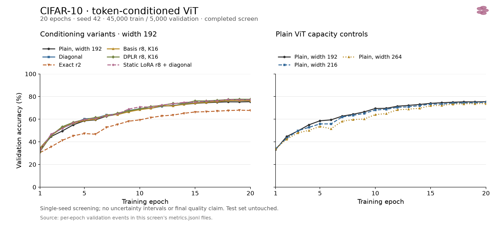
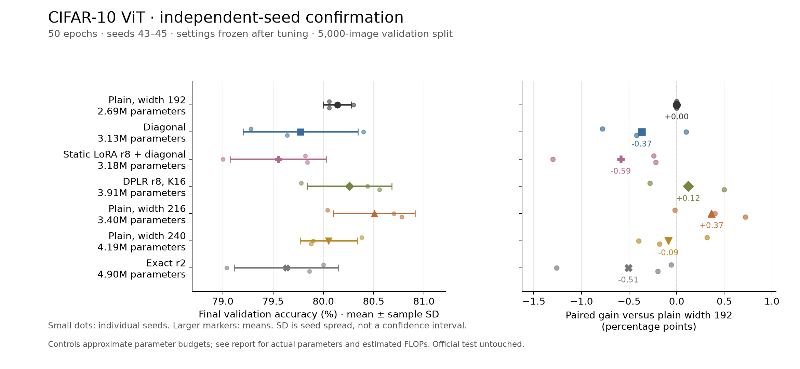
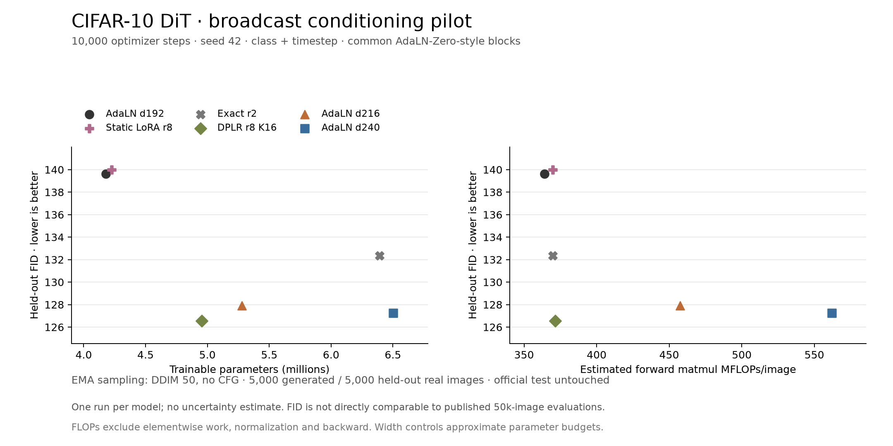
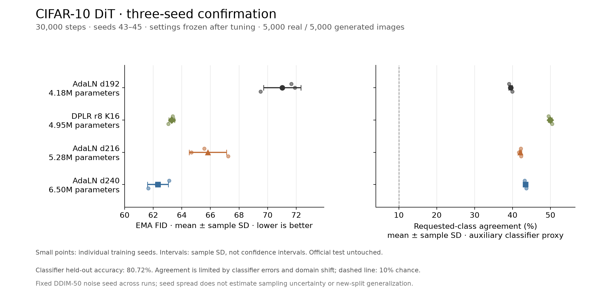

# Condition-generated low-rank transforms

The research direction and hypotheses are in [RESEARCH_BRIEF.md](RESEARCH_BRIEF.md).
[DESIGN_NOTES.md](DESIGN_NOTES.md) records the discussion through 2026-10-08 using PyTorch
notation: current DPLR placement and shapes, generator versus transform choices,
adapter input/ordering, initialization, gain, gauges, and proposed comparisons.
It separates tested behavior from unimplemented alternatives. Use tensor/PyTorch
notation for new design explanations; rendered equations are unreliable in the
conversation viewer.
The notes also reconcile the original setup conversation, including interaction
order, historical memory figures, and compile-versus-fusion assumptions.
The first experiment is a CIFAR-10 ViT with token-conditioned channel transforms.
The older ImageNet, language-model and diffusion trainers remain reference code;
they import helpers from another project and are not the runnable entry point here.

The [generator explanation](DESIGN_NOTES.md#what-basis-mixing-factorizes) now
shows basis mixing as ordinary two-linear-layer projections: the condition
predicts signed coefficients `a,b`, and learned decoder weights synthesize U,V.
Transform rank `r` is distinct from generator width `s=K` per factor. The
[budget ledger](DESIGN_NOTES.md#fractional-generator-widths-and-spending-the-savings)
records proposed widths near `q/4,q/16,q/32` and trades between s and r.
[Generator alternatives](DESIGN_NOTES.md#generator-alternatives-and-diagonal-structure-2026-10-08)
cover nonlinear/structured decoders, channel gains and diagonal structure;
[optimization notes](DESIGN_NOTES.md#initialization-gain-gauges-and-learning-rates)
distinguish generator and transform gauges. Conditional dense and
diagonal-plus-low-rank cores are now implemented; their engineering workflow
and the fractional-width screen are described below. Other proposed structures
remain unimplemented, and neither new core has a quality confirmation.

## CIFAR-10 benchmark

Run from this directory using the instance's existing environment:

```bash
/workspace/bin/gpu-claim run --owner adalora --job conditioning-tests --wait -- /venv/main/bin/python -m pytest -q test_conditioning.py
/workspace/bin/gpu-claim run --owner adalora --job condlr-self-tests --wait -- /venv/main/bin/python condlr.py
/workspace/bin/gpu-claim run --owner adalora --job cifar10-engineering --wait -- /venv/main/bin/python benchmark_cifar10.py
```

The benchmark runs eight configurations sequentially for 100 steps each, using
real CIFAR-10 and 1,000 held-out validation examples. It is an engineering screen
for correctness, stability and cost. These short runs cannot establish quality
rankings. Outputs include full configs, source hashes, split indices, JSONL
metrics, logs, artifact manifests, and an aggregate `summary.json`.

A full training command is:

```bash
/workspace/bin/gpu-claim run --owner adalora --job basis-r8-k16-s42 --wait -- \
  /venv/main/bin/python train_cifar10.py \
  --override_json configs/cifar10/basis-r8-k16.json \
  --epochs 100 --seed 42 --output-dir runs/basis-r8-k16-s42
```

Use the instance supervisor for sustained jobs, following `/workspace/AGENTS.md`.
The managed screen launcher snapshots the source and full configs, then starts
one finite supervisor service per configuration through the shared `gpu-claim`
helper. It uses a dedicated supervisor with a private UNIX socket, so missing
historical instance service paths cannot block or restart this batch:

```bash
/venv/main/bin/python launch_cifar10_screen.py --epochs 20 --launch
/venv/main/bin/python summarize_cifar10_screen.py runs/SCREEN_DIRECTORY/screen.json
supervisorctl -c runs/SCREEN_DIRECTORY/supervisor.conf status
```

Without `--launch`, it only prepares the source/config/service definitions.
Each run uses 45,000 training and 5,000 validation examples; no sample limits,
test evaluation or weight saving. The screen manifest records storage and
retention before launch. The summarizer verifies the shared split and source
hashes and writes a live `summary.json`. Supervisor will not automatically
restart a failed or completed run, since this trainer has no resume checkpoint.

The default dataset reader reuses the existing Arrow cache under
`$HF_HOME/datasets/uoft-cs___cifar10` without a network request. `--hf-home` selects
another cache. Alternatively, use `--data-source torchvision --data-dir PATH`.
Downloads require the explicit `--download` flag. `--synthetic` supplies random
images for debugging only.

The default architecture uses 32×32 images, patch size 4, width 192, depth 6,
three attention heads and an MLP ratio of 4. It has 65 tokens including CLS and
2,690,122 base parameters. Attention uses standard SDPA without QK normalization
by default. All models retain self-attention.

At each MLP input, `h = LayerNorm(x)` is both the projection input and condition.
This ViT retains static LayerNorm affine parameters; the diffusion AdaLN recipe
below uses `elementwise_affine=False`. Treat that difference as part of the
experimental recipe rather than assuming identical normalization.
Gradients flow through the condition; `--detach-condition` provides an ablation.
`--placement qkv` and `--placement both` enable later placement experiments.
This is token self-conditioning, not diffusion's previous-prediction feedback
mechanism. There is no use of the target class as a conditioning input.

| Variant | Conditional projection |
| --- | --- |
| `plain` | `W h + b` |
| `diagonal` | `W [h ⊙ (1 + s(h)) + shift(h)] + b` |
| `exact` | `W h + b + h U(h)V(h)`, full hypernetwork, chunked custom backward |
| `basis` | Same additive update with basis-mixed factors |
| `dplr` | Diagonal scale/shift plus an additive basis-mixed update |
| `static_lora_diagonal` | Diagonal scale/shift plus a static rank-r update |

All conditional branches start at zero. Coefficient heads are initialized
nonzero so the factorized branches can learn. Adapters attach after the base
ViT initialization: equal-width variants built with the same seed start with
identical base weights. The zero classifier briefly delays gradients into the
backbone on the first update, equally across variants.

The diagonal baseline and DPLR both include scale and shift. This is a
token-conditioned affine modulation baseline, rather than a claim to reproduce
the full externally conditioned AdaLN-Zero block recipe. The reference
`DPLRCond` still defaults to scale only; this benchmark enables its optional shift.

## Measurement and fairness

- A stratified split of CIFAR-10's training set uses `split_seed=123`: 45,000
  training and 5,000 validation examples. The official test set is untouched
  unless `--evaluate-test` is explicitly requested after model selection.
- Every initial variant uses the same AdamW settings, crop/flip augmentation,
  batch size, training seed and cosine schedule. Base and hypernetwork learning
  rates can be separated using `--hyper-lr-multiplier`.
- DataLoader generators are independent of model initialization so adding
  adapter parameters does not change the training shuffle/augmentation stream.
- JSONL metrics record loss, accuracy, total and hypernetwork gradient norms,
  throughput and memory. Training throughput excludes validation and the first
  ten warmup steps, and includes data loading, forward/backward and optimizer
  work. Inference throughput includes data loading and evaluation loss/accuracy
  calculations. This is end-to-end throughput, not isolated GPU kernel timing.
- Peak training allocation is captured before validation. CPU runs report GPU
  memory as null. Parameters and forward matrix-multiply FLOPs are reported;
  FLOP estimates exclude pointwise ops, reductions, normalization and backward.
- Wider plain ViTs at widths 216 and 264 are initial capacity controls. They
  approximate the parameter budgets of basis-r8 and exact-r2, respectively;
  neither is an exact parameter-and-FLOP match. Report both budgets, then select
  tighter controls for promising variants. Repeat quality comparisons across
  multiple seeds and use equal training budgets before drawing conclusions.
- Factorized variants support `--compile`. The exact custom-autograd chunk loops
  stay eager; compiling their individual chunk bodies is subsequent work.

Layer-level profiling checks the memory tradeoff without training weights:

```bash
/venv/main/bin/python profile_condlr.py --precision fp32 --output runs/layer-fp32.json
/venv/main/bin/python profile_condlr.py --precision bf16 --output runs/layer-bf16.json
```

This compares exact rank 2/8 with the materializing oracle, basis mixing,
diagonal modulation and DPLR, sweeping exact chunk size. Saved storage counts
unique backing storages and excludes original parameter storage; autocast
weight copies are included and explicitly labeled. Exact saved storage still
contains the small rank-r bottleneck, so it grows slightly with r; the generated
full factors are never retained. Chunk size controls transient memory and launch
overhead. FP32 and bf16 have different reduction/rounding behavior; the tests
check both float64 oracle parity and mixed-precision gradient error bounds.

## Artifacts

No periodic checkpoints or final model weights are saved by default. Compact
evidence is retained in `runs/`, which is git-ignored. Enabling a final weight
file requires both `--save-weights` and `--artifact-purpose TEXT`; the manifest
records its purpose, expected bytes, and final-only retention before training.
Disk capacity is checked before data loading/training. There is no resume path
or automatic checkpoint retention in this first trainer.

The live instance reports `workspace_is_volume: false`. Local records survive
stop/start, but recycle or destruction removes them; off-instance preservation
has not been configured by this workflow.

The externally conditioned CIFAR-10 diffusion experiment uses a small pixel-space
DiT and a class/timestep condition broadcast across tokens; completed pilot and
confirmation results are documented below. Full-sequence conditioning is a
separate research axis: a broadcast
vector cannot directly replace attention's position-dependent selection from
a context sequence. The present benchmark tests conditional channel modulation.

## First engineering screen

All eight real-data configurations completed 100 steps with bf16 on one RTX
5090. All 18 integration tests and the reference self-tests passed; a compiled
basis-mixing CUDA smoke run also passed. Full evidence, source hashes and layer
profiles are preserved in [reports/cifar10-engineering.json](reports/cifar10-engineering.json).

| Configuration | Parameters | Train images/s | Peak training allocation (MiB) |
| --- | ---: | ---: | ---: |
| Plain, width 192 | 2,690,122 | 2,888 | 244.1 |
| Diagonal | 3,134,794 | 2,742 | 287.2 |
| Exact, rank 2 | 4,901,962 | 1,521 | 290.9 |
| Basis, rank 8, K=16 | 3,464,458 | 1,895 | 293.3 |
| DPLR, rank 8, K=16 | 3,909,130 | 2,177 | 346.4 |
| Static LoRA, rank 8 + diagonal | 3,180,874 | 1,955 | 299.0 |
| Plain, width 216 | 3,399,634 | 2,698 | 276.6 |
| Plain, width 264 | 5,067,490 | 2,438 | 349.2 |

These are preliminary end-to-end timings from a single short run each. Their
ordering is sensitive to startup, clocks and CPU activity; in particular, they
do not establish a reliable basis-versus-DPLR speed ranking. No quality winner
is selected from the 100-step validation accuracies.

For one 192→768 projection with 4,096 tokens, the fp32 exact path retained
6.03 MiB at rank 2 and 6.13 MiB at rank 8, versus 36.31 and 127.25 MiB for the
materializing oracle. The bf16 profile also confirms reduced saved storage;
its exact-path total includes fp32 input/condition tensors and autocast copies
from the base projection. These numbers describe saved backing storage, not
whole-model peak GPU memory. Small exact chunks substantially increased eager
launch overhead in this screen, so chunk tuning remains a performance task.

## First 20-epoch quality screen

All eight configurations completed 20 epochs, 7,040 optimizer steps and 900,000
training images each, with seed 42, batch size 128 and the full shared 5,000-image
validation split. All jobs exited successfully; source hashes and split indices
matched. No weights or checkpoints were written, and the test set was untouched.

| Configuration | Parameters | Final validation accuracy | Train images/s | Loop seconds |
| --- | ---: | ---: | ---: | ---: |
| Plain, width 192 | 2,690,122 | 75.44% | 5,009 | 190.9 |
| Diagonal | 3,134,794 | 76.90% | 4,442 | 214.2 |
| Exact, rank 2 | 4,901,962 | 67.74% | 2,563 | 365.7 |
| Basis, rank 8, K=16 | 3,464,458 | 76.34% | 3,825 | 247.0 |
| DPLR, rank 8, K=16 | 3,909,130 | 77.60% | 3,508 | 268.4 |
| Static LoRA, rank 8 + diagonal | 3,180,874 | 77.18% | 4,187 | 226.5 |
| Plain, width 216 | 3,399,634 | 74.94% | 5,314 | 180.7 |
| Plain, width 264 | 5,067,490 | 73.74% | 5,260 | 182.6 |



[Full evidence and audit](reports/cifar10-screen-20epochs.json) ·
[Vector figure](reports/cifar10-screen-20epochs.pdf)

DPLR has the highest endpoint in this single-seed screen: 2.16 percentage points
above the plain ViT, but only 0.42 points above static LoRA plus diagonal, with
more parameters and computation. Basis mixing does not beat diagonal modulation
at this recipe. Exact rank 2 is substantially behind and needs optimization
diagnostics and hypernetwork LR tuning before judging the transform family.
These observations do not establish a general benefit from condition-dependent
mixing or a statistically confirmed ranking.

This motivated the bounded LR tuning and longer, multiple-seed confirmation
below, including width controls and a smaller hypernetwork LR diagnostic for
exact rank 2. External class/timestep conditioning remains a separate experiment.

These jobs ran concurrently on separately claimed GPUs and shared CPU/storage.
Throughput includes the data pipeline and optimizer, while loop seconds include
training and validation but exclude startup. Total loop usage was approximately
0.521 GPU-hours. Use isolated repeated measurements for final efficiency claims.
Raw logs, source snapshot and resolved configs remain under
`runs/cifar10-screen-20261006T205259Z`; the screen's dedicated supervisor has been
shut down after successful completion, leaving other instance services running.

## Learning-rate tuning and confirmation

`cifar10_followup.py` continues from the completed screen and its retained raw
records. It brackets the base LR at 0.0002, 0.0005 and 0.001 for plain width 192,
diagonal, static LoRA plus diagonal, DPLR, and plain widths 216 and 240. Six
completed center runs are reused after verifying identical training-source
hashes. DPLR also tries hypernetwork LR multipliers 0.3 and 3 at base LR 0.0005;
exact rank 2 tries multipliers 0.1 and 0.3. This gives 23 tuning endpoints from
17 new runs, all at 20 epochs with seed 42.

The selection rule is final epoch-20 validation accuracy, with ties resolved
by lower estimated forward matmul FLOPs, then lower base LR. Settings are
written to `selection.json` before starting 50-epoch confirmations from scratch
on seeds 43, 44 and 45. Exact enters confirmation only if its tuned endpoint
is within one percentage point of tuned plain width 192. The six main families
produce 18 confirmation runs; including exact would produce 21.

```bash
/venv/main/bin/python cifar10_followup.py prepare --launch
/venv/main/bin/python audit_cifar10_followup.py runs/followup-TIMESTAMP
/venv/main/bin/python plot_cifar10_followup.py runs/followup-TIMESTAMP
```

The controller and each training stage have dedicated supervisor instances.
Training workers claim one free GPU for their entire lifetime and wait when
other projects hold the available GPUs. Source snapshots, resolved configs,
physical GPU claims, split indices, metrics, selection, logs and audit records
are preserved. No weights, checkpoints or official test evaluations are enabled.
The workflow declares a 400 MiB evidence-storage upper bound before launch.

Confirmation reports final means, sample SD across seeds, individual seed
accuracies, and paired gains against plain ViT. Seed SD is not a confidence
interval. The same held-out split remains in use, DPLR has five tuning candidates
versus three for the other main families, and the width controls approximate
parameter budgets. These limits matter when interpreting small gains.

The tuning stage in `runs/followup-20261006T210955Z` completed all 23 endpoints
and selected base LR 0.0005 for every family. The hypernetwork multiplier stays
at 1 except for exact rank 2, where 0.1 improves the tuning endpoint from 67.74%
to 76.14%, qualifying it for confirmation. DPLR remains the highest tuning
endpoint at 77.60%. Selection was frozen before the 21 confirmation runs on
seeds 43–45 were launched. The confirmation results determine the longer-run
comparison; tuning endpoints alone do not establish a winner.

## 50-epoch confirmation results

All 21 confirmation runs completed from scratch on seeds 43, 44 and 45 using
the frozen selections. Each processed 2,250,000 training images in 17,600
optimizer steps and evaluated the same 5,000-image validation split at all
50 epochs. The independent audit verified source/runtime versions, disjoint
and identical split indices, training budgets, unchanged selected settings,
finite logged losses and gradients, and successful exits for all 38 new
tuning/confirmation workers. No weights or checkpoints were saved; the official
test set was untouched.

| Configuration | Parameters | Final validation accuracy, mean ± seed SD | Estimated forward matmul MFLOPs/image |
| --- | ---: | ---: | ---: |
| Plain, width 192 | 2,690,122 | 80.14% ± 0.14 pp | 365.7 |
| Diagonal | 3,134,794 | 79.77% ± 0.57 pp | 423.2 |
| Static LoRA, rank 8 + diagonal | 3,180,874 | 79.55% ± 0.48 pp | 429.2 |
| DPLR, rank 8, K=16 | 3,909,130 | 80.26% ± 0.42 pp | 523.8 |
| Plain, width 216 | 3,399,634 | 80.51% ± 0.41 pp | 459.9 |
| Plain, width 240 | 4,192,090 | 80.05% ± 0.28 pp | 565.0 |
| Exact, rank 2, hypernetwork LR ×0.1 | 4,901,962 | 79.63% ± 0.52 pp | 653.2 |



[Full results and audit](reports/cifar10-lr-confirmation.json) ·
[Independent audit](reports/cifar10-lr-confirmation-audit.json) ·
[Vector comparison](reports/cifar10-lr-confirmation.pdf) ·
[Learning curves](reports/cifar10-lr-confirmation-curves.png) ·
[Tuning figure](reports/cifar10-lr-tuning.png)

Plain width 216 has the highest mean in this screen. It beats DPLR by
0.22–0.26 percentage points in every paired seed while using about 13% fewer
parameters and 12% fewer estimated forward matmul FLOPs. DPLR's gain over plain
width 192 is only 0.12 points on average, with paired gains −0.28, +0.14 and
+0.50 points. The initial short-screen lead does not establish a quality/compute
advantage for self-conditioned channel mixing in this longer confirmation.
Lowering the exact hypernetwork LR improved its 20-epoch endpoint substantially,
but its 50-epoch confirmation mean remains below plain width 192.

These SDs describe three initialization/data-order seeds on one fixed validation
split; they are not confidence intervals. LRs were selected at 20 epochs and
transferred to 50 epochs, and the controls approximate budgets. The FLOPs
estimates exclude elementwise operations, reductions, normalization and backward.
Concurrent timings are preserved in the report for inspection, with no isolated
speed claim. New training/validation loops totaled approximately 4.43 GPU-hours.
The workflow retains about 45 MiB of compact evidence under
`runs/followup-20261006T210955Z`; its dedicated supervisors are shut down and its
GPU claims released.

## External class/timestep conditioning

`train_dit_cifar10.py` implements the next task-level experiment: a small
pixel-space diffusion transformer on class-conditional CIFAR-10. The existing
U-Net reference in `train_diffusion.py` is preserved. The new trainer uses a
conventional epsilon-prediction DDPM objective and a self-contained AdamW loop.

`dit_cifar10.py` follows the [public DiT block layout](https://github.com/facebookresearch/DiT/blob/main/models.py):
non-affine layer normalization, six AdaLN shift/scale/gate outputs per block,
self-attention, a gated MLP, and a conditioned final output layer. Modulation
heads and the output projection start at zero. This prototype adds normalization
of the summed learned class and sinusoidal-timestep embeddings, uses RGB pixels
without a VAE, and predicts epsilon without learned variance. It is an
AdaLN-Zero-style CIFAR-10 model, rather than a reproduction of the published
latent-space DiT recipe.

Every comparison retains the same AdaLN heads and gates. The alternatives add
static LoRA, exact conditional rank-2 mixing, or basis-mixed rank-8 DPLR at the
MLP input. DPLR's diagonal component comes from the common AdaLN modulation;
it does not add a second affine head. Exact and basis factors are generated once
per sample per block, then applied to every image token using batched matrix
multiplication. The normalized condition is external to those tokens. This
experiment does not supply a condition sequence or compare cross-attention.

The six pilot configs in `configs/diffusion` use patch size 4, 64 tokens, depth
6, three attention heads, batch size 128, BF16, seed 42, and the shared stratified
45,000/5,000 train/validation split with seed 123. Widths and dataset are prototype
choices, not requirements fixed by the research brief. The base width is 192;
widths 216 and 240 provide approximate parameter-budget controls.

| Configuration | Parameters | Estimated forward matmul MFLOPs/image |
| --- | ---: | ---: |
| AdaLN, width 192 | 4,179,696 | 363.95 |
| Static LoRA, rank 8 | 4,225,776 | 369.84 |
| Exact, rank 2 | 6,391,536 | 369.84 |
| DPLR, rank 8, K=16 | 4,954,032 | 371.39 |
| AdaLN, width 216 | 5,277,576 | 457.62 |
| AdaLN, width 240 | 6,503,328 | 562.00 |

These FLOPs include per-sample condition/factor generation and token application,
but exclude elementwise work, reductions, normalization and backward. The exact
rank-2 transform is much cheaper with a broadcast condition than the per-token
ViT path; its parameter cost remains substantial. Width controls approximate
parameters and deliberately expose their different compute budgets.

The pilot runs 10,000 optimizer steps with LR 0.0002, 500-step warmup, cosine
decay to 1% of the initial LR, no weight decay, gradient clipping at 1, and
in-memory EMA decay 0.999. Exact adapters use LR multiplier 0.1 transferred from
the earlier ViT diagnostic; diffusion-specific LR tuning remains outstanding.
Horizontal flipping is the only training augmentation. The diffusion schedule
has 1,000 timesteps with squared-cosine betas. There is no classifier-free
guidance or class dropout.

Validation uses fixed noise/timestep seed 2027 and reports raw/EMA denoising MSE,
timestep deciles, wrong-class MSE, and prediction changes after replacing each
label by `(label + 1) % 10`. This diagnostic checks whether the class influences
denoising; it does not measure generated class accuracy. EMA sampling uses
[DDIM](https://huggingface.co/docs/diffusers/api/schedulers/ddim), 50 steps, eta 0,
seed 2028, and balanced requested labels. A 100-image grid is retained; its ten
columns correspond to class indices 0–9 in dataset order.

Final FID uses 5,000 generated images against all 5,000 held-out real images,
2,048-dimensional pretrained Inception features, uint8 RGB inputs, float32
Inception computation and float64 moment accumulation through TorchMetrics and
torch-fidelity. Evaluator weights were already cached, and their hash, storage
and purpose are recorded before launch. This finite-sample pilot is not directly
comparable to published 50,000-image FID. Global FID alone does not establish
class fidelity.

```bash
# Numerical, learning, sampler and end-to-end CPU checks
CUDA_VISIBLE_DEVICES='' /venv/main/bin/python -m pytest -q test_dit_cifar10.py

# Bounded GPU/FID infrastructure check; these are not quality results
/venv/main/bin/python launch_dit_cifar10_screen.py --engineering --fid-preflight --launch

# Full six-model pilot, one shared lifetime GPU claim per worker
/venv/main/bin/python launch_dit_cifar10_screen.py --launch
/venv/main/bin/python summarize_dit_cifar10_screen.py runs/dit-pilot-TIMESTAMP/screen.json
/venv/main/bin/python plot_dit_cifar10_screen.py runs/dit-pilot-TIMESTAMP/summary.json
```

Each screen has a private supervisor and source snapshot. It records resolved
configs, source/runtime provenance, exact split indices, metrics, logs and small
sample grids. There is no checkpoint or training-weight save option; EMA is
evaluated before the process exits. The six-worker screen declares a 120 MiB
compact-evidence budget and checks shared disk capacity before launch. The
existing shared Inception evaluator cache is retained without modification.

All 15 new CPU tests pass, covering FP64 value/gradient parity with the existing
conditional-layer oracles, BF16 gradients, shared initialization, waking up
zero-initialized conditional paths, EMA, deterministic sampling, and a complete
synthetic training run. Combined with the conditioning suite, 32 tests pass and
one CUDA-specific test is skipped in the CPU invocation. All six 200-step GPU
checks also completed successfully with finite logged losses/gradients, identical
data/source/runtime and working FID evaluation. The
[engineering audit](reports/dit-engineering.json) retains those infrastructure
checks; its 128-image FID values and short-run EMA state are not quality evidence.

## Diffusion pilot results

The screen in `runs/dit-pilot-20261006T223648Z` completed all six 10,000-step
runs. Each processed 1,278,432 images, including the shorter final minibatch of
each completed data pass. Each class has 4,500 training and 500 validation
examples. All runs use identical split indices, training-source hashes, package
versions and initial validation noise, with finite logged losses and gradients
and successful supervisor exits. All six workers' GPU claims are released and
their dedicated supervisor is shut down. No training weights or checkpoints were
saved, and the official test set remains untouched.

| Configuration | Final EMA denoising MSE ↓ | Pilot FID ↓ | Train images/s | Peak training allocation, GiB |
| --- | ---: | ---: | ---: | ---: |
| AdaLN, width 192 | 0.07047 | 139.63 | 3,721 | 0.560 |
| Static LoRA, rank 8 | 0.07032 | 139.98 | 3,599 | 0.582 |
| Exact, rank 2 | 0.06932 | 132.37 | 3,456 | 0.624 |
| DPLR, rank 8, K=16 | 0.06913 | 126.56 | 3,174 | 0.605 |
| AdaLN, width 216 | 0.06939 | 127.93 | 3,789 | 0.646 |
| AdaLN, width 240 | 0.06868 | 127.25 | 3,935 | 0.734 |



[Full audited results](reports/dit-cifar10-pilot.json) ·
[Vector comparison](reports/dit-cifar10-pilot.pdf) ·
[Raw/EMA learning curves](reports/dit-cifar10-pilot-curves.png) ·
[Figure provenance](reports/dit-cifar10-pilot-figure-manifest.json) ·
[DPLR sample grid](reports/dit-cifar10-pilot-dplr-samples.png)

DPLR is the most promising next confirmation candidate in this pilot. Its FID
is 13.07 points below the width-192 AdaLN baseline and 0.69–1.37 below the wider
controls, with fewer parameters and estimated forward matrix FLOPs than either
width control. The wider width-240 model has the lowest denoising MSE. Static
LoRA provides little improvement, and exact rank 2 has worse FID than DPLR or
either width control despite its larger parameter budget. These are single-seed
observations with an untuned diffusion recipe; the small DPLR-versus-width FID
differences need multiple-seed confirmation.

Estimated FLOPs do not establish a wall-clock win: DPLR's observed concurrent
training throughput is lower than the AdaLN controls. Peak allocation includes
the model, in-memory EMA, gradients, optimizer and training activations, while
excluding FID. Each image has 64 tokens, and the report also records training
tokens/s. Sampling/FID time includes feature extraction and statistics; isolated
inference throughput remains unmeasured.

Replacing the correct class by the next class raises final EMA denoising MSE
by 0.00057–0.00066 across models. That verifies a measurable class effect but
does not show stronger class use by DPLR. Generated images remain noisy and often
ambiguous on visual inspection. The pilot neither establishes generated class
accuracy nor evaluates sequence-conditioned attention.

Training/validation loops totaled approximately 0.603 GPU-hours, with another
0.050 GPU-hours for final sampling/FID, excluding process startup. About 7 MiB
of compact evidence remains under the pilot directory, plus the small reports
and figures. The next useful experiment is diffusion-specific LR tuning and
longer multiple-seed confirmation of DPLR against AdaLN widths 192 and 216,
alongside a generated class-fidelity metric. Sequence-valued conditioning and
cross-attention remain a separate comparison after this broadcast test.

## Diffusion LR tuning and independent-seed confirmation

`dit_followup.py` runs a bounded follow-up for AdaLN widths 192, 216 and 240,
plus rank-8, K=16 DPLR at width 192. Each family tries base LRs 0.0001, 0.0002
and 0.0004 at 10,000 steps and seed 42. DPLR additionally tries adapter LR
multipliers 0.3 and 3 at base LR 0.0002, giving 14 fresh tuning runs. Earlier
pilot endpoints are preserved separately. DPLR has five candidates and the
AdaLN controls have three; this difference in tuning budget remains a limit.

Selection uses the lowest final EMA FID on 5,000 generated images against the
same 5,000 held-out real images. Ties use lower EMA denoising MSE, then lower
base LR and adapter LR multiplier. The controller writes `selection.json`
before launching 12 fresh confirmations: four families at 30,000 steps on
seeds 43, 44 and 45. It transfers the selected LRs with the same 500-step
warmup and cosine recipe, evaluating denoising every 5,000 steps and FID at
the final state. Each confirmation processes 3,835,240 training images. A
selection at a grid boundary does not bracket the optimal LR, and a setting
selected at 10,000 steps need not be optimal at 30,000.

Class fidelity is supplemented with a fixed auxiliary classifier. A plain
width-216 CIFAR-10 ViT trains once for 50 epochs using seed 46, LR 0.0005 and
the exact same disjoint 45,000/5,000 train/validation split. It saves one final
approximately 13 MiB evaluator, deliberately required for this evaluation;
there are no periodic checkpoints. Its weights and compact source/config/
split/training records remain until explicitly removed. Diffusion workers save
no training weights. The workflow declares a 640 MiB storage upper bound and
checks shared capacity before launching.

`class_fidelity.py` reloads that evaluator with strict state matching, verifies
its implementation and validation indices, freezes its parameters, and applies
CIFAR mean/std normalization to the RGB32 images. Every confirmation records
FP32 real-image accuracy, generated requested-class agreement, per-class
agreement, predicted class counts and 10×10 confusion matrices. All generated
classes have 500 samples. Agreement is an auxiliary classifier proxy, limited
by classifier errors and domain shift; it is not human class accuracy. The
classifier must exceed a predeclared 75% held-out accuracy floor before
confirmation starts. The official test set is untouched throughout.

```bash
CUDA_VISIBLE_DEVICES='' /venv/main/bin/python -m pytest -q test_dit_cifar10.py test_class_fidelity.py
/venv/main/bin/python dit_followup.py prepare --launch
/venv/main/bin/python audit_dit_followup.py runs/dit-followup-TIMESTAMP
/venv/main/bin/python plot_dit_followup.py runs/dit-followup-TIMESTAMP
```

The controller and each stage have private supervisor instances. Every training
worker holds one shared lifetime GPU claim and waits when the GPUs are occupied.
Source snapshots, resolved configs, physical claims, metrics and small image
grids are retained. The independent audit recomputes tuning selection and seed
statistics, checks paired seeds and unchanged selected settings, validates
classifier provenance and metric denominators, and verifies that the only saved
model is the declared auxiliary evaluator. Figures show all seed points and
sample SD across the three training seeds, rather than confidence intervals.
Sampling noise is fixed across runs, so this spread does not measure sampling
uncertainty or generalization to another validation split.

The workflow is `runs/dit-followup-20261007T174446Z`. All 21 diffusion
and class-agreement tests passed before launch. The fixed classifier finished
at 80.78% held-out accuracy. A full 5,000-image CPU preflight reloaded it and
measured 80.74%, with identical real-image and real-as-generated confusion
matrices. That preflight is an engineering self-consistency check, not generated
quality evidence.

The tuning stage completed all 14 candidates and froze selection at
`2026-10-07T18:05:26Z`, before the fresh-seed confirmation workers started.
All four families selected base LR 0.0004; DPLR kept adapter LR multiplier 1.

| Family | Selected LR | Adapter LR multiplier | Tuning FID ↓ |
| --- | ---: | ---: | ---: |
| AdaLN, width 192 | 0.0004 | 1 | 110.88 |
| AdaLN, width 216 | 0.0004 | 1 | 105.12 |
| AdaLN, width 240 | 0.0004 | 1 | 98.13 |
| DPLR, width 192, rank 8, K=16 | 0.0004 | 1 | 99.34 |

At the tuned short-run endpoints, the width-240 control has lower FID than
DPLR. Every selected LR is at the upper grid boundary, so optimal LR has not
been bracketed. These endpoints select settings; the longer fresh-seed runs
determine the confirmation comparison.

## Diffusion three-seed confirmation results

All 12 confirmation runs completed their 30,000-step budgets, with frozen
selections and fresh seeds 43–45. The independent audit verified all 27 workers'
successful exits (14 tuning, 12 confirmation and one classifier), unchanged
source/runtime across diffusion stages, identical disjoint data splits, exact
processed-image budgets, finite logged metrics, correctly paired seeds and
recomputed summary statistics. The auxiliary evaluator's hashes and real-image
predictions match across every confirmation. Its final GPU FP32 held-out
accuracy is 80.72%.

| Family | Final FID ↓, mean ± seed SD | Requested-class agreement ↑, mean ± seed SD | Mean EMA noise MSE ↓ | Train images/s |
| --- | ---: | ---: | ---: | ---: |
| AdaLN, width 192 | 71.02 ± 1.31 | 39.50% ± 0.46 pp | 0.06166 | 3,894 |
| DPLR, rank 8, K=16 | 63.29 ± 0.20 | 49.95% ± 0.50 pp | 0.06081 | 3,086 |
| AdaLN, width 216 | 65.82 ± 1.31 | 42.07% ± 0.32 pp | 0.06091 | 3,889 |
| AdaLN, width 240 | 62.33 ± 0.73 | 43.46% ± 0.22 pp | 0.06045 | 3,850 |



[Full results](reports/dit-lr-confirmation.json) ·
[Independent audit](reports/dit-lr-confirmation-audit.json) ·
[Vector comparison](reports/dit-lr-confirmation.pdf) ·
[Learning curves](reports/dit-lr-confirmation-curves.png) ·
[LR tuning](reports/dit-lr-tuning.png) ·
[Figure provenance](reports/dit-lr-confirmation-figure-manifest.json)

DPLR improves FID over the closest parameter control, width 216, in every paired
seed by 1.22–4.18 points. It also increases auxiliary requested-class agreement
by 7.28–8.18 percentage points. DPLR uses about 6% fewer parameters and 19% fewer
estimated forward matmul FLOPs than that control. Width 240 retains better
FID than DPLR in all three paired seeds by 0.27–1.40 points and has the lowest
denoising MSE. DPLR's class agreement is higher than width 240 in every paired
seed by 6.26–6.84 percentage points, while using about 24% fewer parameters and
34% fewer estimated forward matrix FLOPs.

This is evidence for a conditioning tradeoff in the tested broadcast recipe:
DPLR has stronger requested-class agreement under the fixed evaluator and is
competitive on global FID at a smaller parameter budget. It does not establish
an overall quality or wall-clock win. Concurrent training throughput is about
20% below the AdaLN controls despite the lower estimated FLOPs. SDs describe
three training seeds on one fixed split with common sampling noise, not
confidence intervals. LRs are all at the upper tuning boundary, DPLR received
more tuning candidates, and generated agreement remains limited by classifier
errors and domain shift. Samples contain more recognizable structures than the
short pilot but remain small, noisy and often ambiguous. Sequence-valued context
and cross-attention are still untested.

Diffusion training/validation loops totaled approximately 4.982 GPU-hours.
Final sampling and feature/classifier evaluation added 0.218 GPU-hours, and the
fixed classifier run took another 0.127 GPU-hours including its validation.
About 50 MiB is retained under the workflow directory, including the one
approximately 13 MiB auxiliary evaluator. No diffusion weights or periodic
checkpoints were saved. The official test split was untouched, all four private
supervisors are shut down, and all AdaLoRA GPU claims are released.

The new metric suite includes seven class-agreement tests, including the
end-to-end generated-image stream shared with FID, in addition to the 15
diffusion tests. The next comparison should examine sequence-valued conditioning
with an attention baseline; the current result concerns a single class/time
vector broadcast across image tokens. Diffusion LR bracketing and isolated
performance measurement also remain open before making an efficiency claim.

## Instrumented adapter design benchmark

The [design notes](DESIGN_NOTES.md#instrumented-design-engineering-workflow)
specify a short comparison of current DPLR, smaller basis generators, and
conditional bottleneck gains. New trainer options are
`--adapter-input normalized|modulated` and `--variant conditional_bottleneck`.
The original variants and normalized-input default retain their initialization
and computation; saved historical runs continue to use their frozen source.

```bash
/venv/main/bin/python -m pytest -q test_dit_cifar10.py test_dit_design.py test_class_fidelity.py
/venv/main/bin/python launch_dit_design.py --launch
```

The launcher snapshots source/configs and runs eight cases sequentially through
one shared lifetime GPU claim under a private supervisor. Each uses 500 steps,
batch 128, width 192/depth 6, LR 0.0004, 50-step warmup, and a reproducible
4,096-image training bank with replacement. It verifies identical batch/noise
streams, common base initialization, and paired adapter initialization. No EMA,
FID, model weights, checkpoints, or official test evaluation are used.

Untimed block diagnostics capture magnitudes, correlations, gradient groups,
and functional updates on fixed inputs. The eager training timer includes
cached CPU batch preparation, transfer, forward/backward, and optimizer. Live
trained first-block projection probes compare eager/compiled execution for
broadcast conditions and a synthetic per-token extension; neither is a full
compiled-model training benchmark. The workflow declares a 64 MiB evidence bound
and an independent completeness/source/stream/numerics audit. Before launch,
33 numerical/integration tests and the complete eight-case CPU smoke workflow
passed. These short engineering runs do not support quality rankings.

### Completed design engineering screen

All eight cases completed 500 steps (64,000 processed images each) on one
sequentially claimed RTX 5090. The independent audit passed shared batch/noise
streams, common base initialization, paired input-variant adapter initialization,
frozen source, budgets, finite metrics, and gradient wake-up. All 16 broadcast/
token compiled probes passed their BF16 output/gradient checks; the largest
relative L2 discrepancy was 1.34%. The original four variants also matched the
frozen pilot source exactly in CPU FP32 initialization and nonzero forward/backward
checks. No historical training evidence was rewritten.

| Case | Extra parameters across six blocks | Peak training MiB | Mean block delta/base RMS at step 500 |
| --- | ---: | ---: | ---: |
| AdaLN | 0 | 560.6 | 0.000 |
| Conditional bottleneck r2 | 13,836 | 582.3 | 0.068 |
| Conditional bottleneck r4 | 27,672 | 582.8 | 0.084 |
| Basis r2, normalized input | 221,376 | 587.4 | 0.321 |
| Basis r2, modulated input | 221,376 | 587.4 | 0.304 |
| Basis r4, normalized input | 405,696 | 592.4 | 0.476 |
| Basis r4, modulated input | 405,696 | 592.4 | 0.447 |
| DPLR r8 reference | 774,336 | 603.4 | 0.690 |

The gain column averages six block ratios on fixed diagnostic images; it is not
an operator-norm bound. Peak training allocation excludes diagnostic forwards
and EMA. The smaller bottlenecks save about 93–94% of adapter parameters relative
to matched-rank basis mixing, but provide smaller deltas under this shared
LR/init recipe. Rank and generator capacity are therefore confounded with gain;
gain and functional-update controls should precede a quality comparison.

For the first-block projection, eager saved nonparameter storage was 15.95 MiB
for broadcast AdaLN, 19.07–19.13 MiB for the bottlenecks, and 19.58–21.25 MiB for
basis variants. Synthetic per-token extensions used 27.77, 33.86–33.96, and
35.40–38.76 MiB, respectively. These totals include common normalization and
six-output modulation, inputs, and autocast weight copies, not just adapter
activations. They do not describe compiled saved tensors or a trained
self-conditioned model. Parameter savings do not remove the additional branch's
activation costs.

Compilation helped some projection probes and slightly hurt others. Timing
repeats, first-call latency, eager/compiled allocator peaks, and complete training
throughput are preserved in the report. First calls can reuse compiler disk
caches. Host-wall timing shares CPU resources with other projects; neither the
single-seed training timings nor three microbenchmark repeats establish a stable
speed ordering. No wall-clock payoff has been established for the richer generator.
Held-out raw noise MSE ranged from 0.0840 to 0.0850 on 256 images; this short subset
diagnostic is not used to select a quality winner.

[Readable tables and interpretation](reports/dit-design-engineering.md) ·
[Full evidence](reports/dit-design-engineering.json) ·
[Independent audit](reports/dit-design-engineering-audit.json) ·
[Artifact hashes](reports/dit-design-engineering-manifest.json).
Raw evidence is under `runs/dit-design-20261007T204233Z`; the worker exited
successfully after about 3 minutes 20 seconds, its private supervisor is shut
down, and its GPU claim is released. About 2.5 MiB is retained under the workflow,
plus the report copies. No weights or checkpoints were saved and the test split
was untouched. Next, compare gain/update-controlled recipes before longer
quality confirmation; sequence-valued conditioning remains a separate priority.

### Completed gain and functional-update screen

The follow-up adds a fixed positive `--adapter-gain` (default 1) and calibrates
the existing adapter LR multiplier on changes in the adapter's function. Basis
ranks 2/4/8 and conditional bottleneck ranks 2/4 use `gain = 1/sqrt(rank)`.
All keep the normalized adapter input, original zero-init rule, common AdaLN
scale/shift/gates, and unchanged base architecture. Gain 1 matched all five
previous variants exactly in CPU seeded initialization and nonzero FP32
forward/backward checks against the frozen design-screen source.

Seven 50-step calibrations selected rates using mean fixed-input delta-update
RMS across all six blocks at steps 10/25/50. The target is scaled basis rank 8
at multiplier 1; the declared tolerance is ±25%. Selection never uses loss or
validation. Six 500-step confirmations then use the selected recipes plus the
raw-gain rank-8 anchor, sharing their early stream and LR schedule with calibration.
All five selected recipes satisfy the early tolerance and replay audit.

| Family | Fixed gain | Adapter LR multiplier | Early update / target | Step-500 update / scaled r8 | Step-500 live delta / base RMS |
| --- | ---: | ---: | ---: | ---: | ---: |
| Basis r2 | 0.7071 | 1.0000 | 0.786 | 0.852 | 0.322 |
| Basis r4 | 0.5000 | 1.0000 | 0.930 | 1.178 | 0.445 |
| Basis r8 | 0.3536 | 1.0000 | 1.000 | 1.000 | 0.572 |
| Bottleneck r2 | 0.7071 | 0.6316 | 0.968 | 0.903 | 0.047 |
| Bottleneck r4 | 0.5000 | 0.7929 | 1.058 | 0.881 | 0.076 |
| Basis r8, raw anchor | 1.0000 | 1.0000 | 2.629 | 2.530 | 0.690 |

The selected families have similar functional updates at step 500, yet markedly
different live branch magnitudes. This rules out treating small bottleneck
output magnitude as direct evidence that its optimizer updates are too small
under these recipes. It does not determine the cause or establish a quality win.
Matching is approximate and varies over time: bottleneck r2 reached a 1.38
update ratio at step 250. Rank scaling alone also does not equalize the learned
branch magnitudes. Separate generator/factor rates and initialization remain
open optimization axes; a longer quality comparison should report these
diagnostics alongside its metrics.

Fixed function probes use FP32 tensors and `float32_matmul_precision="highest"`,
independently of BF16 training. An initial run inherited the faster matmul
setting and produced misleading small-update comparisons, so it is retained as
preliminary evidence in `runs/dit-gain-20261007T212803Z`. The reported results are
the corrected run, `runs/dit-gain-20261007T213229Z`; its immutable source,
streams, budgets, zero initialization, gradient wake-up, finite metrics, and
successful worker exit passed the audit. All 46 numerical/integration tests
pass. About 3.6 MiB of compact evidence is retained per GPU workflow, plus report
copies. Both private supervisors are shut down and the claims are released.
No weights, checkpoints, EMA, FID, or official-test evaluation were used.

[Readable report and figure](reports/dit-gain-engineering.md) ·
[Full evidence](reports/dit-gain-engineering.json) ·
[Audit](reports/dit-gain-engineering-audit.json) ·
[Artifact hashes](reports/dit-gain-engineering-manifest.json).

```bash
/venv/main/bin/python launch_dit_design.py --gain-screen --launch
/venv/main/bin/python audit_dit_gain.py runs/dit-gain-YYYYMMDDTHHMMSSZ
```

### Fresh-seed quality screen of calibrated recipes

All nine configurations completed 5,000 steps on the full 45,000-image training
split, with fresh seed 47 and the same 5,000 held-out images. The five calibrated
gain/rate recipes were frozen before launch; raw rank-8 DPLR and AdaLN widths
192/216/240 were rerun as controls. The budget is a short quality screen,
distinct from the earlier 30k-step, three-seed confirmations. Base LR is 0.0004,
warmup 50, cosine floor 1%, batch 128, no weight decay, global clip 1, and
in-memory EMA decay .999. Final EMA evaluation reuses DDIM 50, sampling seed
2028, 5,000-real/5,000-fake FID, and the original frozen auxiliary classifier.

| Recipe | Total parameters | FID ↓ | Requested-class agreement ↑ |
| --- | ---: | ---: | ---: |
| AdaLN width 192 | 4,179,696 | 143.21 | 24.02% |
| Bottleneck r2, calibrated | 4,193,532 | 138.95 | 23.84% |
| Bottleneck r4, calibrated | 4,207,368 | 146.75 | 23.52% |
| Basis r2, scaled | 4,401,072 | 140.47 | 25.38% |
| Basis r4, scaled | 4,585,392 | 151.51 | 25.56% |
| Basis r8, scaled | 4,954,032 | 142.38 | 26.56% |
| DPLR r8, raw gain | 4,954,032 | 144.86 | 28.80% |
| AdaLN width 216 | 5,277,576 | 149.35 | 23.64% |
| AdaLN width 240 | 6,503,328 | 135.96 | 23.12% |

Width 240 has the lowest observed endpoint FID, while raw DPLR r8 has the
highest requested-class agreement. No recipe dominates both metrics. Bottleneck
r2 adds only 13,836 parameters (0.33% of the width-192 base), with FID 4.26 lower
and agreement 0.18 percentage points lower. Basis r2 adds 221,376 parameters,
with FID 2.74 lower and agreement 1.36 points higher. These smaller variants are
useful candidates for longer paired-seed comparisons, not confirmed winners.
The rank-8 gain reduction improves FID by 2.48 while reducing agreement by
2.24 points. Rank and width improvements are not monotonic at this short horizon.
Samples remain rough and ambiguous; evaluator agreement is a proxy.

Full-data highest-FP32 raw-model probes show that the earlier update calibration
does not transfer uniformly. Relative to scaled basis r8, bottleneck r2/r4 early
update ratios are 0.749/0.641 and final ratios are 0.568/0.486. Basis r2/r4 early
ratios are 1.016/0.965 and final ratios are 0.965/0.768. Live delta/base RMS at
step 5,000 is 0.031/0.066 for the bottlenecks, 0.528/0.630/0.876 for scaled
basis ranks 2/4/8, and 0.892 for raw rank 8. Quality uses EMA while these
diagnostics use the raw model. Architecture and update behavior remain
entangled; recalibrate on full data across intended seeds, or explicitly track
the drift, before claiming a comparison at matched updates.

All 53 numerical/integration tests pass, including exact CPU training/EMA
agreement with diagnostics enabled versus disabled. The audit verifies frozen
recipes/source/evaluators, equal splits and budgets, common width-192 base
initialization, paired rank-8 adapter initialization, matching observed
batch/noise digests and final noise RNG states, gradient wake-up, quality
denominators, finite records and all successful exits. The frozen classifier's
real-image FP32 accuracy is 80.72%; this is not a ceiling on generated agreement.

The workflow is `runs/dit-gain-quality-20261007T215415Z`, with at most three
managed lifetime-claimed GPU workers. Training/validation/diagnostic loops used
0.501 aggregate GPU-hours; final generation/evaluation used another 0.083.
About 13.2 MiB of compact raw evidence is retained, plus reports and figures.
Both private supervisors are shut down and all project claims are released.
No new weights, checkpoints, or generated image datasets were saved; the
official test split was untouched. Concurrent throughput is not an isolated
speed comparison. Sequence-valued conditioning and cross-attention remain open.

[Report and figures](reports/dit-gain-quality.md) ·
[Full evidence](reports/dit-gain-quality.json) ·
[Audit](reports/dit-gain-quality-audit.json) ·
[Artifact hashes](reports/dit-gain-quality-manifest.json).

```bash
/venv/main/bin/python dit_gain_quality.py prepare --launch
/venv/main/bin/python audit_dit_gain_quality.py runs/dit-gain-quality-YYYYMMDDTHHMMSSZ
```

## Full-loader calibrated rank-2 confirmation

Completed 18 confirmation runs: six configurations, three fresh paired training
seeds (50/51/52), 30,000 steps per run on the actual full training loader.
Values are mean ± sample SD, not confidence intervals.

| Variant | Added adapter parameters | FID ↓ | Requested-class agreement ↑ |
|---|---:|---:|---:|
| AdaLN 192 | 0 | 68.94 ± 0.42 | 40.11 ± 0.73% |
| Bottleneck r2 | 13,836 | 69.55 ± 0.91 | 40.06 ± 0.53% |
| Basis r2 | 221,376 | 65.89 ± 0.73 | 44.67 ± 0.32% |
| Basis r8 / sqrt(8) | 774,336 | 61.99 ± 0.33 | 50.15 ± 0.72% |
| Raw DPLR r8 | 774,336 | 60.81 ± 0.91 | 51.17 ± 0.54% |
| AdaLN 240 | 0 | 61.59 ± 0.43 | 43.81 ± 0.36% |

Basis r2 improves FID and requested-class agreement over AdaLN-192 on all three
paired seeds, with 221,376 added parameters (5.3% of the base). It still trails
both rank-8 references. Bottleneck r2 adds only 13,836 parameters (0.33%) but
shows no clear quality improvement over the base and records lower concurrent
throughput. Small adapter parameter count alone does not establish efficiency.

Raw r8 has lower FID and higher class agreement than AdaLN-240 on all three
paired seeds, with 4.95M versus 6.50M total parameters and 620 versus 754 MiB
whole-training peak allocation. Mean differences are -0.78 FID and +7.35
percentage points of agreement. Concurrent training throughput is lower:
3,015 versus 3,758 images/s. This is an observed quality/parameter/memory
tradeoff under this recipe, not an isolated speed or wall-clock-budget win.
The modest FID gap and three training seeds do not establish universal superiority.

Before confirmation, six 500-step calibration runs used full-loader seeds 48/49
and exactly the longer 30,000-step LR schedule's prefix. Highest-FP32 fixed-input
transform updates averaged over six blocks and steps 50/100/250/500 matched
scaled r8 within the declared ±25% tolerance without corrections: basis r2
0.964×, bottleneck r2 1.034×. Both adapter LR multipliers were frozen at 1.
Selection used no loss, validation or generated quality. The optional
`lr_schedule_steps` field leaves the previous schedule unchanged when unset.

The match is approximate. Fresh-seed early ratios average 0.935 for basis r2
and 0.955 for bottleneck r2; bottleneck seed 50 is outside tolerance at 0.690.
Endpoint ratios average 1.025 and 0.689. Live delta/base RMS is 0.356 for basis
r2, 0.041 for bottleneck r2, 0.672 for scaled r8 and 0.540 for raw r8; combined
pre-activation/base RMS is 1.139/1.001/1.367/1.266 respectively. These raw-model
diagnostics are distinct from EMA quality and do not show variance preservation.

All 62 tests passed before launch, including exact short/long-prefix training
and EMA checks. The independent audit verifies selection/rates frozen before
fresh seeds, sources/runtime/data, full disjoint splits and budgets, actual
schedules, paired initializations, observed batch/noise digests and final noise
RNG states, zero starts/gradient wake-up, claimed GPU UUIDs, frozen evaluators,
quality denominators, finite metrics and successful worker exits. It does not
hash every training image or eliminate sampling uncertainty.

The workflow is `runs/dit-rank2-20261008T010252Z`. At most six managed
lifetime-claimed workers ran concurrently. Confirmation training/validation/
diagnostic loops used 6.044 GPU-hours, with 0.168 additional GPU-hours for final
generation/evaluation; calibration and startup are additional. Around 40 MiB
of compact raw evidence is retained against a 512 MiB bound. All workers and
private supervisors are shut down and their GPU claims released. No new model
weights/checkpoints, evaluator weights, generated image datasets or official-test
evaluations were saved/performed.

The protocol uses warmup 50, unlike the earlier 30k study's warmup 500, so only
current controls share this recipe. FID remains a 5,000-image estimate on one
held-out split; class agreement uses the frozen classifier with real accuracy
80.72%. Added capacity and conditioning are not fully isolated: there is no
exact parameter-matched FFN/static-adapter control in this cohort. Class/time
broadcast conditioning is tested; sequence-valued conditioning and cross-attention
remain open.

This cohort motivated a parameter-matched FFN control for basis r2 and small
conditional cores between diagonal bottleneck gains and generated bases.
Their tensor shapes and costs are in
[the design notes](DESIGN_NOTES.md#small-conditional-core-implemented-engineering-screen).
The separate engineering and calibrated quality studies below now cover those
checks. Isolated eager/compiled throughput remains open.

[Report and figures](reports/dit-rank2-confirmation.md) ·
[Structured comparison](reports/dit-rank2-confirmation.json) ·
[Complete evidence](reports/dit-rank2-confirmation-evidence.json) ·
[Audit](reports/dit-rank2-confirmation-audit.json) ·
[Artifact hashes](reports/dit-rank2-confirmation-manifest.json).

```bash
/venv/main/bin/python dit_rank2_confirmation.py prepare --launch
/venv/main/bin/python audit_dit_rank2.py runs/dit-rank2-YYYYMMDDTHHMMSSZ
/venv/main/bin/python summarize_dit_rank2.py runs/dit-rank2-YYYYMMDDTHHMMSSZ
```

## Generator widths and conditional cores

The trainer now supports `--variant conditional_core` and
`--variant conditional_dplr_core`. Both add a parallel delta at MLP input:
`(h @ U0) @ G(c) @ V0`, using static learned outer factors and broadcast
class/timestep conditioning. Dense cores generate `[B,r,r]`; DPLR cores apply
`diag(g(c)) + L(c) @ R(c)` directly, without materializing that matrix.
`--rank` is the outer transform rank; `--core-rank` is the inner L/R rank.
Common AdaLN heads/gates and non-affine LayerNorm are retained. Both start at
zero and tests verify adapter gradient wake-up.

The bounded 14-case engineering screen covers base AdaLN, the FFN budget
control, basis ranks 2/8/16, generator widths near q/4/q/16/q/32, conditional
rank gains, dense cores r4/r8/r16 and a DPLR core r8/p2. It uses 500 training
steps/case on shared cached real-data streams, then eager/compiled broadcast
and per-token first-block projection probes. This is a memory/timing and
learning screen, with no FID, EMA, generated images, weights or checkpoints.
This engineering study does not calibrate function updates or measure longer
generative quality; the separate full-loader confirmation below does.
See [the full protocol](DESIGN_NOTES.md#generatorcore-engineering-workflow-2026-10-08).

```bash
/venv/main/bin/python launch_dit_design.py --generator-screen --steps 500 --launch
/venv/main/bin/python runs/WORKFLOW/source/audit_dit_generators.py runs/WORKFLOW
/venv/main/bin/python runs/WORKFLOW/source/summarize_dit_generators.py runs/WORKFLOW
```

All 74 targeted tests and the complete 14-case CPU smoke passed before the
real screen launched as `runs/dit-generators-20261008T031001Z`. Source snapshots
and artifact policy are recorded in its protocol; the worker used one GPU
through a private supervisor. Compact evidence has a declared 128 MiB bound.

The screen completed all 14 cases, and the independent audit passed. Selected
results below count added capacity relative to AdaLN; training peaks exclude
EMA and diagnostic forwards.

| Case | Added parameters | Peak training MiB | Final mean delta/base RMS |
| --- | ---: | ---: | ---: |
| FFN budget control | 221,760 | 591.1 | 0 (no adapter) |
| Basis r2/s16 | 221,376 | 587.4 | 0.275 |
| Basis r8/s16 | 774,336 | 603.4 | 0.574 |
| Basis r8/s6 | 290,376 | 596.8 | 0.417 |
| Basis r16/s6 | 566,856 | 609.6 | 0.585 |
| Dense core r8 | 120,192 | 584.8 | 0.282 |
| DPLR core r8/p2 | 92,400 | 585.0 | 0.134 |

The cores save 84–88% of adapter parameters versus basis r8, with about 3%
lower whole-training peak allocation. Final fixed-input adapter-delta updates
are larger than scaled basis r8 despite smaller live outputs; gains/rates do
not constitute a matched optimization recipe. Per-token probes and all
configurations are in the report. Maximum compiled output/gradient discrepancy
is below 0.5% in BF16. Timing varies substantially and does not identify a
stable speed or quality winner. The FFN control is parameter-matched within
384 but only seed-matched in initialization; its longer quality test is below.
The finite worker exited successfully and released its GPU claim.

[Report](reports/dit-generator-engineering.md) ·
[Full comparison](reports/dit-generator-engineering.json) ·
[Audit](reports/dit-generator-engineering-audit.json) ·
[Artifact hashes](reports/dit-generator-engineering-manifest.json).

## Calibrated cores and FFN quality confirmation

[dit_core_confirmation.py](dit_core_confirmation.py) calibrates dense r8 and
DPLR r8/p2 cores on full-loader seeds 53/54, then freezes rates for seven
families on fresh seeds 55/56/57 at 30k steps each. Controls are AdaLN-192,
the near-exact FFN budget match, basis r2, scaled basis r8 and raw basis r8.
All 81 targeted tests passed before launch. The actual workflow is
`runs/dit-core-20261008T040258Z`.

Initial core function updates were 2.412×/2.115× the scaled-r8 target at
multiplier 1. One bounded correction selected global adapter LR multipliers
0.414517/0.472845, giving aggregate ratios 1.158×/1.064× within tolerance.
Selection used only highest-FP32 fixed-input adapter-delta updates across
six blocks, steps 50/100/250/500 and both calibration seeds. Quality never
entered selection. Gains remain fixed; confirmation rates stay frozen.

All 21 quality runs completed and the independent audit passed. They use the
common 45k/5k split,
warmup 50/30k cosine schedule, base LR 4e-4, BF16, in-memory EMA and existing
FID/classifier evaluators, with 5,000 real/generated images and DDIM50. At most
six managed workers held one GPU claim each. Compact evidence has a 512 MiB
bound; no new model weights/checkpoints, generated datasets or test evaluation.
See [the full protocol](DESIGN_NOTES.md#full-loader-core-calibration-and-fresh-seed-quality-confirmation).

Values are mean ± sample SD over three fresh training seeds; FID uses 5,000
real/generated images, and requested-class agreement uses the frozen classifier.

| Variant | Added parameters | FID ↓ | Class agreement ↑ |
| --- | ---: | ---: | ---: |
| AdaLN-192 | 0 | 68.91 ± 0.73 | 40.21 ± 0.82% |
| FFN budget control | 221,760 | 67.06 ± 0.40 | 40.96 ± 0.97% |
| Basis r2 | 221,376 | 65.33 ± 1.43 | 45.35 ± 0.25% |
| Scaled basis r8 | 774,336 | 61.43 ± 0.65 | 50.38 ± 0.73% |
| Raw basis r8 | 774,336 | 62.23 ± 1.08 | 50.82 ± 0.26% |
| Dense core r8 | 120,192 | 68.21 ± 0.91 | 41.11 ± 0.83% |
| DPLR core r8/p2 | 92,400 | 68.34 ± 0.19 | 41.49 ± 0.62% |

Basis r2 improves mean FID by 1.73 and class agreement by 4.39 percentage
points versus the nearly equal-budget FFN. FID improves in two of three paired
seeds (the third is 0.10 worse); agreement improves in all three. The control
supports a benefit beyond ordinary added FFN capacity under this recipe, with
initialization differences and three-seed uncertainty still relevant.

The cores save 84–88% of **adapter** parameters versus basis r8, while whole
training peak allocation falls about 3.4% (620.2 to approximately 599 MiB,
including EMA). Both cores have worse FID and agreement than basis r2 and both
rank-8 references in every paired seed. Their small mean improvement over
AdaLN does not establish that this compression preserves rank-8 quality.

Core early update ratios average 0.981/0.927 of paired scaled r8, but fall to
0.432/0.450 at 30k. DPLR-core seed 55 misses early tolerance at 0.741; frozen
rates were retained. Final live delta/base ratios are 0.131/0.080, versus 0.611
for scaled r8. Early scalar matching does not control later updates or signal
magnitude. Scaled r8 has lower FID than raw r8 in all three new seeds, reversing
the prior cohort's FID ordering; raw r8 retains slightly higher mean agreement.
These results do not settle a universal gain rule or sequence-conditioning result.

Training/validation/diagnostics used 7.04 aggregate GPU-hours and final
generation/evaluation 0.20; calibration/startup are additional. All private
supervisors are closed and GPU claims released. Approximately 51.5 MiB of raw
evidence is retained. Concurrent timings do not establish an isolated speed win.

[Report and figures](reports/dit-core-confirmation.md) ·
[Structured comparison](reports/dit-core-confirmation.json) ·
[Full evidence](reports/dit-core-confirmation-evidence.json) ·
[Audit](reports/dit-core-confirmation-audit.json) ·
[Artifact hashes](reports/dit-core-confirmation-manifest.json).

```bash
/venv/main/bin/python dit_core_confirmation.py prepare --launch
# After workers finish and this workflow's controller supervisor is closed:
/venv/main/bin/python runs/WORKFLOW/runner/audit_dit_core.py runs/WORKFLOW
/venv/main/bin/python runs/WORKFLOW/runner/summarize_dit_core.py runs/WORKFLOW
```

## Joint rank/width search and token self-conditioning

[rank_width_search.py](rank_width_search.py) runs a bounded two-seed screen:
the broadcast diffusion grid crosses `r=[2,4,8,16]` and `s=[6,12,24,48]`,
with reference and FFN controls; the ViT pilot compares token-dependent
diagonal/static/dynamic transforms, detached conditioning and an FFN budget
control. The completed workflow is `runs/rank-width-20261008T084000Z`.
Diffusion runs 5k steps of a 30k schedule; ViT runs ten epochs, both on the
full 45k/5k CIFAR-10 split with seeds 58/59. All 64 runs completed and the
independent audit passed.

The ViT condition is each normalized contextual hidden token, `c=h`; the
low-rank branch uses activation mixing with intermediate `[B,T,s,r]` rather
than materialized per-token U/V. Common base initialization, gradient wake-up,
function updates and branch magnitudes are audited. Dedicated isolated speed
benchmarks remain deferred, and model weights/checkpoints are disabled.
See [the launch protocol and recovery record](DESIGN_NOTES.md#launched-rankwidth-screen-and-renewed-token-conditioning-pilot).

At a similar diffusion decoder budget (`r*s=96`), ranks 2/4/8/16 gave mean
FID 141.28/132.10/128.78/127.27, while class agreement favored middle ranks.
At rank 8, widening the generator beyond `s=16` did not give a steady FID
improvement. Rank-16/s24 gave 120.19 ± 0.38 FID with 2.27M added parameters;
rank-16/s48 gave 118.28 ± 21.56 with 4.53M added parameters. These are short
two-seed screens, and the largest configuration's mean has substantial uncertainty.

ViT rank-8/s16 reached 69.75 ± 1.29% versus diagonal conditioning at
69.31 ± 1.65%: paired gains of +0.18/+0.70 percentage points, costing
774,336 additional parameters and 92.5 MiB more reported training allocation.
Full condition gradients at rank-8/s12 improved accuracy by +1.76/+2.96
points over detaching `c=h`. Diagonal conditioning remains an essential
control; the dynamic branch's small advantage needs longer confirmation.

Width also changed diffusion function-update scale: rank-8/s6 and s48 early
updates were 0.423× and 2.794× the same-seed s16 reference. Zero initialization
and the common `1/sqrt(r)` gain do not establish variance preservation or
optimization equivalence. FFN controls performed poorly at this short common
recipe, so these results do not establish superiority over optimized ordinary
capacity. Dedicated speed work and broader LM/retrieval/operator experiments
remain deferred or on the roadmap.

Successful training/validation/diagnostics used 3.45 aggregate GPU-hours and
final diffusion evaluation 0.44; the preserved failed evaluator attempt used
another 0.42 claimed GPU-hours, with startup additional. Private supervisors
are closed, claims released, and no new weights/checkpoints were saved.

[Report and figures](reports/rank-width-search.md) ·
[Structured results](reports/rank-width-search.json) ·
[Full evidence](reports/rank-width-search-evidence.json) ·
[Audit](reports/rank-width-search-audit.json) ·
[Artifact hashes](reports/rank-width-search-manifest.json).

## Targeted gain and LR confirmation

[dit_width_calibration.py](dit_width_calibration.py) calibrates early adapter
function updates for r8/s12 and r16/s6 against the scaled r8/s16 anchor.
It compares default rates, matched rates, and an empirical width-compensated
gain with matched rates. Calibration uses seeds 60/61 without quality selection;
selected gains/rates freeze before seven recipes × three fresh seeds 62/63/64
at 30k steps. The managed workflow is `runs/dit-width-20261008T165955Z`.
All 18 calibration and 21 confirmation runs completed, and the independent
audit passed. No weights/checkpoints or dedicated speed studies were enabled.
See [the bounded protocol and findings](DESIGN_NOTES.md#targeted-rankwidth-gain-and-lr-confirmation).

At r8/s12, LR matching gives FID **61.68 ± 0.35**, versus the r8/s16 anchor's
62.48 ± 0.55, with 25% fewer adapter parameters (3.91% fewer whole-model
parameters). Class agreement is slightly lower: 49.77% versus 50.43%.
At r16/s6, matched LR gives 61.38 ± 2.38 FID but 47.52% agreement, losing
agreement to the anchor in every seed. These three-seed results show tradeoffs.

The larger-gain alternative worsens mean FID and agreement relative to LR
matching alone for both shapes. It nevertheless keeps r16/s6's final function
update near the anchor (0.981×), whereas LR matching alone drifts to 2.100×.
Early update matching, live magnitude and generated quality remain distinct.
Keep r8/s16 as the conditioning reference and r8/s12 with calibrated LR as an
affordable candidate; token conditioning retains its diagonal/full/detached
controls and needs its own calibration. All private supervisors are closed
and GPU claims released.

[Report and figures](reports/dit-width-calibration.md) ·
[Structured results](reports/dit-width-calibration.json) ·
[Full evidence](reports/dit-width-calibration-evidence.json) ·
[Audit](reports/dit-width-calibration-audit.json) ·
[Artifact hashes](reports/dit-width-calibration-manifest.json).

## Proposed next projector comparisons

The next design question is whether sharing across depth can fund a wider or
more expressive projector. At fixed r8 and the current six-layer dimensions,
six independent affine s16 projectors, two shared s48 projectors (first/second
half), and one shared s96 projector each cost 774,336 adapter parameters.
A two-group s16 control costs 258,112. Whole-projector sharing ties the
conditional transform within each group; shared trunks or shared decoders
with layer-specific heads preserve different kinds of specialization.

Follow with affine versus SiLU coefficient heads at the same width/budget,
then a small nonlinear MLP if useful. Wider independent s24/s48 remains an
alternative width control. Recalibrate shared gradients rather than transferring
old rates. Broadcast factors can be reused within a group; token conditions
change per layer, so weight sharing alone does not remove per-token computation
or activation storage. At equal affine budget, leading factor-generation FLOPs
can remain similar despite fewer groups.

Coefficient/factor/transform normalization and a smooth magnitude cap are
separate proposed ablations, with zero-init, gauge and computation caveats.
Whole-projector broadcast sharing and direct SiLU coefficient heads are now
implemented; the other designs remain proposed. Dedicated speed work remains
deferred. See [tensor designs, exact budgets and revised priorities](DESIGN_NOTES.md#proposed-wider-nonlinear-and-shared-projectors-2026-10-08).

## Shared and nonlinear projector screen

[dit_projector_screen.py](dit_projector_screen.py) runs update-only calibration
on seeds65/66, followed by six recipes on fresh seeds67/68 for 5k steps of a
30k schedule. Five recipes match total parameters: independent affine/SiLU
s16, first/second-half shared affine/SiLU s48, and fully shared affine s96.
The two-group affine s16 control measures tying at fixed width.

The completed workflow is `runs/dit-projectors-20261008T205312Z`: 22 calibration
runs and twelve quality runs passed the full audit. Prelaunch validation passed
78 targeted CPU tests, exact frozen-default
parity and two claimed GPU compatibility smokes. Unique shared parameters,
factor reuse, EMA and layer-specific diagnostics are verified. Rates freeze
before quality runs after bounded calibration passed tolerance.
No checkpoints or dedicated speed studies were enabled. See
[implementation, protocol and artifact policy](DESIGN_NOTES.md#shared-and-nonlinear-projector-screen-implementation-and-launch).

Independent affine s16 has the best observed mean FID (124.12 ± 3.34).
Equal-budget two-group s48 affine (131.96 ± 6.33) and fully shared s96 affine
(136.49 ± 3.91) worsen FID and class agreement in both paired seeds. Independent
SiLU offers no clear benefit; two-group SiLU improves agreement but has mixed,
variable FID. The fixed-width two-group s16 control saves 10.42% of total
parameters with worse quality and only 2.27% lower training peak memory.
These two-seed 5k results favor retaining layer specialization in the next
proposed sharing/MLP designs. All private workers are closed and claims released;
no longer confirmation was launched.

[Report and figures](reports/dit-projector-screen.md) ·
[Structured results](reports/dit-projector-screen.json) ·
[Full evidence](reports/dit-projector-screen-evidence.json) ·
[Audit](reports/dit-projector-screen-audit.json) ·
[Artifact hashes](reports/dit-projector-screen-manifest.json).

## Shared bases and layer-specific heads

[dit_basis_head_screen.py](dit_basis_head_screen.py) tests independent layer
heads with two or fully shared factor bases, plus a parameter-matched
hidden-linear/SiLU MLP pair. The completed workflow is
`runs/dit-basis-heads-20261008T214617Z`: fresh calibration seeds70/71,
quality seeds72/73, six5k-step recipes, bounded update-only rate selection.
Wider shared-base recipes match total parameters within0.1%; the MLP pair
adds0.56%. Validation passed108 CPU tests and exact frozen-default parity.
Two GPU compatibility checks passed;26 calibration and twelve quality runs
completed and passed the full audit. At most **two GPUs** are used
throughout; no checkpoints or automatic longer confirmation are enabled.
See [tensor designs, budgets and protocol](DESIGN_NOTES.md#shared-bases-with-layer-heads-and-small-mlps-two-gpu-screen).

SiLU MLP48 has the best observed mean FID (128.93 ±4.72), versus linear MLP48
(131.60 ±4.26) and the affine reference (133.67 ±5.35). Against the matched
linear MLP it improves FID in both seeds but lowers agreement (27.18% versus
28.72%); it is not a joint-quality winner. Wider shared bases worsen both
metrics in both seeds. MLP early update calibration transfers poorly to fresh
seeds, and SiLU's final update ratio reaches2.663×; keep that optimization
caveat with these two-seed5k results. All workers are closed and claims released.
Next comparisons should keep independent affine/linear/SiLU controls and
strengthen update-transfer diagnostics before longer confirmation.

[Report and figures](reports/dit-basis-head-screen.md) ·
[Structured results](reports/dit-basis-head-screen.json) ·
[Full evidence](reports/dit-basis-head-screen-evidence.json) ·
[Audit](reports/dit-basis-head-screen-audit.json) ·
[Artifact hashes](reports/dit-basis-head-screen-manifest.json).

The5k projector screens measure early training, not converged FID. At5k the
30k cosine schedule retains93.5% of peak LR; an earlier separate30k r8/s16
reference reached FID62.48±0.55. Establish longer baseline learning curves
and sampling controls before treating early projector rankings as final.
See [training-setup and convergence caution](DESIGN_NOTES.md#convergence-and-training-setup-caution-2026-10-09).

The trainer now supports configurable Adam betas, opt-in training compilation,
and CFG training/evaluation via label dropout and a learned null class. CUDA
AdamW was already fused. Defaults preserve the historical conditional baseline.
See [configuration, tensor design and controlled next steps](DESIGN_NOTES.md#optimizer-compilation-and-cfg-controls-2026-10-09).

The paired beta1/CFG convergence study has launched in
`runs/dit-optimizer-cfg-20261009T224730Z`: eight30k runs, current-size plain
AdaLN-Zero/DPLR × beta1.9/.95 × seeds86/87, with intermediate CFG1 learning
curves and final CFG1/1.5/2. At most two GPUs; no model checkpoints or final
weights. See [protocol and evidence policy](DESIGN_NOTES.md#paired-beta1cfg-convergence-study-launch-2026-10-09).

The beta1/CFG study is complete and audited. CFG2 improves FID and classifier
agreement in both seeds for all four recipes. DPLR beta1=.9 reaches mean
FID49.50 and79.98% classifier agreement, versus62.11/48.67% at CFG1; plain
AdaLN-Zero reaches59.05/67.93% at CFG2. Beta1=.95 has a clear early lead but
little final advantage. The measured DPLR CFG1 curve131.34 →81.86 →64.99 →62.11
at5k/10k/20k/30k reinforces the undertraining concern. A postflight byte-tally
comparison bug was corrected without retraining; original failure and recovery
provenance are retained. All private supervisors are closed and claims released.
[Report and figures](reports/dit-optimizer-cfg.md) ·
[Result notes and recovery details](DESIGN_NOTES.md#beta1cfg-study-completed-results-and-postflight-recovery-2026-10-10).

The larger-model capacity comparison has launched in
`runs/dit-capacity-20261010T014610Z`: six30k runs at width256/depth8, covering
plain AdaLN-Zero (9.76M), a wider static MLP (11.138M), and DPLR (11.135M),
paired seeds86/87. Beta1=.9 and the other training settings are fixed; final
CFG1/2 share one state. The static MLP matches DPLR within0.022% of parameters.
At most two GPUs; no checkpoints or final weights. See
[protocol, controls and artifact policy](DESIGN_NOTES.md#larger-model-capacity-controls-launch-2026-10-10).

The larger-model capacity study is complete and audited. At CFG 2, DPLR
reaches FID **39.68 ± 0.50**, versus **42.90 ± 0.69** for the parameter-matched
wider static MLP and **45.59 ± 0.20** for plain AdaLN-Zero. DPLR improves FID
and classifier agreement in both paired seeds against the matched control;
mean agreement is 83.62% versus 77.01%. All private supervisors are closed,
claims released and no model weights saved. These are two-seed, 5k-image
held-out pilot results. [Report and figures](reports/dit-capacity.md) ·
[Result notes](DESIGN_NOTES.md#larger-model-capacity-controls-completed-2026-10-10).

The higher-s and nonlinear-projector confirmation has launched in
`runs/dit-projector-confirmation-20261010T043230Z`: fourteen new30k-step runs
(seeds86/87), comparing affine s32/s64, matched linear/SiLU s32 h64, and three
parameter-matched static MLP controls. Six audited capacity runs supply frozen
anchors. Transform rank8, model width256/depth8, gain and rates stay fixed.
208 CPU checks passed; four CUDA preflights precede quality. At most two GPUs;
no model checkpoints or final weights. See
[design, budgets and artifact policy](DESIGN_NOTES.md#higher-s-and-nonlinear-projector-confirmation-launch-2026-10-10).

All four compiled CUDA preflights passed; the fourteen 30k-step quality runs
are underway with two workers active. Adapter gradients activated by step5
in the three adapter preflights.

A bounded adapter-LR follow-up is implemented and awaits completion/audit of
the projector comparison. It uses22 short pilots on separate seeds, freezes
rates using function updates only, then permits six paired30k runs if matching
bounds pass. Gain and base LR stay fixed; all stages retain the two-GPU cap.
Fifteen focused CPU checks passed. See
[protocol and resource bounds](DESIGN_NOTES.md#adapter-lr-controls-implementation-ready-awaiting-paired-study-2026-10-10).

The adapter-LR follow-up is now queued in `runs/dit-projector-lr-20261010T064856Z`.
Seventeen focused CPU checks passed. Its managed waiter uses no GPUs and
starts pilots only after the current study passes its audit and closes its
workers; six longer runs remain conditional on the bounded pilot match.

The higher-s/projector comparison is complete and audited. Affine s16/s32/s64
reaches CFG2 FID39.68/38.22/37.61. Affine s32 beats its parameter-matched static
MLP by3.62 FID in both paired seeds; s64 adds a further0.62 FID improvement for
2.75M parameters. SiLU loses FID and classifier agreement to its matched linear
head in both seeds. Function-update scale differences motivate the queued LR
controls, whose bounded pilot phase has now started under the two-GPU cap.
The parent supervisors are closed; no model weights were saved.
[Report and figures](reports/dit-projector-confirmation.md).


## Adapter LR controls completed; longer confirmation launched (2026-10-10)

All 22 calibration pilots and six 30k-step quality runs completed and passed
the audit. Pilot seeds90/91 selected adapter LR multipliers0.5 for affine s32,
0.25 for affine s64 and2.0 for SiLU s32/h64 using function updates only.
The two quality seeds86/87 give the following mean CFG2 FIDs:

| Projector | Unit adapter LR | Controlled adapter LR | Controlled minus unit FID |
| --- | ---: | ---: | ---: |
| Affine s32 | 38.22 | 38.88 | +0.66 |
| Affine s64 | 37.61 | 40.01 | +2.40 |
| SiLU s32/h64 | 40.50 | 39.17 | −1.33 |

Each rate-effect FID direction holds in both seeds and at CFG1 and CFG2.
SiLU improves with higher rate but still trails its hidden-linear control
(mean CFG2 FID38.59) in both seeds. Early update matching transferred within
the declared bounds; it is approximate and does not establish matching across
the full trajectory or optimize quality. Unit-rate affine s32 remains the
leading parameter tradeoff. The LR workflow's private supervisors are closed;
no weights were saved. [Report, plots and exact evidence](reports/dit-projector-lr.md).

The longer comparison is launched in
`runs/dit-longer-confirmation-20261010T154131Z`: plain AdaLN, parameter-matched
static MLP and affine DPLR s32/r8, each on fresh seeds92/93 for60k steps.
Five focused CPU checks passed; two compiled CUDA preflights gate quality.
The 60k cosine schedule starts from fresh initialization. Width256/depth8,
beta1=.9, fused AdamW, compiled BF16, class dropout0.1 and EMA0.999 stay fixed.
Final CFG1/2 share one in-memory state; generation curves use CFG1.
At most two GPUs, an estimated5–8 aggregate GPU-hours and4GiB retained
artifact bound. No checkpoints or final weights. ViT token self-conditioning
is next after this comparison, with its own calibration and controls.
[Launch protocol and interpretation](DESIGN_NOTES.md#fresh-seed-longer-confirmation-launch-2026-10-10).


Both longer-comparison CUDA preflights passed at15:43 UTC: correct parameter
counts, ragged-batch budget and final CFG1/2 evaluations. DPLR's V gradients
activated by step3 and U/coefficient gradients by step5. The six60k-step quality
runs are now underway with two claimed workers; this is launch validation,
not a longer-run quality result.


## Longer confirmation completed; factor-offset comparison launched (2026-10-10)

All six60k runs completed and passed their audit on fresh seeds92/93.
Mean CFG2 FID is30.08 ±1.25 for affine s32,32.33 ±0.90 for parameter-matched
static capacity, and35.07 ±0.39 for plain AdaLN. DPLR beats both controls in
both seeds at CFG1 and CFG2; mean guided classifier agreement is90.40%,84.77%
and82.68%, respectively. These remain5k-image held-out research proxies.
Fresh schedules/seeds confound direct comparisons with older30k endpoints.
All private supervisors are closed and no model weights were saved.
[Report and exact evidence](reports/dit-longer-confirmation.md).

The authorized factor-offset study is launched in
`runs/dit-factor-offset-20261010T193609Z`. It compares generator widths s8/s32,
each with offsets off/on, at fixed transform rank8 and two fresh seeds94/95:
eight30k runs. Fifteen final focused checks passed, following61 earlier
regression checks; two compiled BF16 GPU preflights gate quality. The new
`factor_offsets` flag defaults to false and is restricted to DPLR.
At most two GPUs,4–6 estimated aggregate GPU-hours,4GiB retained artifacts,
and no checkpoints/final weights. Both static factor offsets are initialized
at zero; the V decoder remains zero and the coefficient heads/U decoder remain
nonzero. Existing initial tensors/RNG are preserved within each pair.
[Design and launch protocol](DESIGN_NOTES.md#factor-offset-ablation-launch-2026-10-10).


Both factor-offset compiled GPU preflights passed at19:38 UTC. All V offsets
activated by step3 and U offsets by step5, with zero initial gates/deltas and
correct parameter/evaluation budgets. The eight paired30k quality runs are
underway with two workers. This verifies launch behavior; offset quality
results are pending.

## Factor-offset comparison completed (2026-10-11)

All eight fresh 30k runs finished and passed all 13 experiment audit checks.
At CFG2, mean FID changes from **41.55 to 40.88 at s8**, and from
**38.57 to 37.85 at s32**. Offsets improve FID and classifier agreement in
both paired seeds at both CFG1 and CFG2. Transform rank stays at 8.
Each enabled model adds 81,920 parameters (0.78%/0.65% at s8/s32).
This modest improvement supports retaining an optional factor bias; two seeds,
extra capacity and an untuned offset learning rate do not establish a universal
default. The narrower s8 generator still trails s32.

Training completed on October 10; the controller's report then failed because
the comparison checker treated `factor_offsets` as a common training setting.
Reporting was recovered on October 11 with a separate frozen reporting runner.
Only that checker changed; training/evaluation records and original snapshots
remain intact, including the failed protocol and exit-1 log. Twenty-two focused
checks passed, including rejection of unplanned training/evaluation differences.
All private supervisors are closed, our GPU claims are released, and no weights
were saved. Retained artifacts are about 516 MiB within the 4 GiB bound.

[Report, plots, audit and recovery provenance](reports/dit-factor-offset.md).
Next planned track is ViT token self-conditioning with its own optimization
calibration and static/diagonal/capacity controls; no additional jobs are launched.

## Forward defaults and token self-conditioning (2026-10-11)

By user decision, zero-initialized unrestricted U/V factor offsets are **on
by default in new research recipes and applicable method extensions**. Keep
an explicit off ablation. This is a working design choice based on a small
consistent gain; it does not claim statistical significance. Historical frozen
studies and legacy constructor/config defaults remain available for replay.
The new templates explicitly set `factor_offsets: true`:
[ViT](configs/vit-token-defaults.json) and [DiT](configs/dit-forward-defaults.json).

The next ViT study is prepared with MLP-input token self-conditioning,
transform rank8 and generator widths12/24/48 at model width192. Compiled
GPU preflights gate28 rate-calibration pilots on seeds96/97, followed by
16 ten-epoch runs on fresh seeds98/99. Rates use early function updates,
not held-out accuracy. Plain, diagonal, static rank8+diagonal, near-parameter-
matched static MLP and detached-conditioning controls accompany the width trend.
Factor offsets act as biases with zero weight decay; factor bases retain0.05.
All LayerNorm affine settings and ordinary self-attention remain consistent.

The token contraction never creates `[B,T,d,r]` or `[B,T,r,o]` factors.
It adds `x @ U_offset` to the `[B,T,r]` intermediate and `z @ V_offset`
to the output. The study preserves source/config/runtime/seed/split/metrics
evidence and compiler caches within4GiB; no model weights, checkpoints or
official-test evaluation. At most two GPUs across all stages; estimated3–6
aggregate GPU-hours. [Protocol and interpretation](reports/vit-token-study-plan.md).

The study is running in `runs/vit-token-20261011T070503Z`. Both compiled GPU
preflights finished12 steps and passed their full audits; all dynamic adapter
parameters received gradients by step3. The28 calibration pilots are underway
with two workers. Forty-one prelaunch CPU checks passed (one legacy exact-kernel
CUDA case was skipped; the DPLR path passed real GPU preflights); seven later protocol regression
checks passed. A duplicate `config` field stopped preflight report assembly;
a separately frozen recovery controller reused the successful runs without
retraining or changing their sources. A CPU launch probe briefly initialized
CUDA contexts on all devices; that process exited, and the helper is now
explicitly CPU-only. Both exceptions and their fixes are recorded in the
launch validation/recovery manifests. [Live plan](reports/vit-token-study-plan.json).

All28 ViT pilots subsequently completed and passed their evidence audits, but
the coarse learning-rate grid missed the fixed calibration bounds for s12 and
static rank8+diagonal. The ten-epoch stage was correctly withheld. This is an
update-matching failure, with finite completed training, not a quality result.
The original controllers are closed and their failed gate stays preserved.
[Exact ratios and early observations](reports/vit-token-coarse-calibration.md).
A separate bounded refinement tests eight new pilots: s12×2, s48×0.5, and
static×8/×12 on the same pilot seeds. Bounds and training sources stay fixed;
passing this gate enables the original16 quality runs.
[Refinement plan and resource declaration](reports/vit-token-refinement-plan.md).

The refinement is launched in `runs/vit-token-refinement-20261011T185940Z`.
Its new pilots run on two claimed GPU workers after re-auditing the original
preflights/pilots and pinning their hashes. Nineteen CPU checks passed; all
training/model/diagnostic sources are unchanged. The original16 quality runs
remain gated and no weights/checkpoints are saved.

Calibration passed on 2026-10-11 at 19:04 UTC. All eight additional pilots
passed the evidence audit, and the combined 36-case grid passed the unchanged
selection gate. Frozen adapter LR multipliers are s12×2, s24×1, s48×0.5,
detached s24×1 and static rank8+diagonal×12. Selected early low-rank update
ratios span 0.778–1.397 across both seeds and all three probes. Rates were
selected using updates; validation accuracy played no role.

The 16 fresh-seed, ten-epoch quality runs have started with at most two claimed
GPU workers. Factor offsets remain enabled in dynamic methods. No weights or
checkpoints are saved. The quality comparison and final audit are pending; the
original coarse-grid failure remains preserved.

[Audited calibration selection](reports/vit-token-refinement-calibration.json).
