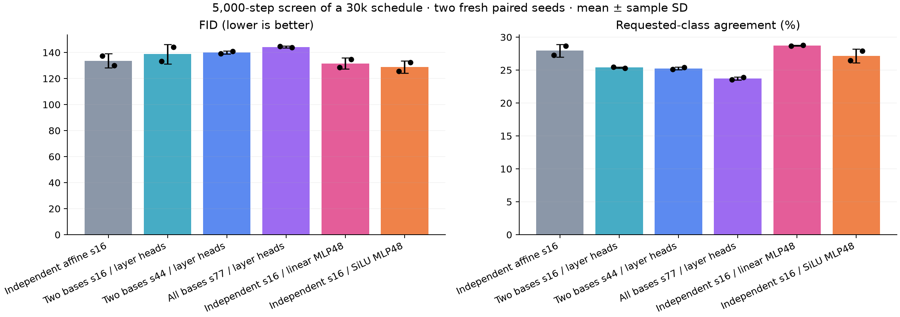
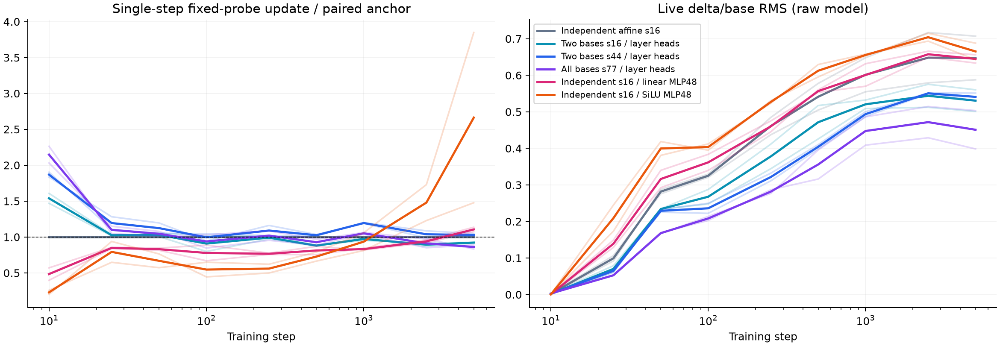

# Shared factor bases, layer-specific heads and small MLP screen

Two fresh paired screen seeds (72/73), 5,000 steps of the 30k schedule. Values are mean ± sample SD, not confidence intervals. Independent update-only calibration uses seeds 70/71; recipes freeze before quality training. This is a short screen, not longer confirmation.

| Recipe | Adapter / total parameters | Decoder groups | s | LR multiplier | FID ↓ | Agreement ↑ |
| --- | ---: | ---: | ---: | ---: | ---: | ---: |
| Independent affine s16 | 774,336 / 4,954,032 | 6 | 16 | 1.000000 | 133.67 ± 5.35 | 27.96 ± 0.96% |
| Two bases s16 / layer heads | 282,816 / 4,462,512 | 2 | 16 | 1.041632 | 138.72 ± 7.61 | 25.39 ± 0.10% |
| Two bases s44 / layer heads | 777,744 / 4,957,440 | 2 | 44 | 0.417542 | 140.12 ± 1.22 | 25.26 ± 0.20% |
| All bases s77 / layer heads | 769,692 / 4,949,388 | 1 | 77 | 0.225863 | 144.25 ± 0.66 | 23.72 ± 0.25% |
| Independent s16 / linear MLP48 | 802,272 / 4,981,968 | 6 | 16 | 1.731733 | 131.60 ± 4.26 | 28.72 ± 0.06% |
| Independent s16 / SiLU MLP48 | 802,272 / 4,981,968 | 6 | 16 | 3.504777 | 128.93 ± 4.72 | 27.18 ± 1.05% |

Two shared-basis s44 and fully shared-basis s77 match the affine reference within 0.1% whole-model parameters; two shared-basis s16 is a fixed-width control. Hidden-linear and SiLU MLP48 have exactly equal budgets, adding 0.56% whole-model parameters. All six layer heads remain independent. Rank is eight throughout, with fixed gain 1/sqrt(8). Base width192/depth6/heads3/patch4, non-affine AdaLN-Zero, normalized adapter input, broadcast class/time and self-attention remain common.

U/V decoder bases are tied within contiguous groups while coefficients and generated factors remain layer-specific. Optimizer parameters count unique tensors; per-adapter gradient records overlap shared decoders, with separate unique decoder/head records. Each layer still generates its own factors. Shared bases do not imply identical transforms or reduced generation work at wider s.

## Update selection and magnitude

Calibration uses the full 45k loader and a 500-step prefix of the 30k schedule. Highest-FP32 single-step adapter function-update RMS is averaged over six layer probes, steps50/100/250/500 and both seeds. All layer functions have independent heads; calibration weights each layer equally. One rate response is always verified for non-anchor families, followed by at most two further corrections when needed; multipliers are bounded to [1/16,16]. Selection minimizes absolute log(update/target), excludes quality, and requires the selected aggregate within ±15%.

| Recipe | Calibration update / target | Fresh early update / anchor | Final update / anchor | Live delta/base | Fixed transform Frobenius | Peak MiB |
| --- | ---: | ---: | ---: | ---: | ---: | ---: |
| Independent affine s16 | 1.000 | 1.000 ± 0.000 | 1.000 ± 0.000 | 0.647 ± 0.084 | 2.326 ± 0.002 | 620.2 ± 0.0 |
| Two bases s16 / layer heads | 0.981 | 0.972 ± 0.058 | 0.922 ± 0.005 | 0.531 ± 0.042 | 2.245 ± 0.032 | 612.6 ± 0.0 |
| Two bases s44 / layer heads | 1.133 | 1.073 ± 0.047 | 1.029 ± 0.028 | 0.541 ± 0.014 | 2.824 ± 0.111 | 624.4 ± 0.0 |
| All bases s77 / layer heads | 1.017 | 0.996 ± 0.033 | 0.861 ± 0.041 | 0.451 ± 0.074 | 2.518 ± 0.015 | 628.1 ± 0.0 |
| Independent s16 / linear MLP48 | 1.009 | 0.805 ± 0.060 | 1.106 ± 0.043 | 0.645 ± 0.016 | 1.555 ± 0.081 | 620.7 ± 0.0 |
| Independent s16 / SiLU MLP48 | 0.961 | 0.632 ± 0.003 | 2.663 ± 1.676 | 0.665 ± 0.032 | 2.015 ± 0.421 | 620.8 ± 0.0 |

Fresh early ratios outside calibration tolerance: Independent s16 / linear MLP48 seed 72: 0.847×; Independent s16 / linear MLP48 seed 73: 0.763×; Independent s16 / SiLU MLP48 seed 72: 0.630×; Independent s16 / SiLU MLP48 seed 73: 0.634×. Recipes were not retuned.

Fixed-probe updates measure one optimizer step on the raw model. Transform Frobenius values average fixed-condition generated transforms across samples and unique projector groups, including fixed gain; their input/output factor norms are retained per group in full evidence. Live ratios average six layer branches on eight fixed held-out images. EMA quality is a different state. These diagnostics do not prove a gauge cause or variance preservation. Whole-training peaks include EMA, gradients, optimizer, activations and fixed probes; diagnostic forwards and final FID are excluded.

## Paired differences

Variant minus control, in seed order72/73. Negative FID and positive agreement favor the variant.

| Comparison | FID differences | Agreement differences (pp) |
| --- | --- | --- |
| Two bases s16 / layer heads vs Independent affine s16 | -4.11, +14.21 | -1.82, -3.32 |
| Two bases s44 / layer heads vs Independent affine s16 | +1.80, +11.09 | -2.16, -3.24 |
| All bases s77 / layer heads vs Independent affine s16 | +7.26, +13.90 | -3.74, -4.74 |
| Two bases s44 / layer heads vs Two bases s16 / layer heads | +5.91, -3.12 | -0.34, +0.08 |
| Independent s16 / linear MLP48 vs Independent affine s16 | -8.86, +4.72 | +1.40, +0.12 |
| Independent s16 / SiLU MLP48 vs Independent s16 / linear MLP48 | -3.00, -2.34 | -2.24, -0.84 |
| Independent s16 / SiLU MLP48 vs Independent affine s16 | -11.86, +2.38 | -0.84, -0.72 |

## Protocol and limits

Full45k/5k CIFAR-10 split123, baseLR4e-4, warmup50, cosinefloor.01 over30k, AdamW(.9,.999), weightdecay0, clip1, BF16, in-memory EMA.999. Final EMA evaluation uses5k real/generated images, DDIM50, noCFG, sampling seed2028 and the unchanged frozen classifier. No official-test evaluation.

- Two fresh seeds and 5k steps of a 30k schedule; not longer confirmation or statistical significance.
- Independent s16 versus two shared decoder groups s44 and one group s77 match whole-model parameters within 0.1%, not exactly.
- Two shared decoder groups s16 is a fixed-width tying control; all adapters have independent layer-specific heads.
- Hidden-linear versus SiLU MLP heads have exactly equal parameters; both add 0.56% whole-model parameters relative to the affine reference.
- U/V decoders are shared, but independently generated per-layer factors cannot be reused as identical transforms.
- Base blocks, AdaLN heads and gates remain independent; the produced rank stays eight.
- Gradient records per adapter overlap shared decoder parameters; separate unique decoder and head groups describe ownership.
- Rates are selected only on aggregate early function updates; fresh seeds/layers/later steps may drift and are not retuned.
- Calibration seeds 70/71 and quality seeds 72/73 are fresh relative to previous studies.
- FID uses5k images and one sampling seed; class agreement is a frozen proxy.
- Fixed-probe operator norms and raw-model updates do not guarantee variance preservation or EMA quality.
- No output normalization, shared nonlinear trunk, layer embeddings, new token-conditioning or structured operators are tested.
- At most two claimed GPU workers including all stages; concurrent eager telemetry is not isolated speed evidence.
- No weights/checkpoints and no automatic longer confirmation.

Calibration loops 0.173, screen loops 0.734, final evaluations 0.122 aggregate GPU-hours; startup and compatibility smoke additional. Raw evidence at audit 74.2MiB under512MiB. All private supervisors are closed and GPU claims released. No model/evaluator weights, checkpoints, grids or generated datasets saved.

[Structured results](dit-basis-head-screen.json) · [Full evidence](dit-basis-head-screen-evidence.json) · [Audit](dit-basis-head-screen-audit.json) · [Design notes](../DESIGN_NOTES.md)
