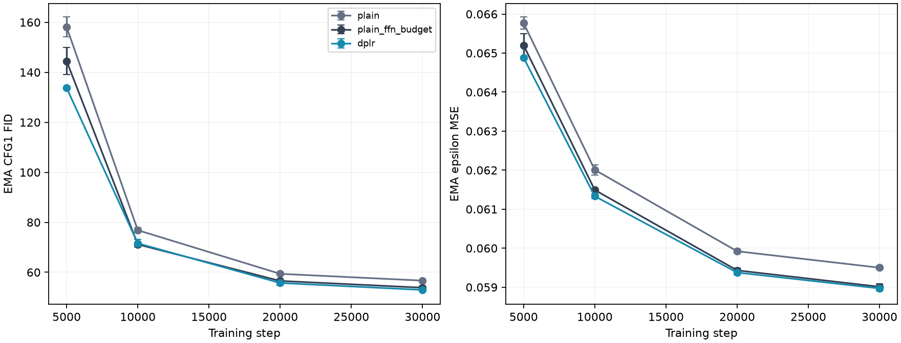
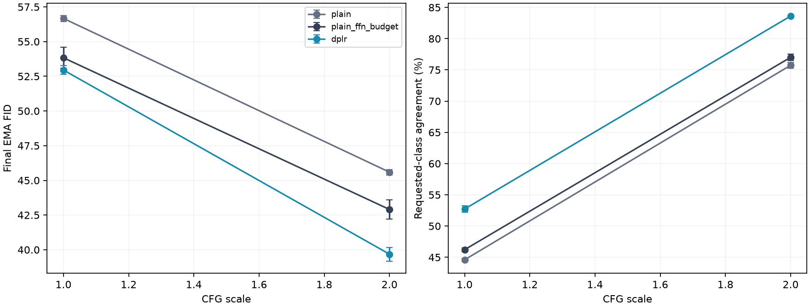

# Larger-model capacity controls

Six 30k-step runs, paired seeds 86/87; mean ± sample SD, not confidence intervals.

| Model | Parameters | CFG1 FID | CFG2 FID | CFG2 agreement | Train peak allocated MiB |
|---|---:|---:|---:|---:|---:|
| plain | 9,758,768 | 56.67 ± 0.21 | 45.59 ± 0.20 | 75.74 ± 0.45% | 1521.77 ± 0.00 |
| plain_ffn_budget | 11,137,712 | 53.84 ± 0.77 | 42.90 ± 0.69 | 77.01 ± 0.49% | 1645.50 ± 0.09 |
| dplr | 11,135,280 | 52.95 ± 0.31 | 39.68 ± 0.50 | 83.62 ± 0.08% | 1171.37 ± 0.57 |

DPLR-minus-control differences below preserve seed order86/87. Negative FID and positive agreement differences favor DPLR.

| Control | CFG | FID differences | Agreement differences (pp) |
|---|---:|---|---|
| plain | 1.0 | -3.35, -4.09 | +7.64, +8.62 |
| plain | 2.0 | -5.42, -6.40 | +8.26, +7.50 |
| plain_ffn_budget | 1.0 | -1.20, -0.56 | +5.96, +7.06 |
| plain_ffn_budget | 2.0 | -3.36, -3.08 | +6.32, +6.90 |

All models use width256/depth8/heads4, beta1=.9,30k cosine LR4e-4/warmup50, batch128, BF16 compiled/fused training,10% label dropout and EMA.999. Static MLP hidden widths are1024 and1360; DPLR uses r8/s16, hidden1024 and gain1/sqrt(8). Evaluations use DDIM50,5k real/generated images and the fixed auxiliary classifier. Weights remain in memory only.

Limits: Two paired seeds and one held-out split; sample SD is not a confidence interval. Wider plain MLP matches DPLR parameters within0.022%, not FLOPs, activation shapes or identical initialization. Plain ratio4 and DPLR share the same base initialization; all three share observed data/noise/effective-label traces. LR and adapter gain/rate are held fixed, not recalibrated or optimized for the larger models. Earlier small-model anchors use the same seeds and training implementation but were run in a separate cohort. Intermediate quality uses CFG1; final scales1/2 share one EMA state and initial-noise seed. 5k-image held-out-train FID is not published50k-image FID; classifier agreement is an auxiliary proxy. Compiled concurrent training is not an isolated speed benchmark. Thirty thousand steps do not establish convergence or saturation.

[Comparison](dit-capacity.json) · [Evidence](dit-capacity-evidence.json) · [Audit](dit-capacity-audit.json) · [Protocol](dit-capacity-protocol.json)

## Interpretation and next experiments

At CFG 2, DPLR improves FID over the parameter-matched wider static MLP by
3.22 on average, with paired improvements of 3.36 and 3.08 for seeds 86/87.
Classifier agreement improves by 6.61 percentage points, also in both seeds.
The model budgets differ by only 2,432 parameters (0.022%). This supports a
benefit beyond simply adding static MLP parameters under this training recipe.
At CFG 1 the FID advantage is smaller (0.88), while agreement improves by
6.51 percentage points. The wider MLP has a slightly better mean CFG 1 FID at
10k; the final ordering should not be inferred from every early checkpoint.

Larger DPLR improves CFG 2 FID from the earlier current-size anchor's 49.50
to 39.68, and larger plain AdaLN-Zero improves from 59.05 to 45.59. These are
separate cohorts with compatible frozen training implementations, paired seeds
and audited input/noise/label streams. Capacity helps both architectures.

DPLR's measured training peak allocation is 1,171 MiB versus 1,646 MiB for
the wider static MLP (28.8% lower). The forward matrix-multiplication ledger
estimates 862 million versus 1,025 million FLOPs per image (15.9% lower).
The allocation includes model, EMA, optimizer, activations and resident
diagnostic inputs; it is not a measurement of factor storage alone. The FLOP
ledger is not an end-to-end runtime or backward-compute benchmark.

Final EMA epsilon MSE is nearly identical for DPLR and the wider static MLP
(0.058970 versus 0.059012), despite clearer differences in generated-image
metrics. Keep both generation and denoising measurements. The classifier's
83.62% generated-image agreement is a proxy; it can exceed its 80.72% real
holdout accuracy because generated images and real images have different
complexity and distributions. It does not establish human-rated class accuracy.

The next useful comparison is a focused higher-s and nonlinear-projector
study at fixed model width/depth and transform rank, retaining the affine
r8/s16 reference and explicit parameter budgets. Initialization, adapter gain,
and update-transfer diagnostics should remain controlled. A longer schedule
would separately test whether the gains persist with more training. Neither
experiment is launched by this result update.

All six runs and the reconstructed-evidence audit completed successfully.
The private controller and workers are closed; GPU claims are released.
No training weights were saved. Compact evidence and declared compiler caches
remain retained under the original 2 GiB bound.
