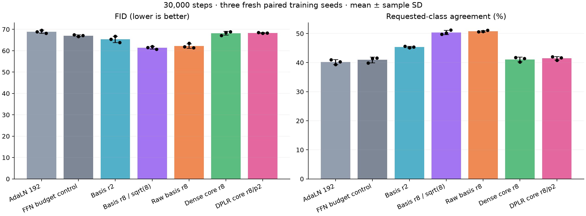
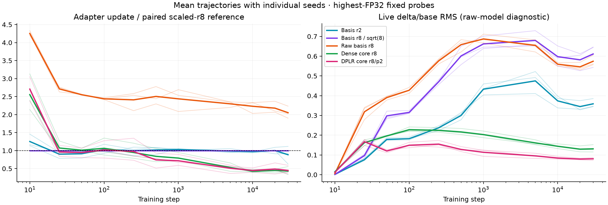

# Calibrated conditional cores and FFN quality confirmation

Three fresh paired seeds (55/56/57), 30,000 steps each. Values are mean ± sample SD, not confidence intervals.

| Variant | Parameters | Added versus AdaLN | FID ↓ | Class agreement ↑ | EMA noise MSE | Train images/s |
| --- | ---: | ---: | ---: | ---: | ---: | ---: |
| AdaLN 192 | 4,179,696 | 0 | 68.91 ± 0.73 | 40.21 ± 0.82% | 0.06147 ± 0.00005 | 3698 ± 10 |
| FFN budget control | 4,401,456 | 221,760 | 67.06 ± 0.40 | 40.96 ± 0.97% | 0.06115 ± 0.00007 | 3702 ± 125 |
| Basis r2 | 4,401,072 | 221,376 | 65.33 ± 1.43 | 45.35 ± 0.25% | 0.06102 ± 0.00016 | 2982 ± 116 |
| Basis r8 / sqrt(8) | 4,954,032 | 774,336 | 61.43 ± 0.65 | 50.38 ± 0.73% | 0.06060 ± 0.00010 | 3169 ± 47 |
| Raw basis r8 | 4,954,032 | 774,336 | 62.23 ± 1.08 | 50.82 ± 0.26% | 0.06060 ± 0.00012 | 3113 ± 125 |
| Dense core r8 | 4,299,888 | 120,192 | 68.21 ± 0.91 | 41.11 ± 0.83% | 0.06138 ± 0.00009 | 3129 ± 35 |
| DPLR core r8/p2 | 4,272,096 | 92,400 | 68.34 ± 0.19 | 41.49 ± 0.62% | 0.06140 ± 0.00005 | 2894 ± 105 |

The FFN MLP hidden width is 864 (ratio 4.5), versus 768 for the other families. Its total budget is only 384 parameters above basis r2. It has no adapter; its added capacity is not counted as adapter parameters. Changing its shape also changes initialization, so this control is seed-matched rather than identical-base matched. All equal-shape variants have identical base hashes, and raw/scaled basis r8 share adapter initialization.

| Variant | Whole-training peak MiB |
| --- | ---: |
| AdaLN 192 | 574.3 ± 0.0 |
| FFN budget control | 605.7 ± 0.0 |
| Basis r2 | 602.0 ± 0.0 |
| Basis r8 / sqrt(8) | 620.2 ± 0.0 |
| Raw basis r8 | 620.2 ± 0.0 |
| Dense core r8 | 599.0 ± 0.0 |
| DPLR core r8/p2 | 599.2 ± 0.0 |

Peak allocation includes model, in-memory EMA, gradients, optimizer, training activations and fixed diagnostic inputs. Diagnostic forwards and final FID evaluation are excluded. Timing is concurrent eager training; these results are not an isolated speed or equal-time quality comparison.

Calibration uses the full 45,000-image loader on seeds 53/54 for a 500-step prefix of the confirmation schedule. The metric averages independent highest-FP32 adapter-delta update RMS across all six blocks at steps 50/100/250/500 and both seeds. Core adapter LR multipliers are selected only on this metric, with at most two bounded corrections and ±25% tolerance. All gains stay fixed; control multipliers stay 1. Recipes are frozen before confirmation. No loss, validation, FID or class agreement enters selection.

| Calibrated family | Frozen adapter LR multiplier | Update / target | Selected attempt |
| --- | ---: | ---: | ---: |
| Basis r8 / sqrt(8) | 1.000000 | 1.000 | 0 |
| Dense core r8 | 0.414517 | 1.158 | 1 |
| DPLR core r8/p2 | 0.472845 | 1.064 | 1 |

| Adapter | Early update / paired r8 | Final update / paired r8 | Final live delta/base | Final combined/base | Base–delta correlation |
| --- | ---: | ---: | ---: | ---: | ---: |
| Basis r2 | 0.962 ± 0.065 | 0.886 ± 0.245 | 0.359 ± 0.023 | 1.140 ± 0.018 | 0.099 ± 0.016 |
| Basis r8 / sqrt(8) | 1.000 ± 0.000 | 1.000 ± 0.000 | 0.611 ± 0.059 | 1.316 ± 0.046 | 0.157 ± 0.011 |
| Raw basis r8 | 2.498 ± 0.075 | 2.053 ± 0.169 | 0.574 ± 0.027 | 1.283 ± 0.021 | 0.163 ± 0.005 |
| Dense core r8 | 0.981 ± 0.136 | 0.432 ± 0.113 | 0.131 ± 0.019 | 1.015 ± 0.003 | 0.024 ± 0.005 |
| DPLR core r8/p2 | 0.927 ± 0.191 | 0.450 ± 0.125 | 0.080 ± 0.007 | 1.005 ± 0.001 | 0.006 ± 0.001 |

Fresh-seed early core ratios outside the calibration tolerance: DPLR core r8/p2 seed 55: 0.741×. Confirmation rates were not changed in response.

The update probe measures only the adapter delta at fixed independent normalized inputs/conditions, in the raw model. It does not measure the entire network update. Live branch diagnostics use eight fixed held-out images and report means across six blocks. EMA quality measures a different state. Scalar calibration does not match each block, seed, later update or signal magnitude, and is not a variance-preservation/gauge-fixing guarantee.

Paired differences below are variant minus control in seed order 55/56/57. Negative FID and positive agreement differences favor the variant.

| Variant vs control | FID differences | Agreement differences (pp) |
| --- | --- | --- |
| Basis r2 vs FFN budget control | -2.13, +0.10, -3.17 | +5.76, +3.66, +3.74 |
| Dense core r8 vs AdaLN 192 | -1.76, -1.05, +0.71 | +0.78, +0.84, +1.10 |
| Dense core r8 vs FFN budget control | -0.28, +1.93, +1.80 | +1.92, -1.26, -0.20 |
| Dense core r8 vs Basis r2 | +1.84, +1.83, +4.97 | -3.84, -4.92, -3.94 |
| Dense core r8 vs Basis r8 / sqrt(8) | +5.62, +6.58, +8.13 | -7.98, -10.04, -9.78 |
| Dense core r8 vs Raw basis r8 | +5.35, +5.13, +7.47 | -8.88, -10.52, -9.72 |
| DPLR core r8/p2 vs AdaLN 192 | -0.37, -1.44, +0.11 | +1.02, +1.46, +1.36 |
| DPLR core r8/p2 vs FFN budget control | +1.10, +1.54, +1.20 | +2.16, -0.64, +0.06 |
| DPLR core r8/p2 vs Basis r2 | +3.23, +1.44, +4.37 | -3.60, -4.30, -3.68 |
| DPLR core r8/p2 vs Basis r8 / sqrt(8) | +7.01, +6.19, +7.54 | -7.74, -9.42, -9.52 |
| DPLR core r8/p2 vs Raw basis r8 | +6.74, +4.74, +6.87 | -8.64, -9.90, -9.46 |

The common recipe is pixel-space epsilon prediction, width 192/depth 6/3 heads/patch 4, normalized broadcast class/time conditioning, non-affine pre-norm/AdaLN-Zero, base LR 4e-4, warmup 50, AdamW (.9,.999), zero weight decay, global clipping 1, cosine floor .01, BF16 and in-memory EMA .999. FID uses 5,000 held-out real and 5,000 generated images, 50-step DDIM without CFG and sampling seed 2028. Class agreement uses the existing frozen FP32 classifier, with 500 requested images per class. One held-out split/sampling seed and three training seeds do not establish a universal architectural winner. Sequence-valued conditioning/cross-attention remain untested.

Training/validation/diagnostics used 7.035 aggregate GPU-hours; final generation/evaluation used 0.198. Calibration/startup are additional. Compact raw evidence is 51.5 MiB under the declared 512 MiB bound. All finite workers/controllers exited successfully, supervisors closed and GPU claims released. No new model/evaluator weights, resume checkpoints, generated image datasets or official test evaluation.

[Structured comparison](dit-core-confirmation.json) · [Audit](dit-core-confirmation-audit.json) · [Full evidence](dit-core-confirmation-evidence.json) · [Design notes](../DESIGN_NOTES.md)
