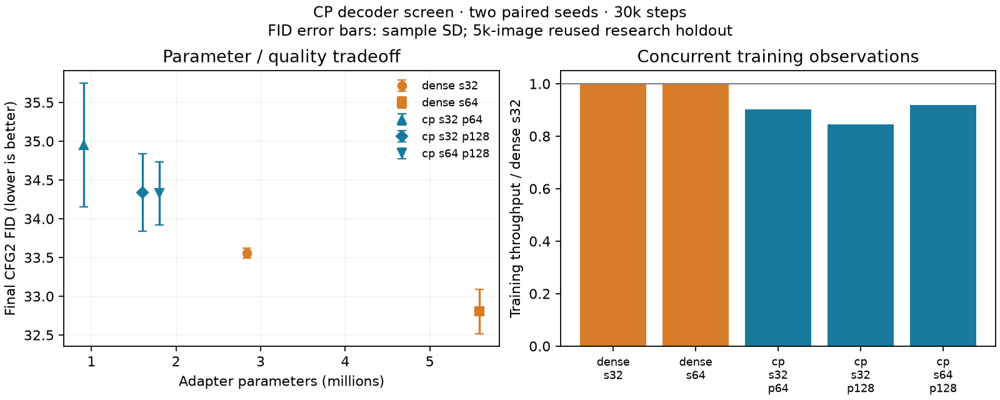

# Completed CP decoder-compression screen

CP lowers generator parameters with a modest guided quality cost in both seeds. It does not improve training throughput here. The first screen is complete; all eight final audits passed, including replay with the frozen runner.

| Decoder | Adapter params | Total params | CFG2 FID | CFG2 class agreement | Images/s | Peak allocated GiB |
|---|---:|---:|---:|---:|---:|---:|
| dense_s32 | 2,834,944 | 12,593,712 | 33.56 ± 0.07 | 88.53 ± 1.00% | 2889 | 1.168 |
| dense_s64 | 5,587,968 | 15,346,736 | 32.81 ± 0.29 | 89.36 ± 0.08% | 2879 | 1.218 |
| cp_s32_p64 | 909,824 | 10,668,592 | 34.95 ± 0.80 | 85.72 ± 0.28% | 2606 | 1.138 |
| cp_s32_p128 | 1,606,144 | 11,364,912 | 34.34 ± 0.50 | 86.60 ± 0.25% | 2441 | 1.152 |
| cp_s64_p128 | 1,803,264 | 11,562,032 | 34.33 ± 0.40 | 87.30 ± 0.03% | 2656 | 1.156 |

Values are means ± sample SD over new seeds120/121, not confidence intervals. Final30k EMA state, CFG2, DDIM50, 5k real/5k generated images. The wider dense control improves guided FID by −0.75 in mean versus dense s32, in both seeds, for 2.75M additional parameters.

| CP design | Guided FID difference vs dense s32, seed120 | Seed121 | Mean | Adapter parameter saving vs dense s32 |
|---|---:|---:|---:|---:|
| cp_s32_p64 | +0.78 | +2.01 | +1.40 | 67.9% |
| cp_s32_p128 | +0.39 | +1.18 | +0.78 | 43.3% |
| cp_s64_p128 | +1.01 | +0.53 | +0.77 | 36.4% |

CP s64/p128 and s32/p128 have nearly identical mean guided FID (34.33/34.34), with mixed per-seed effects from increasing s. Class agreement improves by 0.70 percentage points in mean with wider coefficients. CP s64/p128 trails the newly trained dense s64 control by +1.60/+1.44 FID. Every CP guided comparison against dense s32 is worse in both seeds. Unguided CP s32 cases slightly outperform dense s32 in seed120, but lose in seed121; unguided evidence is less consistent. Both CFG scales and all paired differences remain in the comparison JSON.

The smallest CP design saves 67.9% of adapter parameters but 15.3% of total model parameters. Against dense s32, observed training throughput falls about 8–15% and whole-training peak allocated memory falls only 1–3%. These are concurrent training observations, not isolated speed or activation-memory benchmarks. Parameter compression alone does not establish lower compute or training-memory cost.

Optimization remains a confound. At step500, mean fixed-input function-update RMS is 0.00091 for dense s32 versus 0.00382/0.00523/0.00766 for the three CP designs. Fixed independent-condition operator magnitudes also differ substantially, while live delta/base ratios are smaller for CP late in training. These probes measure different properties; they do not establish a gauge cause, variance preservation or poor behavior on actual conditions. Shared LR and matched marginal initialization variance do not match functional updates. Do not attribute the entire FID gap to decoder capacity.

The next bounded experiment tests channel-factorized (Tucker-style) decoders with unrestricted coefficient/rank cores, paired CP controls, and an equal two-point adapter-LR sensitivity check. It retains transform rank8, sample-wise broadcast conditioning, zero output factor, factor offsets and the base training recipe. Initialization can expand the CP cores so the paired CP/Tucker initial factors match in FP32 within arithmetic tolerance, while Tucker releases the core restriction during learning. This still changes optimizer geometry and does not guarantee improvement.

Fifteen workers completed (five compiled preflights and ten full30k runs). All routes received gradients by step5 in the preflights. Sixty-nine workspace CPU checks and twenty frozen-runner checks passed before launch. The workflow ran October13, 18:12–20:41 UTC, about2h29m; recorded loops plus generation total5.08 aggregate GPU-hours. About0.80GiB is retained within the4GiB bound. All worker supervisors and the finished private controller are closed; claims released. No weights, checkpoints, official-test evaluation or new evaluator downloads.

This is a two-seed screen on a reused CIFAR-10 research holdout and fixed sampling noise, with a frozen auxiliary class classifier. No automatic recipe selection or longer confirmation was performed. It tests broadcast conditions, not per-token memory, causal sequence retrieval or cross-attention.

[Comparison](dit-decoder-compression.json) · [Evidence](dit-decoder-compression-evidence.json) · [Audit](dit-decoder-compression-audit.json) · [Protocol](dit-decoder-compression-protocol.json) · [Launch plan](dit-decoder-compression-plan.md)
