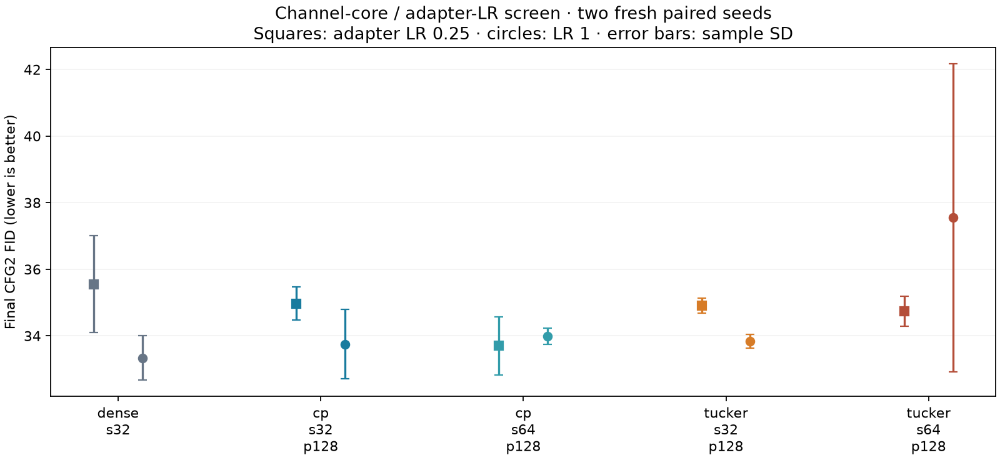

# Completed channel-core decoder and LR screen

The unrestricted channel-mode cores did not give a consistent guided-quality improvement over CP. Dense s32 at unit adapter LR remains the strongest observed mean recipe in this two-seed grid. Quarter-rate training worsens dense, CP s32 and channel-core s32 guided FID in both seeds; effects are mixed for the wider designs. These are bounded observations, not established optimal LRs or general architecture rankings.

| Design | Adapter params | Adapter LR 0.25: CFG2 FID | Adapter LR 1: CFG2 FID |
|---|---:|---:|---:|
| dense_s32 | 2,834,944 | 35.55 ± 1.45 | 33.34 ± 0.67 |
| cp_s32_p128 | 1,606,144 | 34.97 ± 0.50 | 33.75 ± 1.05 |
| cp_s64_p128 | 1,803,264 | 33.70 ± 0.87 | 33.98 ± 0.24 |
| tucker_s32_p128 | 2,048,512 | 34.90 ± 0.22 | 33.84 ± 0.20 |
| tucker_s64_p128 | 2,704,384 | 34.74 ± 0.45 | 37.55 ± 4.63 |

Final30k EMA, CFG2/DDIM50, 5k-image reused research holdout. Means ± sample SD over seeds122/123, not confidence intervals. Both CFG scales, class agreement, every per-seed contrast, throughput and memory remain in the comparison/evidence JSON.

At unit rate, CP s32-minus-dense guided FID is +1.63/−0.80 (mean +0.41); channel-core s32-minus-dense is +1.12/−0.12 (mean +0.50). Channel-core s32-minus-CP is −0.51/+0.68 (mean +0.09), so freeing the core did not give a consistent FID gain. Unit class agreement averages89.07% dense,86.90% CP s32 and87.83% channel-core s32. The core improves class agreement against CP in both seeds, while retaining a quality/parameter tradeoff against dense.

The wider channel-core unit-rate run is volatile: seed122 FID40.82 versus34.28 for seed123. Quarter rate changes these to34.42/35.06, improving the poor unit-rate seed and worsening the other. All workers completed with finite evidence; this is a poor-quality/variable outcome, not a numerical failure. Wider CP quarter rate yields33.70 mean, but its paired FID effects versus its own unit rate are mixed (+0.17/−0.73), and class agreement averages86.63%. It does not establish a robust advantage over the dense unit-rate reference.

Unit-rate mean training throughput is2863 images/s dense,2528 CP s32,2530 CP s64,2642 channel-core s32 and2724 channel-core s64. The freer cores run somewhat faster than CP in these concurrent measurements but do not beat dense. Whole-training peak allocation remains close, around1.15–1.17GiB. These are descriptive concurrent observations, not isolated speed or activation-memory benchmarks.

CP/core channel bases, heads and initial factor functions were paired in FP32 within arithmetic tolerance. BF16 reassociation, optimizer geometry, general basis gauges and a restricted two-point LR grid remain confounds. The experiment does not prove that compression capacity alone caused the quality differences, or that update-magnitude matching would determine the best LR. Initial pairing did not remove learning-dynamics differences. No new default or automatic best-recipe confirmation was selected.

The next bounded comparison uses cheaper condition-driven channel scales around learned static low-rank factors, with a condition-independent static-factor control, dense DPLR and CP references. It preserves the parallel MLP delta, common AdaLN, static offsets, transform rank8 and the two-GPU/no-checkpoint policy. This is a different conditioning restriction; it is not a repair justified by a proven gauge cause.

Twenty-five workers completed: five compiled preflights and twenty full30k runs. All nine final checks passed in the controller and frozen-runner replay, including actual optimizer ownership/rates, paired initialization/data/noise/dropout, evaluator/guidance budgets, exits/claims/storage. Ninety-three workspace and24 frozen-runner checks passed before launch. The workflow ran October14,07:19–12:13 UTC, about4h54m. About1.33GiB is retained within the4GiB bound. Private workers/controller are closed and claims released. No weights, checkpoints, official test evaluation or new evaluator downloads.

The holdout/noise/evaluator are reused; two seeds do not establish independent final-quality evidence. Broadcast class/timestep conditioning remains distinct from causal retrieval or token self-conditioning. Dedicated speed benchmarking remains deferred.

[Comparison](dit-decoder-core.json) · [Evidence](dit-decoder-core-evidence.json) · [Audit](dit-decoder-core-audit.json) · [Protocol](dit-decoder-core-protocol.json) · [Launch plan](dit-decoder-core-plan.md)
