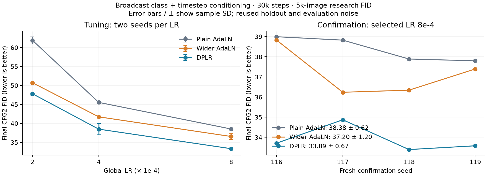

# Broadcast DPLR after equal global-LR tuning

DPLR retains a quality advantage after the same bounded LR search for all three methods. On four fresh confirmation seeds, guided FID averages 33.89 versus 37.20 for parameter-matched wider AdaLN and 38.38 for plain AdaLN. DPLR wins both guided comparisons on all four seeds. This supports the external class/timestep-conditioning recipe tested here; the earlier ViT self-conditioning results did not establish a comparable validation gain.

All methods selected 8e-4, the highest tested LR. These are selected recipes within the grid, not established LR optima. No additional GPU runs or grid expansion were launched.

## Confirmation results

Final 30k-step EMA state, DDIM50, 5,000 real and 5,000 generated images. Values are mean ± sample SD over seeds 116–119, not confidence intervals. Class agreement is measured by the frozen auxiliary classifier.

| Method | Parameters | CFG1 FID | CFG2 FID | CFG2 class agreement |
|---|---:|---:|---:|---:|
| Plain AdaLN | 9,758,768 | 50.31 ± 0.68 | 38.38 ± 0.62 | 79.76 ± 0.51% |
| Wider AdaLN | 12,594,632 | 48.87 ± 1.15 | 37.20 ± 1.20 | 80.58 ± 0.47% |
| DPLR | 12,593,712 | 47.43 ± 0.86 | 33.89 ± 0.67 | 89.01 ± 0.42% |

Wider hidden width 1715 matches offset-enabled DPLR within 920 parameters (0.0074%). DPLR has 29.05% more parameters than plain AdaLN. The parameter match does not imply compute or functional equivalence.

| Seed | Plain CFG2 FID | Wider CFG2 FID | DPLR CFG2 FID | DPLR − plain | DPLR − wider |
|---|---:|---:|---:|---:|---:|
| 116 | 39.00 | 38.83 | 33.71 | -5.29 | -5.12 |
| 117 | 38.83 | 36.24 | 34.87 | -3.95 | -1.37 |
| 118 | 37.89 | 36.34 | 33.39 | -4.49 | -2.95 |
| 119 | 37.80 | 37.39 | 33.58 | -4.22 | -3.81 |

Guided DPLR-minus-wider FID averages −3.31, with class agreement +8.44 percentage points. DPLR-minus-plain FID averages −4.49 and agreement +9.25 points. Unguided DPLR-minus-wider FID averages −1.44, but one of four seeds is worse (+0.55); the unguided result is less consistent. Unguided class agreement improves against both controls on every seed.

## Equal tuning search

Each method received six complete 30k runs: three global LRs × two tuning seeds (114/115). Selection used final CFG2 EMA FID; selection was hash-frozen before twelve confirmation runs. No intermediate best-FID selection or historical confirmation cells were used.

| Global LR | Plain CFG2 FID | Wider CFG2 FID | DPLR CFG2 FID |
|---|---:|---:|---:|
| 2e-04 | 61.91 ± 0.95 | 50.72 ± 0.24 | 47.82 ± 0.40 |
| 4e-04 | 45.54 ± 0.08 | 41.74 ± 0.11 | 38.49 ± 1.51 |
| 8e-04 | 38.53 ± 0.53 | 36.55 ± 0.74 | 33.34 ± 0.23 |

Increasing LR improves every method across this grid. The fresh guided gap survives the fairer search, while a broader LR study would still be required to compare optima.

## Design and cost

The external condition is learned class-plus-timestep `[B,256]`, normalized with non-affine LayerNorm and broadcast over 64 image tokens. Every method uses width 256, depth 8, four heads, patch size 4, common AdaLN-Zero scale/shift and residual gates. DPLR adds a parallel MLP-input delta from the normalized value input, transform rank 8, projector bottleneck 32, independent affine coefficient heads, learned static factor offsets, and gain `1 / sqrt(8)`. Generated factors are per sample, rather than per token.

Training uses batch 128, fused AdamW `(0.9,0.999)`, weight decay 0, gradient clipping 1, BF16, compiled dynamic model, 50-step warmup and a fresh 30k cosine schedule, EMA 0.999, and class dropout 0.1. The relative adapter LR remains 1. Original DiT trainer/model/data/diagnostic sources are preserved byte-for-byte.

| Method | Mean training images/s | Mean peak allocated GiB | Estimated forward matmul GFLOPs/image |
|---|---:|---:|---:|
| Plain AdaLN | 3897 | 1.27 | 0.849 |
| Wider AdaLN | 3710 | 1.50 | 1.211 |
| DPLR | 2873 | 1.17 | 0.865 |

Throughput excludes benchmark warmup but comes from concurrent runs, not a controlled speed benchmark. DPLR is about 23% slower than wider AdaLN and 26% slower than plain here, despite a much smaller estimated matmul FLOP increase. The estimate excludes pointwise operations, reductions, normalization and backward; small operations, backward and compiler behavior remain profiling questions. Peak allocation includes model, optimizer, gradients and activations according to the trainer, and does not measure all reserved/device memory.

DPLR adds 2,834,944 parameters: coefficient heads 131,584 and factor decoders/offsets 2,703,360. The coefficient heads are 1.04% of total parameters; decoders/offsets are 21.47%. Calling only the small coefficient heads the projector would hide the main generator parameter cost.

## Validation and interpretation

All 32 workers completed: two compiled preflights, 18 tuning runs and 12 confirmation runs. All nine final audit checks passed in the controller and on replay using the frozen runner. Audits check exact grid/configs, source/evaluator hashes, paired initialization/data/noise/dropout streams, zero-start and gradient wake-up, equal validation/generation budgets, frozen selection and fresh seeds, two-worker GPU cap, and artifact policy. Fifty-four CPU checks plus eight frozen-runner protocol checks passed before launch.

The workflow ran 07:18–12:59 UTC on October 13 (about 5h41m). Recorded training loops plus intermediate and final generation total about 11.69 aggregate GPU-hours; this is recorded compute time rather than billed or complete worker wall time. About 1.51 GiB is retained within the 4 GiB bound. All private stage supervisors are closed; the finished controller supervisor was shut down after replay. Our GPU claims are released. No model weights, checkpoints or official-test evaluation were produced.

This is evidence for one small class/timestep-conditioned DiT, using a reused 5k held-out portion of CIFAR-10 training data and fixed sampling noise. Fresh seeds address training variability; they do not remove reuse of the holdout or evaluator. The class metric is an auxiliary classifier proxy. These results do not establish sequence-conditioning or cross-attention superiority, universal external-versus-self-conditioning behavior, or a speed advantage.

The next useful decision is whether to bracket the LR boundary equally for all methods, or first profile the DPLR overhead and add a condition-independent/static-transform control. Keep the completed study fixed; any follow-up needs a separate bounded protocol.

[Comparison](dit-external-lr.json) · [Full evidence](dit-external-lr-evidence.json) · [Audit](dit-external-lr-audit.json) · [Protocol](dit-external-lr-protocol.json) · [Frozen selection](dit-external-lr-selection.json) · [Launch protocol](dit-external-lr-plan.md)
