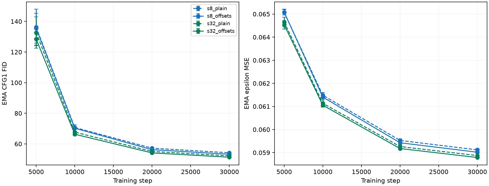
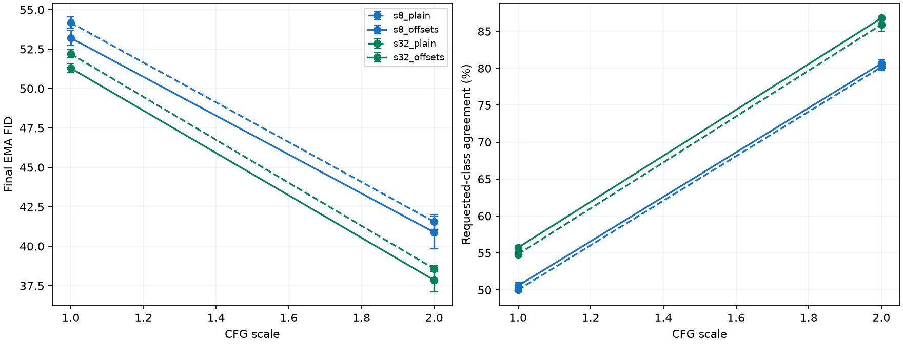

# Factor-offset comparison

Eight fresh 30,000-step runs; means ± sample SD over paired seeds 94/95.

All four families are DPLR. `plain` in the family name means offsets disabled. Transform rank is 8; s8/s32 are generator bottleneck widths.

Offsets lower final FID and increase class agreement in both seeds at CFG1 and CFG2. Mean CFG2 FID improves by 0.67 at s8 and 0.72 at s32, for 81,920 extra parameters per model (0.78%/0.65%). This is a modest extra-capacity result; both offsets change together and their learning rate was not tuned. Keep offsets optional; this does not establish that they should be enabled everywhere.

All 13 experiment audit checks passed. Training completed on October 10. The controller then exited with status 1 because the comparison checker incorrectly treated `factor_offsets` as a common training setting. On October 11, reporting was recovered from unchanged training/evaluation records, using a separate frozen reporting runner. Original failed protocol, logs and source snapshots remain preserved. Only the reporting checker changed; there was no retraining or new GPU evaluation. Twenty-two focused checks passed, including six cases rejecting unplanned optimizer, budget, split or evaluation differences.

No model weights or periodic checkpoints were saved; all private supervisors are closed and our GPU claims are released. Retained raw artifacts are approximately 516 MiB, within the declared 4 GiB bound.

Next planned track: token self-conditioning in ViT, with its own optimization calibration and static/diagonal/capacity controls. No new jobs were launched by this status check.

| Family | Parameters | CFG1 FID | CFG2 FID | CFG2 agreement |
|---|---:|---:|---:|---:|
| s8_plain | 10,447,024 | 54.17 ± 0.36 | 41.55 ± 0.48 | 80.16 ± 0.42% |
| s8_offsets | 10,528,944 | 53.21 ± 0.48 | 40.88 ± 1.03 | 80.65 ± 0.47% |
| s32_plain | 12,511,792 | 52.19 ± 0.26 | 38.57 ± 0.20 | 85.90 ± 0.88% |
| s32_offsets | 12,593,712 | 51.29 ± 0.29 | 37.85 ± 0.72 | 86.79 ± 0.13% |

Paired offset-minus-no-offset differences; negative FID favors offsets.

| Contrast | CFG | Per-seed FID differences | Per-seed agreement differences (pp) |
|---|---:|---|---|
| s8_offsets_minus_s8_plain | 1.0 | -0.876, -1.052 | +0.360, +0.740 |
| s8_offsets_minus_s8_plain | 2.0 | -0.273, -1.061 | +0.460, +0.520 |
| s32_offsets_minus_s32_plain | 1.0 | -0.886, -0.922 | +0.900, +0.900 |
| s32_offsets_minus_s32_plain | 2.0 | -0.357, -1.090 | +1.420, +0.360 |





Limits: Two fresh paired seeds94/95 and a reused holdout/evaluation split; sample SD is not a confidence interval. Each offset-enabled model adds81,920 parameters; this tests the feature at modest extra capacity, not an exactly parameter-matched change. All families share base initialization; within each s, existing adapter tensors and initial functions match. Offsets initialize at zero without consuming RNG. Both U and V offsets change together; this does not isolate which offset matters or establish a tuned learning rate. Adapter gain1/sqrt(8), adapter LR multiplier1 and base LR remain fixed; new update directions can change effective optimization. Fresh30k schedules are separate from the previous60k cohort; previous endpoint quality is context, not a rate-only or bias-only paired control. Generated factors remain per sample, broadcast across tokens; this does not measure per-token memory. Final CFG1/2 share one EMA state/noise;5k-image held-out FID and classifier agreement are pilot proxies. Concurrent compiled telemetry is not an isolated speed benchmark; no model weights or periodic checkpoints are saved.

[Evidence](dit-factor-offset-evidence.json) · [Comparison](dit-factor-offset.json) · [Audit](dit-factor-offset-audit.json) · [Protocol](dit-factor-offset-protocol.json)

[Reporting recovery provenance](dit-factor-offset-recovery.json) · [Export manifest](dit-factor-offset-manifest.json)

To replay the full audit, use the recovered reporting runner (original training sources remain frozen):

```bash
/venv/main/bin/python runs/dit-factor-offset-20261010T193609Z/reporting-recovery/runner/dit_factor_offset_study.py audit --output runs/dit-factor-offset-20261010T193609Z
```
