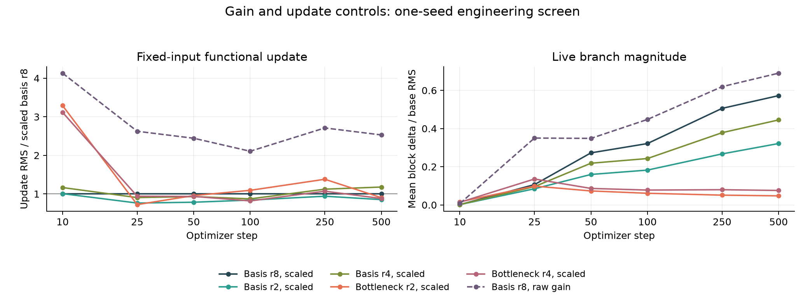

# DiT fixed-gain and functional-update screen

Source run: `/workspace/adalora/runs/dit-gain-20261007T213229Z`. Audited 7 calibration runs and six 500-step confirmations; one seed (42).

This is an optimization diagnostic. No quality winner is selected, and there are no model weights, checkpoints, EMA, FID, or official-test evaluation.

All selected families meet the early ±25% update tolerance. At step 500, their fixed-input update ratios span 0.852–1.178 relative to the scaled rank-8 reference. Live delta/base RMS remains very different: basis ranks 2/4/8 give 0.322, 0.445, 0.572, while bottleneck ranks 2/4 give 0.047, 0.076. Matching function movement does not match the size of the learned branch.

## Protocol

```python
h = norm_mlp(tokens)  # (B, T, d), affine=False
base = mlp_in(h * (1 + scale[:, None]) + shift[:, None])
delta = adapter_gain * conditional_lowrank(h, condition)  # (B, T, 4*d)
pre_act = base + delta
tokens = tokens + gate[:, None] * mlp_out(gelu(pre_act))
```

Gain is a fixed positive scalar. Basis mixing retains a zero output factor; the bottleneck retains a zero condition-to-rank gain head. The default gain of 1 preserves the previous code path.

All scaled candidates use `adapter_gain = 1 / sqrt(rank)`. Base LR is 4e-4. AdamW uses betas=(0.9, 0.999), no weight decay, global gradient clipping at 1, and 50-step warmup then cosine decay. All adapter groups share the selected multiplier.

The target is the rank-8 basis model with scaled gain and multiplier 1. Calibration averages fixed-token/condition output-update RMS across all blocks at steps [10, 25, 50]. A rate correction multiplies the current rate by `target / observed`, bounded to [1/16, 16], with at most two corrections. Selection uses closest absolute log update ratio; loss and validation never enter the choice. ±25% is the declared tolerance.

Calibration and confirmation deliberately share their early batches, noise, initialization, and LR schedule. The audit verifies that prefix replay. Later confirmation steps measure whether the early match persists; they are not independent-seed validation.

## Calibration

| Family | Fixed gain | Unit-rate update / target | Selected adapter LR multiplier | Selected update / target | Within ±25% |
|---|---:|---:|---:|---:|---|
| basis_r8 | 0.3536 | 1.000 | 1.0000 | 1.000 | yes |
| basis_r2 | 0.7071 | 0.786 | 1.0000 | 0.786 | yes |
| basis_r4 | 0.5000 | 0.930 | 1.0000 | 0.930 | yes |
| bottleneck_r2 | 0.7071 | 1.583 | 0.6316 | 0.968 | yes |
| bottleneck_r4 | 0.5000 | 1.261 | 0.7929 | 1.058 | yes |

Target mean functional update RMS: `0.00081760622`. This probe holds independent normalized tokens and conditions fixed, so it measures adapter function movement rather than raw parameter norms or a drift in inputs. It uses FP32 tensors, highest FP32 matmul precision, and no autocast, independently of BF16 training.

## Confirmation

| Family | Extra parameters | Early update / target | Final update / scaled rank-8 | Final live delta / base RMS | Final pre-activation / base RMS |
|---|---:|---:|---:|---:|---:|
| basis_r8 | 774,336 | 1.000 | 1.000 | 0.572 | 1.171 |
| basis_r2 | 221,376 | 0.786 | 0.852 | 0.322 | 1.077 |
| basis_r4 | 405,696 | 0.930 | 1.178 | 0.445 | 1.114 |
| bottleneck_r2 | 13,836 | 0.968 | 0.903 | 0.047 | 1.001 |
| bottleneck_r4 | 27,672 | 1.058 | 0.881 | 0.076 | 1.004 |
| basis_r8_raw | 774,336 | 2.629 | 2.530 | 0.690 | 1.234 |

Later functional-update ratios relative to the scaled rank-8 reference:

| Family | Step 100 | Step 250 | Step 500 |
|---|---:|---:|---:|
| basis_r8 | 1.000 | 1.000 | 1.000 |
| basis_r2 | 0.840 | 0.940 | 0.852 |
| basis_r4 | 0.871 | 1.123 | 1.178 |
| bottleneck_r2 | 1.093 | 1.380 | 0.903 |
| bottleneck_r4 | 0.818 | 1.070 | 0.881 |

## Interpretation and limits

An early match is a calibration result, not proof of variance preservation or comparable learning throughout training. Fixed probes, live branch magnitudes, and gate magnitudes measure different parts of the system. A shared scalar adapter rate cannot generally control all blocks, generator/factor groups, and steps.

Basis and bottleneck architectures retain different function classes and zero-init paths. The bottleneck's static input/output subspaces are particularly restrictive at rank 2 or 4. This screen does not tune separate factor rates, change generator initialization, test orthogonal/structured transforms, or derive muP scaling.

Model/data: width 192, depth 6, heads 3, patch 4, batch 128; fixed 4096-image train bank sampled with replacement and flips, 256 held-out training-split examples. Validation MSE remains a learning diagnostic. Whole-model timing is eager and can vary with shared host load; compile timing is deliberately not repeated here.

Sequence-valued conditioning and cross-attention remain untested.



[Vector figure](dit-gain-engineering.svg). Each plotted update is a single diagnostic step; calibration matches the average over its declared early observation window.
