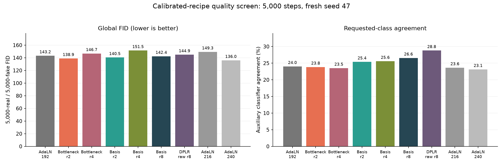
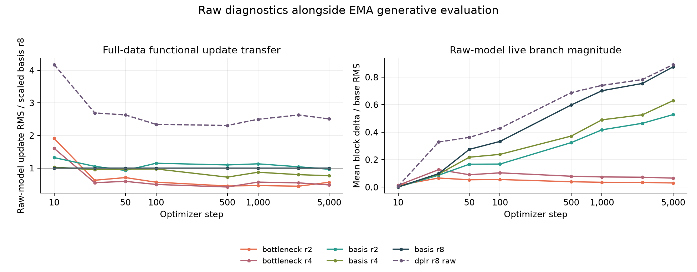

# Calibrated DiT recipes: fresh-seed quality screen

Audited source run: `/workspace/adalora/runs/dit-gain-quality-20261007T215415Z`. Nine configurations, one fresh training seed (47), 5,000 steps each.

The lowest observed endpoint FID is 135.96 for `adaln_d240`. The highest requested-class agreement is 28.80% for `dplr_r8_raw`. These are descriptive short-screen endpoints, not confirmed winners.

## Protocol

The five fixed-gain recipes were frozen from the audited full-FP32 functional-update calibration before this screen launched. The raw-gain rank-8 DPLR anchor and AdaLN widths 192/216/240 provide fresh controls. No learning rate was selected using quality in this screen.

All use CIFAR-10's cached training split: 45,000 training and 5,000 held-out images, split seed 123. Training seed 47 is fresh relative to calibration and earlier diffusion runs. Batch 128, LR 0.0004, 50-step warmup, cosine floor 1%, AdamW (.9,.999), no weight decay, global clip 1, in-memory EMA decay .999. Depth 6, three heads, patch 4, MLP ratio 4; adapter models have width 192. AdaLN scale/shift/gates and non-affine LayerNorm are common. Adapter input is unmodulated normalized tokens.

Final evaluation uses EMA weights, DDIM 50 steps without guidance, common sampling seed 2028, 5,000 generated images and the same 5,000 real images. Requested-class agreement uses the existing frozen classifier on the same generated stream as FID. Its real-image accuracy is a diagnostic, not a ceiling on generated-image agreement. No evaluator was retrained.

## Quality and cost

| Family | Parameters | Extra adapter parameters | FID ↓ | Class agreement ↑ | EMA noise MSE ↓ | Train images/s |
|---|---:|---:|---:|---:|---:|---:|
| adaln_d192 | 4,179,696 | 0 | 143.21 | 24.02% | 0.07046 | 3,914 |
| bottleneck_r2 | 4,193,532 | 13,836 | 138.95 | 23.84% | 0.07014 | 3,246 |
| bottleneck_r4 | 4,207,368 | 27,672 | 146.75 | 23.52% | 0.07037 | 3,295 |
| basis_r2 | 4,401,072 | 221,376 | 140.47 | 25.38% | 0.06980 | 3,027 |
| basis_r4 | 4,585,392 | 405,696 | 151.51 | 25.56% | 0.06950 | 3,045 |
| basis_r8 | 4,954,032 | 774,336 | 142.38 | 26.56% | 0.06909 | 2,960 |
| dplr_r8_raw | 4,954,032 | 774,336 | 144.86 | 28.80% | 0.06904 | 3,113 |
| adaln_d216 | 5,277,576 | 0 | 149.35 | 23.64% | 0.06921 | 4,016 |
| adaln_d240 | 6,503,328 | 0 | 135.96 | 23.12% | 0.06835 | 4,001 |

Bottleneck r2 adds only 13,836 parameters (0.33% of the base model), with FID change -4.26 and agreement change -0.18 percentage points versus width-192 AdaLN. Basis r2 adds 221,376 parameters, with FID change -2.74 and agreement change +1.36 points. These two smaller variants are useful candidates for longer paired-seed checks.

At identical rank-8 parameter counts, the scaled recipe changes FID by -2.48 and agreement by -2.24 points relative to raw gain. That is a quality/conditioning tradeoff, not dominance. Increasing rank or width does not give a monotonic endpoint improvement in this short screen.

The fixed classifier's real-image accuracy was 80.72%. Generated agreement is a proxy affected by classifier errors and domain shift. Concurrent train throughput excludes diagnostic probes and validation; it shares host resources and does not establish an isolated speed ordering.

## Did the update calibration transfer?

| Adapter | Gain | Adapter LR multiplier | Early update / current scaled r8 | Step-5000 update / current scaled r8 | Raw live delta/base RMS at 5000 |
|---|---:|---:|---:|---:|---:|
| bottleneck_r2 | 0.7071 | 0.6316 | 0.749 | 0.568 | 0.031 |
| bottleneck_r4 | 0.5000 | 0.7929 | 0.641 | 0.486 | 0.066 |
| basis_r2 | 0.7071 | 1.0000 | 1.016 | 0.965 | 0.528 |
| basis_r4 | 0.5000 | 1.0000 | 0.965 | 0.768 | 0.630 |
| basis_r8 | 0.3536 | 1.0000 | 1.000 | 1.000 | 0.876 |
| dplr_r8_raw | 1.0000 | 1.0000 | 2.761 | 2.509 | 0.892 |

The bottleneck update match from the subset calibration does not persist on this full-data seed: both early and final update ratios are below the reference. Architectural and optimization differences therefore remain entangled. Recalibrate on the full-data loader across intended seeds, or explicitly track this drift, before treating a longer comparison as a test of function class at matched updates.

These full-FP32 probes hold independent normalized tokens/conditions fixed and measure optimizer-induced movement of the raw adapter. Live image/condition magnitudes also use the raw model. Quality is evaluated with EMA; the two states serve different purposes. Transfer to a new seed and full-data loader is measured rather than assumed. Similar branch magnitudes and similar functional updates are different constraints.

## Limits and retained evidence

This screen has one seed and a short horizon. A low endpoint FID does not establish a multi-seed or long-budget advantage; sampling uncertainty and optimization differences remain. Base LR 0.0004 was previously at the upper tuning boundary, and these architectures have not received equal, separate quality-LR searches. Rank scaling is an empirical recipe, not a variance-preservation guarantee or a muP derivation.

The audit verifies frozen recipes/source/evaluators, identical splits and budgets, common width-192 base initialization, paired raw/scaled rank-8 initialization, matching batch/noise digests at diagnostic steps, matching final noise RNG states, zero initialization and adapter gradient wake-up, quality denominators, finite records and successful managed exits. Diagnostic digests verify the observed batches; they are not a hash of every training image.

No new model weights/checkpoints or generated image datasets were saved. Compact configs, split indices, sources, logs, metrics, summaries and 100-image grids are retained. Existing shared classifier/Inception artifacts are referenced and preserved. The official test split was untouched. Sequence-valued conditioning and cross-attention remain untested.

[Full evidence](dit-gain-quality.json) · [Audit](dit-gain-quality-audit.json) · [Vector quality figure](dit-gain-quality.svg) · [Vector diagnostics](dit-gain-quality-updates.svg)
