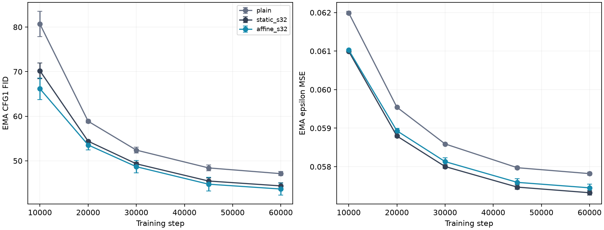
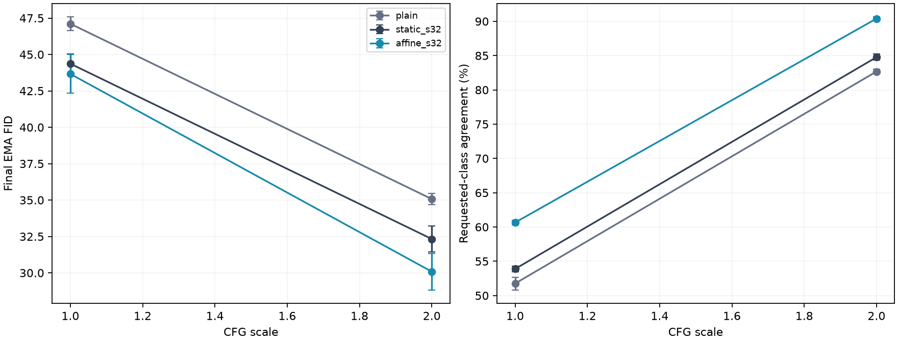

# Fresh-seed longer confirmation

Six60k-step runs, paired fresh seeds92/93; mean ± sample SD, not confidence intervals.

| Model | Parameters | CFG1 FID | CFG2 FID | CFG2 agreement | Train peak allocated MiB |
|---|---:|---:|---:|---:|---:|
| plain | 9,758,768 | 47.11 ± 0.46 | 35.07 ± 0.39 | 82.68 ± 0.31% | 1521.77 ± 0.00 |
| static_s32 | 12,516,656 | 44.37 ± 0.66 | 32.33 ± 0.90 | 84.77 ± 0.44% | 1747.74 ± 0.18 |
| affine_s32 | 12,511,792 | 43.66 ± 1.32 | 30.08 ± 1.25 | 90.40 ± 0.23% | 1195.37 ± 0.13 |

DPLR-minus-control differences below preserve seed order92/93. Negative FID and positive agreement differences favor DPLR.

| Control | CFG | FID differences | Agreement differences (pp) |
|---|---:|---|---|
| plain | 1.0 | -4.06, -2.84 | +8.48, +9.32 |
| plain | 2.0 | -5.59, -4.38 | +7.34, +8.10 |
| static_s32 | 1.0 | -1.17, -0.24 | +6.72, +6.82 |
| static_s32 | 2.0 | -2.49, -2.00 | +5.16, +6.10 |

All models use width256/depth8/heads4, beta1=.9,60k cosine LR4e-4/warmup50, batch128, BF16 compiled/fused training,10% label dropout and EMA.999. Static MLP hidden widths are1024 and1696; DPLR uses r8/s32, hidden1024 and gain1/sqrt(8). Evaluations use DDIM50,5k real/generated images and the fixed auxiliary classifier. Weights remain in memory only.

Limits: Two paired seeds and one held-out split; sample SD is not a confidence interval. Wider plain MLP matches DPLR parameters within0.039%, not FLOPs, activation shapes or identical initialization. Plain ratio4 and DPLR share the same base initialization; all three share observed data/noise/effective-label traces. Affine s32 uses adapter rate1 and gain1/sqrt(8); LR pilot matching was diagnostic and did not improve its30k quality. No new LR search is performed. Seeds92/93 are fresh for this comparison; the held-out split/evaluation noise remain reused exploratory proxies. Intermediate quality uses CFG1; final scales1/2 share one EMA state and initial-noise seed. 5k-image held-out-train FID is not published50k-image FID; classifier agreement is an auxiliary proxy. Compiled concurrent training is not an isolated speed benchmark. Fresh60k cosine schedules are not resumptions of30k runs; equal-step comparisons to previous30k cohorts are schedule-confounded. Sixty thousand steps still do not establish saturation.

[Comparison](dit-longer-confirmation.json) · [Evidence](dit-longer-confirmation-evidence.json) · [Audit](dit-longer-confirmation-audit.json) · [Protocol](dit-longer-confirmation-protocol.json)

The parameter-matched contrast persists in both fresh seeds at both CFG scales. The guided paired differences are−2.49/−2.00 FID and+5.16/+6.10 agreement points. These remain two-seed exploratory results on the reused held-out split; fresh60k schedules and seeds prevent interpreting the difference from previous30k endpoints as the isolated effect of extra steps.

All private supervisors are closed and claims released. No weights were saved.
