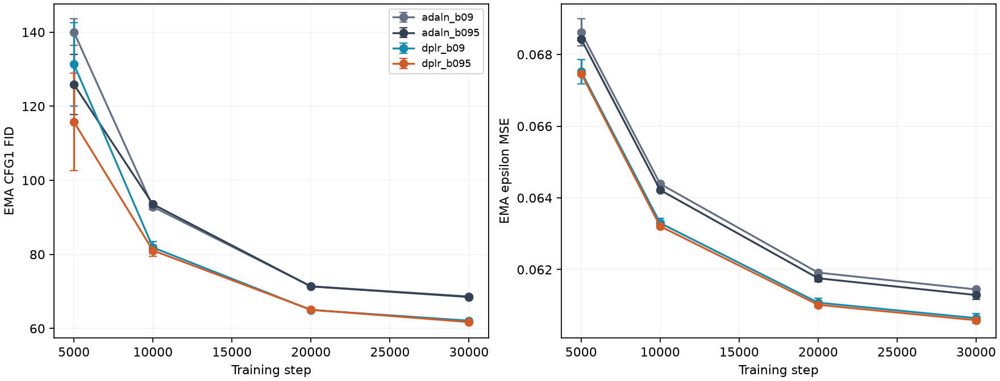
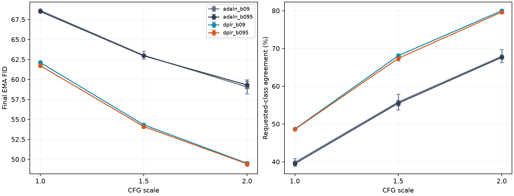

# Current-size beta1 and CFG comparison

Eight 30k-step runs: four recipes and paired seeds86/87. Values are mean ± sample SD, not confidence intervals.

CFG2 is the best tested scale for every recipe in both seeds: it improves FID and requested-class classifier agreement together. The DPLR beta1=.9 reference improves from FID62.11 to49.50 and agreement48.67% to79.98% when changing only final-state guidance from1 to2. Plain AdaLN-Zero improves from68.63 to59.05 and39.84% to67.93%. These are same-state sampling comparisons, so additional training cannot explain the guidance gains.

Beta1=.95 gives a substantial early lead in both paired seeds: at5k, mean CFG1 FID is115.78 versus131.34 for DPLR, and125.89 versus140.01 for plain AdaLN-Zero. The final differences are much smaller. At30k/CFG2, DPLR means are49.43 versus49.50; the paired FID changes are+0.04 and-0.18, while agreement declines in both seeds. Plain beta1=.95 has slightly worse mean CFG2 FID59.30 versus59.05, with mixed seed effects. Treat.95 as an early-convergence candidate, not an established better final optimizer.

The reference DPLR beta1=.9 now has a measured same-cohort CFG1 learning curve:131.34 at5k,81.86 at10k,64.99 at20k and62.11 at30k. This strengthens the undertraining diagnosis for the early screens. Training still improves between20k and30k; these curves do not prove saturation. DPLR has about18.5% more parameters than the same-width plain model, so its advantage does not isolate conditioning from added capacity. The auxiliary classifier's real holdout accuracy is80.72%; generated agreement near80% is a proxy, not a human fidelity estimate.

A practical next control is to retain beta1=.9, compare CFG1/2, and test width256/depth8 with matched plain/DPLR recipes. Larger-model training and additional guidance scales have not been launched.

| Recipe | Parameters | EMA MSE | CFG1 FID | CFG1.5 FID | CFG2 FID |
|---|---:|---:|---:|---:|---:|
| adaln_b09 | 4,179,888 | 0.06145 ± 0.00001 | 68.63 ± 0.08 | 63.02 ± 0.49 | 59.05 ± 0.88 |
| adaln_b095 | 4,179,888 | 0.06129 ± 0.00011 | 68.50 ± 0.10 | 62.95 ± 0.05 | 59.30 ± 0.47 |
| dplr_b09 | 4,954,224 | 0.06065 ± 0.00013 | 62.11 ± 0.17 | 54.32 ± 0.13 | 49.50 ± 0.13 |
| dplr_b095 | 4,954,224 | 0.06059 ± 0.00004 | 61.72 ± 0.22 | 54.10 ± 0.23 | 49.43 ± 0.28 |

| Recipe | CFG1 agreement | CFG1.5 agreement | CFG2 agreement |
|---|---:|---:|---:|
| adaln_b09 | 39.84 ± 0.99% | 55.82 ± 2.09% | 67.93 ± 1.74% |
| adaln_b095 | 39.48 ± 0.25% | 55.49 ± 0.69% | 67.63 ± 0.16% |
| dplr_b09 | 48.67 ± 0.27% | 68.08 ± 0.48% | 79.98 ± 0.25% |
| dplr_b095 | 48.58 ± 0.03% | 67.37 ± 0.69% | 79.61 ± 0.16% |

Paired beta differences below are beta1=.95 minus.9 in seed order86/87; negative FID and positive agreement differences favor.95.

| Architecture | CFG | FID differences | Agreement differences (pp) |
|---|---:|---|---|
| adaln | 1.0 | -0.27, -0.01 | +0.52, -1.24 |
| adaln | 1.5 | -0.38, +0.24 | +0.66, -1.32 |
| adaln | 2.0 | -0.04, +0.53 | +0.82, -1.42 |
| dplr | 1.0 | -0.11, -0.66 | +0.08, -0.26 |
| dplr | 1.5 | +0.03, -0.47 | +0.12, -1.54 |
| dplr | 2.0 | +0.04, -0.18 | -0.08, -0.66 |

All recipes use width192/depth6/heads3/patch4, LR4e-4, warmup50, 30k cosine schedule, batch128,10% label dropout, BF16, compiled training, fused AdamW, EMA.999 and50-step deterministic DDIM. DPLR is independent affine r8/s16 with gain1/sqrt(8) and adapter LR multiplier1. Intermediate generation is CFG1 only; final scales share a state/noise seed. Model weights remain in memory only.

Limits: Two paired seeds on one held-out split; sample SD is not a confidence interval. All recipes train with10% label dropout; this does not isolate dropout versus the historical no-dropout regime. Beta1 changes use a fixed base and adapter LR; no update recalibration or quality-based rate selection. Plain and DPLR use the same width/depth, not equal total parameters; capacity remains a confound. Guidance scales are evaluated on the same EMA state/noise; scale1 uses one forward and other scales use two. Intermediate quality uses CFG1 only; the final state evaluates all three scales. FID is finite-sample 5k-image held-out-train FID, not published50k-image FID. Classifier agreement is an auxiliary proxy; real accuracy and per-class confusion are retained. Compilation is common to all recipes; throughput is concurrent and not an isolated speed experiment. Thirty thousand steps are a convergence probe, not proof of saturation; larger models are deferred.

[Structured comparison](dit-optimizer-cfg.json) · [Full evidence](dit-optimizer-cfg-evidence.json) · [Audit](dit-optimizer-cfg-audit.json) · [Protocol](dit-optimizer-cfg-protocol.json)

The automatic postflight exporter stopped because its live disk tally changed after it wrote the stage summary. Analysis was recovered by ignoring only that volatile tally in replay equality while independently verifying actual retained storage. All eight training runs and their metrics are unchanged. The original failure protocol, controller log, frozen runner, correction source and regression test evidence remain available. The full audit now passes; all supervisors are closed, the two-GPU cap held, and no checkpoints or final weights were saved. Training loops and intermediate/final generation used2.506 aggregate GPU-hours; preflight and startup are additional.

[Postflight recovery provenance](dit-optimizer-cfg-postflight.json).
