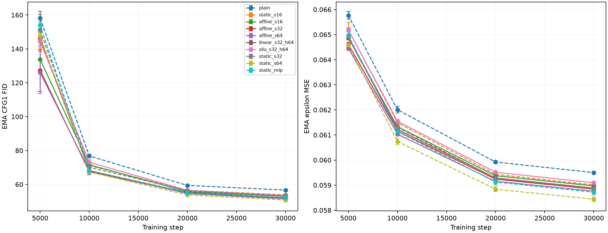
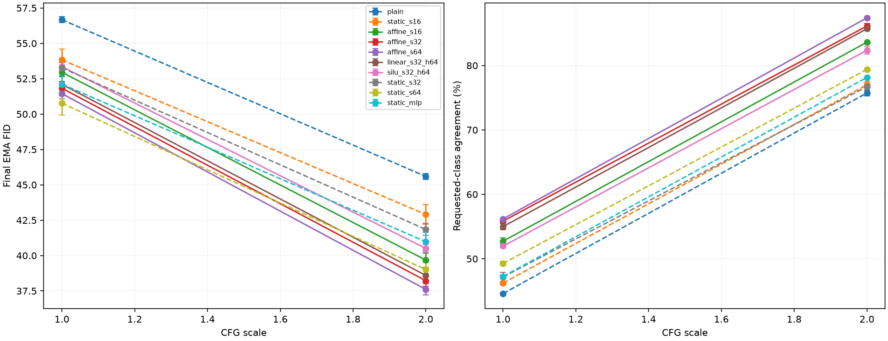
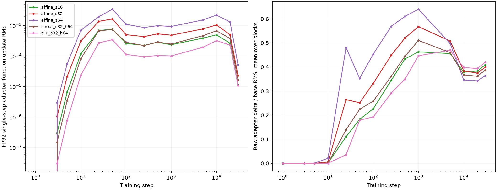

# Higher basis width and linear/SiLU projector comparison

Fourteen new 30k-step runs plus six frozen capacity anchors, paired seeds 86/87. Mean ± sample SD, not confidence intervals.

| Model | Parameters | CFG1 FID | CFG2 FID | CFG2 classifier agreement | Train peak allocated MiB |
|---|---:|---:|---:|---:|---:|
| plain | 9,758,768 | 56.67 ± 0.21 | 45.59 ± 0.20 | 75.74 ± 0.45% | 1521.77 ± 0.00 |
| static_s16 | 11,137,712 | 53.84 ± 0.77 | 42.90 ± 0.69 | 77.01 ± 0.49% | 1645.50 ± 0.09 |
| affine_s16 | 11,135,280 | 52.95 ± 0.31 | 39.68 ± 0.50 | 83.62 ± 0.08% | 1171.37 ± 0.57 |
| affine_s32 | 12,511,792 | 51.83 ± 0.50 | 38.22 ± 0.39 | 86.13 ± 0.41% | 1195.46 ± 0.00 |
| affine_s64 | 15,264,816 | 51.44 ± 0.37 | 37.61 ± 0.38 | 87.40 ± 0.17% | 1246.81 ± 0.97 |
| linear_s32_h64 | 12,545,072 | 52.10 ± 0.56 | 38.59 ± 0.35 | 85.71 ± 0.30% | 1196.18 ± 0.00 |
| silu_s32_h64 | 12,545,072 | 53.35 ± 0.30 | 40.50 ± 0.27 | 82.36 ± 0.57% | 1196.30 ± 0.00 |
| static_s32 | 12,516,656 | 53.27 ± 0.38 | 41.84 ± 0.43 | 76.72 ± 0.57% | 1747.61 ± 0.00 |
| static_s64 | 15,274,544 | 50.77 ± 0.83 | 39.01 ± 0.49 | 79.40 ± 0.14% | 1981.72 ± 0.00 |
| static_mlp | 12,549,488 | 52.11 ± 0.60 | 40.98 ± 0.67 | 78.15 ± 0.13% | 1746.54 ± 0.00 |

Candidate-minus-control paired differences; negative FID and positive agreement favor the candidate.

| Contrast | CFG | FID differences (seeds 86/87) | Agreement differences (pp) |
|---|---:|---|---|
| affine_s32_minus_affine_s16 | 1.0 | -1.70, -0.55 | +3.72, +2.50 |
| affine_s32_minus_affine_s16 | 2.0 | -2.09, -0.83 | +2.74, +2.28 |
| affine_s64_minus_affine_s16 | 1.0 | -1.99, -1.02 | +3.78, +3.14 |
| affine_s64_minus_affine_s16 | 2.0 | -2.70, -1.45 | +3.60, +3.96 |
| affine_s64_minus_affine_s32 | 1.0 | -0.30, -0.47 | +0.06, +0.64 |
| affine_s64_minus_affine_s32 | 2.0 | -0.61, -0.62 | +0.86, +1.68 |
| linear_s32_h64_minus_affine_s32 | 1.0 | +0.23, +0.33 | -1.44, -0.26 |
| linear_s32_h64_minus_affine_s32 | 2.0 | +0.40, +0.35 | -0.92, +0.08 |
| silu_s32_h64_minus_linear_s32_h64 | 1.0 | +1.86, +0.64 | -2.58, -3.48 |
| silu_s32_h64_minus_linear_s32_h64 | 2.0 | +2.35, +1.46 | -2.74, -3.96 |
| affine_s16_minus_static_s16 | 1.0 | -1.20, -0.56 | +5.96, +7.06 |
| affine_s16_minus_static_s16 | 2.0 | -3.36, -3.08 | +6.32, +6.90 |
| affine_s32_minus_static_s32 | 1.0 | -1.53, -1.36 | +8.40, +8.94 |
| affine_s32_minus_static_s32 | 2.0 | -3.60, -3.64 | +9.30, +9.52 |
| affine_s64_minus_static_s64 | 1.0 | +1.00, +0.35 | +7.12, +6.70 |
| affine_s64_minus_static_s64 | 2.0 | -1.33, -1.47 | +7.98, +8.02 |
| linear_s32_h64_minus_static_mlp | 1.0 | +0.02, -0.04 | +7.26, +8.22 |
| linear_s32_h64_minus_static_mlp | 2.0 | -2.16, -2.61 | +7.26, +7.86 |
| silu_s32_h64_minus_static_mlp | 1.0 | +1.88, +0.60 | +4.68, +4.74 |
| silu_s32_h64_minus_static_mlp | 2.0 | +0.20, -1.14 | +4.52, +3.90 |

Optimization profiles in comparison.json contain mean per-block branch ratios, FP32 fixed-condition factor/coefficient magnitudes, and paired single-step function-update ratios versus the s16 anchor. Missing historical coefficient telemetry is omitted. These probes are descriptive, not update calibration or EMA measurements.

All models use width256/depth8, rank8, Adam beta1=.9, LR4e-4, 30k cosine schedule, batch128, compiled BF16/fused training, EMA.999, class dropout.1. Final EMA CFG1/2 share weights and initial noise. DPLR keeps independent layer heads, normalized adapter input, zero V bases, gain1/sqrt(8), multiplier1. Linear/SiLU heads use s32/h64 and identical initial parameter tensors. The linear hidden width64 can represent any affine256-to64 coefficient map; it is a factorization/optimization control, not a stricter rank bottleneck. SiLU changes activation magnitude as well as function class.

Limits: Two paired seeds and one held-out split; sample SD is not a confidence interval. Static MLP controls match each DPLR budget within0.065%, not FLOPs, activation shapes or identical initialization. DPLR families share base initialization; linear/SiLU pair has identical initial parameter tensors. Data/noise/effective-label traces are paired. LR, adapter gain1/sqrt(8), and rate multiplier1 are held fixed; basis width and nonlinearity can change effective gain. Magnitudes/update ratios are descriptive, not calibrated. Six reused anchor runs are from the prior capacity cohort; training/model sources match, diagnostics add only magnitude telemetry. Intermediate quality uses CFG1; final scales1/2 share one EMA state and initial-noise seed. 5k-image held-out-train FID is not published50k-image FID; classifier agreement is an auxiliary proxy. Compiled concurrent training is not an isolated speed benchmark. Thirty thousand steps do not establish convergence or saturation.

[Comparison](dit-projector-confirmation.json) · [Evidence](dit-projector-confirmation-evidence.json) · [Audit](dit-projector-confirmation-audit.json) · [Protocol](dit-projector-confirmation-protocol.json)

## Interpretation

Increasing affine basis count improves both CFG2 FID and classifier agreement
in both paired seeds. Moving s16 to s32 reduces mean FID by1.46; moving s32
to s64 reduces it by another0.62, while adding2.75M parameters. Affine s32
is a useful working tradeoff pending the rate controls. The generated u/v
factor shapes remain fixed because transform rank is still8; additional
parameters largely reside in learned bases. The s32 coefficient head has
131,584 parameters across eight layers, about1.05% of the12.51M total.

Against parameter-matched static MLPs, s32 improves CFG2 FID by3.62 and
agreement by9.41 percentage points; s64 improves them by1.40 and8.00 points.
Both contrasts favor DPLR in both seeds. At CFG1, however, s64 has worse FID
than its static control (51.44 versus50.77), also in both seeds, while retaining
higher classifier agreement. The larger-budget advantage depends on sampling
and metric; it is not a universal win over static capacity.

The hidden-linear head trails affine s32 by0.37 mean guided FID. SiLU trails
its matched hidden-linear head by1.91 FID and3.35 agreement points, with both
metrics worse in both seeds at CFG1 and CFG2. This rejects a simple quality
advantage for this nonlinear recipe at its current gain/rate, not nonlinear
projectors in general. SiLU's guided FID contrast against its static control
has mixed signs across seeds, so its slight mean advantage there is not a
consistent paired FID win.

Optimization diagnostics substantiate a scale difference: at step500, s32
function updates are1.75–2.08 times the s16 anchor; s64 updates are3.03–4.14
times the anchor. SiLU updates are0.34–0.39 times its matched linear control.
These FP32 fixed-input raw-model probes are combined-function measurements;
individual factor/coefficient magnitudes are also affected by learned basis
gauges. Rates and transform gain were deliberately fixed. The quality results
therefore compare expressivity, parameterization and effective update scale
together. The observed association does not establish gain as the sole cause.

Broadcast conditioning makes higher s modest in forward-compute cost here:
estimated forward matmul FLOPs/image are862.1M/864.8M/870.3M at s16/32/64.
The s32 measured training peak allocation is1,195MiB versus1,748MiB for its
matched static MLP; s64 is1,247MiB versus1,982MiB. These whole-training peaks
include model/EMA/optimizer/activations/diagnostic inputs, not isolated factor
storage. The FLOP ledger omits backward and non-matmul work. Concurrent compiled
training establishes neither isolated speed nor per-token-conditioning memory.

The parent controller and workers are closed. The queued adapter-LR study
has begun its bounded22-pilot phase after this successful audit. Separate pilot
seeds90/91 select rates solely from paired function-update ratios. Six new30k
runs on the reused quality seeds86/87 proceed only if calibration guards pass;
quality-seed update transfer is retained as evidence. Transform gain and base
LR stay fixed. No checkpoints or final model weights are saved in either study.

These remain two-seed experiments with finite5k-image held-out FID and a fixed
auxiliary classifier. Agreement is a proxy, not human-rated image quality.
The s16 anchors were executed in the prior audited cohort. No significance,
convergence saturation or sequence-conditioning comparison is established.
