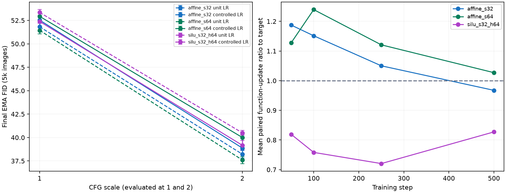

# Projector adapter-LR controls

Two paired quality seeds; means and sample SDs are exploratory estimates. Rate selection uses separate pilot seeds and function updates only.

| Recipe | Adapter LR multiplier | CFG | FID | Unit-rate FID | Paired FID change | Classifier agreement |
|---|---:|---:|---:|---:|---:|---:|
| affine_s32 | 0.5 | 1.0 | 52.54 ± 0.35 | 51.83 | +0.71 | 52.88% |
| affine_s32 | 0.5 | 2.0 | 38.88 ± 0.18 | 38.22 | +0.66 | 84.76% |
| affine_s64 | 0.25 | 1.0 | 52.94 ± 0.00 | 51.44 | +1.49 | 53.05% |
| affine_s64 | 0.25 | 2.0 | 40.01 ± 0.33 | 37.61 | +2.40 | 83.79% |
| silu_s32_h64 | 2.0 | 1.0 | 52.39 ± 0.21 | 53.35 | -0.96 | 53.82% |
| silu_s32_h64 | 2.0 | 2.0 | 39.17 ± 0.51 | 40.50 | -1.33 | 83.91% |

Quality-seed early update ratios are included in comparison.json; pilot matching does not imply successful transfer. Keep these with the rate and quality comparisons.

Limits: Quality seeds86/87 and evaluation split are reused for paired rate contrasts; this is an exploratory follow-up, not an independent generalization estimate. Calibration seeds90/91 are separate; rates are frozen before new quality runs and never selected using FID, agreement or loss. Function updates are FP32 raw-model fixed-input probes; matching is approximate and path/optimizer dependent, not a muP derivation. Quality-seed update transfer is measured and reported; a pilot match does not establish matching throughout training. Only adapter LR changes; base LR, gain, initialization, model/data/sampling recipe and 30k schedule remain fixed. Final CFG1/2 share one EMA state/noise; 5k-image held-out FID and classifier agreement remain pilot proxies.

[Comparison](dit-projector-lr.json) · [Calibration](dit-projector-lr-calibration.json) · [Frozen recipes](dit-projector-lr-recipes.json) · [Evidence](dit-projector-lr-evidence.json) · [Audit](dit-projector-lr-audit.json)

## Interpretation

The fixed pilot grid passed: affine s32 selected adapter LR multiplier0.5, affine s64 selected0.25 and SiLU selected2.0. Geometric mean update ratios on separate seeds90/91 were1.146,1.126 and0.756; this is approximate matching rather than equality. Selection never read loss, FID or classifier agreement.

On paired quality seeds86/87, controlled rates worsened affine s32 CFG2 FID by0.66 and affine s64 by2.40; increasing SiLU rate improved it by1.33. Each rate-effect FID direction held in both seeds and both evaluated CFG scales. SiLU at rate2 still trails hidden linear at rate1 (39.17 vs38.59 mean CFG2 FID), with paired FID differences +0.471, +0.689 (seeds86/87). These observations show sensitivity to adapter optimization but do not establish that update matching optimizes quality or isolate expressivity causally.

Quality-seed early update ratios transferred within the declared per-observation bounds: affine s32 ranged0.912–1.453, affine s64 0.892–1.363, SiLU0.690–0.925. This checks the early observation window, not matching over the full trajectory. The unchanged unit-rate affine s32 remains the leading parameter tradeoff for a fresh-seed longer comparison; unit-rate affine s64 retains the lowest30k CFG2 FID at higher parameter cost.

Both stages and the private queue controller closed successfully. The audit records two-GPU compliance, frozen sources/evaluators, paired initialization/streams, correct update-only selection, no saved weights and1.40GiB retained evidence/cache within the4GiB study bound.
