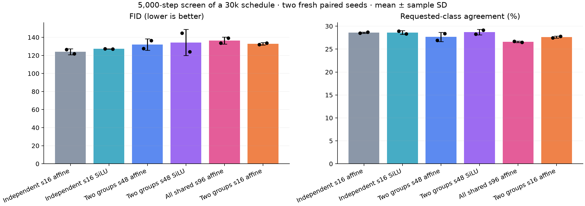
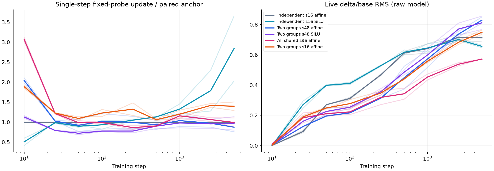

# Shared and nonlinear factor-projector screen

Two fresh paired screen seeds (67/68), 5,000 steps of the 30k schedule. Values are mean ± sample SD, not confidence intervals. Independent update-only calibration uses seeds 65/66; recipes freeze before quality training. This is a short screen, not longer confirmation.

| Recipe | Adapter / total parameters | Groups | s | LR multiplier | FID ↓ | Agreement ↑ |
| --- | ---: | ---: | ---: | ---: | ---: | ---: |
| Independent s16 affine | 774,336 / 4,954,032 | 6 | 16 | 1.000000 | 124.12 ± 3.34 | 28.58 ± 0.14% |
| Independent s16 SiLU | 774,336 / 4,954,032 | 6 | 16 | 3.038430 | 127.22 ± 0.19 | 28.62 ± 0.42% |
| Two groups s48 affine | 774,336 / 4,954,032 | 2 | 48 | 0.353904 | 131.96 ± 6.33 | 27.65 ± 1.00% |
| Two groups s48 SiLU | 774,336 / 4,954,032 | 2 | 48 | 0.953765 | 134.34 ± 14.56 | 28.71 ± 0.61% |
| All shared s96 affine | 774,336 / 4,954,032 | 1 | 96 | 0.214559 | 136.49 ± 3.91 | 26.59 ± 0.18% |
| Two groups s16 affine | 258,112 / 4,437,808 | 2 | 16 | 1.319520 | 132.89 ± 1.29 | 27.62 ± 0.23% |

The first five recipes have exactly equal parameter counts; two-group s16 is a fixed-width tying control. Rank is eight throughout, with fixed gain 1/sqrt(8). Direct SiLU changes coefficient dependence without adding parameters or widening the factor decoder span. Base width192/depth6/heads3/patch4, non-affine AdaLN-Zero, normalized adapter input, broadcast class/time and self-attention remain common.

Shared factors are generated once per group per forward and reused across its contiguous layers. Parameters, optimizer groups and gradient records count unique tensors; branch observations remain layer-specific. Identical conditions tie each group’s conditional transform. At equal affine budget G*s is fixed, so fewer groups do not imply fewer leading generation FLOPs.

## Update selection and magnitude

Calibration uses the full 45k loader and a 500-step prefix of the 30k schedule. Highest-FP32 single-step adapter function-update RMS is averaged over six layer probes, steps50/100/250/500 and both seeds. Shared layer probes repeat the same function within a group and thus weight groups by their layer counts. One rate response is always verified for non-anchor families, followed by at most two further corrections when needed; multipliers are bounded to [1/16,16]. Selection minimizes absolute log(update/target), excludes quality, and requires the selected aggregate within ±15%.

| Recipe | Calibration update / target | Fresh early update / anchor | Final update / anchor | Live delta/base | Fixed transform Frobenius | Peak MiB |
| --- | ---: | ---: | ---: | ---: | ---: | ---: |
| Independent s16 affine | 1.000 | 1.000 ± 0.000 | 1.000 ± 0.000 | 0.712 ± 0.038 | 2.443 ± 0.306 | 620.2 ± 0.0 |
| Independent s16 SiLU | 1.095 | 0.962 ± 0.011 | 2.839 ± 1.148 | 0.656 ± 0.012 | 4.368 ± 2.055 | 620.2 ± 0.0 |
| Two groups s48 affine | 1.114 | 0.952 ± 0.218 | 0.872 ± 0.164 | 0.829 ± 0.029 | 2.583 ± 0.086 | 616.1 ± 0.0 |
| Two groups s48 SiLU | 0.971 | 0.768 ± 0.052 | 0.966 ± 0.236 | 0.812 ± 0.063 | 2.326 ± 0.075 | 616.2 ± 0.0 |
| All shared s96 affine | 1.053 | 0.956 ± 0.049 | 0.990 ± 0.161 | 0.572 ± 0.003 | 2.835 ± 0.151 | 615.3 ± 0.0 |
| Two groups s16 affine | 0.957 | 1.144 ± 0.040 | 1.396 ± 0.150 | 0.749 ± 0.020 | 2.985 ± 0.209 | 606.1 ± 0.0 |

Fresh early ratios outside calibration tolerance: Two groups s48 affine seed 67: 0.798×; Two groups s48 SiLU seed 67: 0.731×; Two groups s48 SiLU seed 68: 0.805×; Two groups s16 affine seed 68: 1.173×. Recipes were not retuned.

Fixed-probe updates measure one optimizer step on the raw model. Transform Frobenius values average fixed-condition generated transforms across samples and unique projector groups, including fixed gain; their input/output factor norms are retained per group in full evidence. Live ratios average six layer branches on eight fixed held-out images. EMA quality is a different state. These diagnostics do not prove a gauge cause or variance preservation. Whole-training peaks include EMA, gradients, optimizer, activations and fixed probes; diagnostic forwards and final FID are excluded.

## Paired differences

Variant minus control, in seed order67/68. Negative FID and positive agreement favor the variant.

| Comparison | FID differences | Agreement differences (pp) |
| --- | --- | --- |
| Independent s16 SiLU vs Independent s16 affine | +0.87, +5.32 | +0.44, -0.36 |
| Two groups s48 SiLU vs Two groups s48 affine | +17.15, -12.40 | +1.34, +0.78 |
| Two groups s48 affine vs Independent s16 affine | +1.00, +14.67 | -1.54, -0.32 |
| All shared s96 affine vs Independent s16 affine | +7.24, +17.49 | -1.76, -2.22 |
| Two groups s16 affine vs Independent s16 affine | +5.50, +12.04 | -1.02, -0.90 |
| Two groups s48 affine vs Two groups s16 affine | -4.49, +2.63 | -0.52, +0.58 |

## Protocol and limits

Full45k/5k CIFAR-10 split123, baseLR4e-4, warmup50, cosinefloor.01 over30k, AdamW(.9,.999), weightdecay0, clip1, BF16, in-memory EMA.999. Final EMA evaluation uses5k real/generated images, DDIM50, noCFG, sampling seed2028 and the unchanged frozen classifier. No official-test evaluation.

- Two-seed 5k quality screen, not longer confirmation or statistical significance.
- Independent affine/silu s16, two-group affine/silu s48, and all-shared affine s96 have equal adapter and total parameter counts.
- Two-group affine s16 is a fixed-width tying control; the full sharing/width/nonlinearity factorial is not tested.
- One shared module per group; unique parameters and per-layer diagnostics are separately audited.
- The same broadcast condition ties the conditional transform within each group, while base blocks and AdaLN/gates remain independent.
- At equal affine budget G*s is fixed; lower group count does not establish lower total generation FLOPs or speed.
- Rates are selected only on aggregate early function updates, not loss or generated quality; matching may drift across seeds/layers/time.
- Calibration seeds 65/66 and screen seeds 67/68 are fresh relative to previous quality studies.
- FID uses 5k images and a fixed sampling seed; classifier agreement is a frozen proxy.
- Raw-model diagnostics and EMA quality concern different states; fixed-probe operator Frobenius norms do not establish variance preservation.
- No output normalization, larger MLP/trunk, layer embeddings, partial decoder sharing, new ViT/LM/retrieval or structured operators are tested.
- Concurrent eager training is not isolated timing or an equal-time comparison; dedicated speed work stays deferred.
- No automatic longer confirmation is launched by this screen.

Calibration loops 0.138, screen loops 0.697, final evaluations 0.114 aggregate GPU-hours; startup and compatibility smoke additional. Raw evidence at audit 50.7MiB under512MiB. All private supervisors are closed and GPU claims released. No model/evaluator weights, checkpoints, grids or generated datasets saved.

[Structured results](dit-projector-screen.json) · [Full evidence](dit-projector-screen-evidence.json) · [Audit](dit-projector-screen-audit.json) · [Design notes](../DESIGN_NOTES.md)
