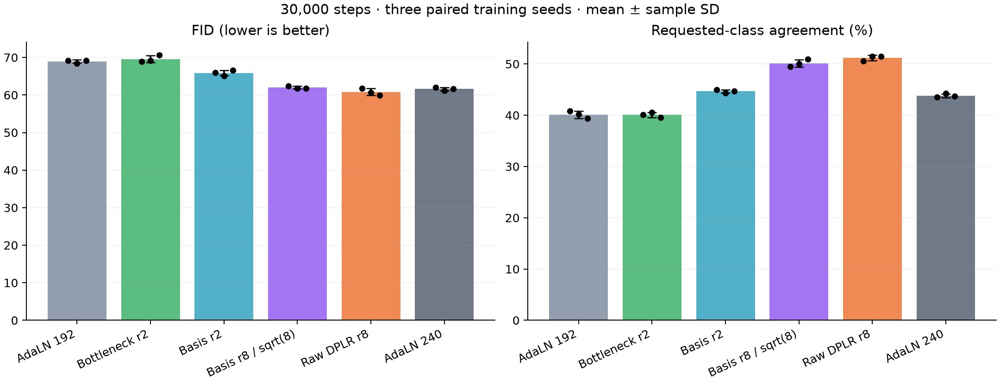
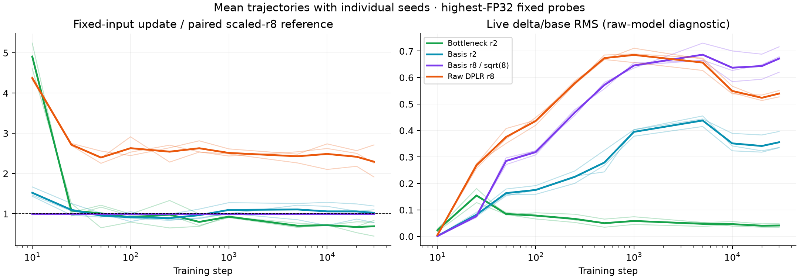

# Full-loader calibrated rank-2 diffusion confirmation

Three paired training seeds (50/51/52), 30,000 steps each. All values below are mean ± sample standard deviation, not confidence intervals.

| Variant | Parameters | Added adapter params | FID ↓ | Class agreement ↑ | EMA noise MSE | Train images/s |
|---|---:|---:|---:|---:|---:|---:|
| AdaLN 192 | 4,179,696 | 0 | 68.94 ± 0.42 | 40.11 ± 0.73% | 0.06145 ± 0.00007 | 3623 ± 131 |
| Bottleneck r2 | 4,193,532 | 13,836 | 69.55 ± 0.91 | 40.06 ± 0.53% | 0.06149 ± 0.00012 | 3083 ± 81 |
| Basis r2 | 4,401,072 | 221,376 | 65.89 ± 0.73 | 44.67 ± 0.32% | 0.06120 ± 0.00008 | 2967 ± 48 |
| Basis r8 / sqrt(8) | 4,954,032 | 774,336 | 61.99 ± 0.33 | 50.15 ± 0.72% | 0.06068 ± 0.00005 | 2978 ± 136 |
| Raw DPLR r8 | 4,954,032 | 774,336 | 60.81 ± 0.91 | 51.17 ± 0.54% | 0.06053 ± 0.00010 | 3015 ± 110 |
| AdaLN 240 | 6,503,328 | 0 | 61.59 ± 0.43 | 43.81 ± 0.36% | 0.06035 ± 0.00004 | 3758 ± 32 |



| Variant | Whole-training peak allocated MiB |
|---|---:|
| AdaLN 192 | 574.3 ± 0.0 |
| Bottleneck r2 | 596.1 ± 0.0 |
| Basis r2 | 602.0 ± 0.0 |
| Basis r8 / sqrt(8) | 620.2 ± 0.0 |
| Raw DPLR r8 | 620.2 ± 0.0 |
| AdaLN 240 | 753.9 ± 0.0 |

Peaks include the model, in-memory EMA, gradients, optimizer, training activations and resident fixed diagnostic inputs. Diagnostic forwards and final FID evaluation are excluded. These are whole-trainer peaks, not generated-factor storage or standalone-layer activation memory. Timing is concurrent eager training on the shared machine.

Calibration used the actual 45,000-example training loader on seeds 48/49 and a 500-step prefix of the 30,000-step schedule. Fixed gains are `1/sqrt(rank)` for scaled adapters; raw r8 retains gain 1. The metric averages highest-FP32 independent-input transform-update RMS over all six blocks, steps 50/100/250/500 and both seeds. The declared ±25% tolerance was met on the first attempt: basis r2 0.964×, bottleneck r2 1.034×. Both global adapter LR multipliers remain 1. No loss, validation or generated quality entered selection. Rates were frozen before confirmation.

| Adapter | Early update / paired r8 | Final update / paired r8 | Final live delta/base RMS | Final combined/base RMS | Base–delta correlation |
|---|---:|---:|---:|---:|---:|
| Bottleneck r2 | 0.955 ± 0.239 | 0.689 ± 0.213 | 0.041 ± 0.007 | 1.001 ± 0.001 | 0.004 ± 0.004 |
| Basis r2 | 0.935 ± 0.037 | 1.025 ± 0.215 | 0.356 ± 0.035 | 1.139 ± 0.026 | 0.100 ± 0.021 |
| Basis r8 / sqrt(8) | 1.000 ± 0.000 | 1.000 ± 0.000 | 0.672 ± 0.048 | 1.367 ± 0.028 | 0.179 ± 0.004 |
| Raw DPLR r8 | 2.503 ± 0.084 | 2.295 ± 0.400 | 0.540 ± 0.012 | 1.266 ± 0.004 | 0.173 ± 0.021 |

Fresh-seed early matches outside the declared calibration tolerance: Bottleneck r2 seed 50: 0.690×. Confirmation rates were not adjusted in response.



Raw-model transform diagnostics and EMA quality measure different states. Calibration matches a scalar aggregate, not every block, seed or later update. The live RMS ratios describe the additive MLP-input branch; they are not variance-preservation guarantees. `combined/base` measures `rms(base + delta) / rms(base)` before GELU; the centered base–delta correlation helps distinguish reinforcing and cancelling contributions. These are averages over six blocks and a fixed eight-image diagnostic batch, not whole-dataset moments.

Paired differences are variant minus control, in training-seed order 50/51/52. Negative FID differences favor the variant; positive agreement differences favor it.

| Variant vs control | FID differences | Agreement differences (pp) |
|---|---|---|
| Bottleneck r2 vs AdaLN 192 | -0.24, +0.68, +1.37 | -0.74, +0.42, +0.16 |
| Bottleneck r2 vs AdaLN 240 | +6.92, +8.01, +8.94 | -3.44, -3.64, -4.18 |
| Bottleneck r2 vs Basis r8 / sqrt(8) | +6.54, +7.38, +8.76 | -9.42, -9.44, -11.40 |
| Bottleneck r2 vs Raw DPLR r8 | +7.15, +8.42, +10.65 | -10.46, -10.92, -11.94 |
| Basis r2 vs AdaLN 192 | -3.25, -3.31, -2.60 | +4.14, +4.16, +5.36 |
| Basis r2 vs AdaLN 240 | +3.92, +4.02, +4.96 | +1.44, +0.10, +1.02 |
| Basis r2 vs Basis r8 / sqrt(8) | +3.53, +3.38, +4.78 | -4.54, -5.70, -6.20 |
| Basis r2 vs Raw DPLR r8 | +4.15, +4.43, +6.67 | -5.58, -7.18, -6.74 |
| Basis r8 / sqrt(8) vs AdaLN 192 | -6.78, -6.69, -7.39 | +8.68, +9.86, +11.56 |
| Basis r8 / sqrt(8) vs AdaLN 240 | +0.38, +0.63, +0.18 | +5.98, +5.80, +7.22 |
| Raw DPLR r8 vs AdaLN 192 | -7.40, -7.74, -9.28 | +9.72, +11.34, +12.10 |
| Raw DPLR r8 vs AdaLN 240 | -0.23, -0.41, -1.71 | +7.02, +7.28, +7.76 |

The recipe uses pixel-space epsilon prediction, width 192/depth 6/3 heads/patch 4 (64 tokens), class/time broadcast conditions, base LR 4e-4, warmup 50, AdamW (.9,.999), no weight decay, clipping 1, cosine floor .01, BF16 training and in-memory EMA .999. AdaLN-240 widens only the base. FID uses 5,000 held-out real and 5,000 generated images, 50-step DDIM without CFG, sampling seed 2028. Requested-class agreement uses the existing frozen FP32 classifier, with 500 examples per requested class; real held-out classifier accuracy is 80.72%.

Training/validation/diagnostic loops used 6.044 aggregate GPU-hours; final generation/evaluation used 0.168. Calibration and startup are additional. Raw evidence is 39.8 MiB. Workers are managed with private supervisors and shared lifetime claims, at most six concurrent workers. No new weights/checkpoints, generated image datasets or official-test evaluations were saved/performed.

The independent audit recomputes calibration proposals/selection, frozen rates and source hashes, actual recorded schedules, full disjoint splits and counts, paired initializations and observed batch/noise digests, final noise RNG states, zero starts and gradient wake-up, evaluator hashes and denominators, finite results and successful exits. Observed diagnostic digests do not hash every training image.

Limits: Calibration matches a scalar aggregate; individual seeds, blocks and later updates can drift. Three training seeds and one held-out split; sample SD is not a confidence interval. Finite 5,000-image FID; one fixed sampling seed; auxiliary classifier agreement is a proxy. Rates are update-selected, not quality-optimized; gains are empirical choices, not a variance-preservation or muP guarantee. Concurrent throughput is not an isolated speed comparison; equal steps are not equal wall-clock budgets. Warmup 50 differs from the earlier 30k study's warmup 500; only current controls are recipe-matched. Broadcast class/time conditioning only; sequence-valued cross-attention remains untested. The controls use base width 192 and larger width 240; there is no exact parameter-matched FFN or static-adapter control in this study, so added capacity and conditioning are not isolated.

[Structured comparison](dit-rank2-confirmation.json) · [Complete evidence](dit-rank2-confirmation-evidence.json) · [Audit](dit-rank2-confirmation-audit.json)

Raw workflow: `/workspace/adalora/runs/dit-rank2-20261008T010252Z`.

```bash
/venv/main/bin/python dit_rank2_confirmation.py prepare --launch
/venv/main/bin/python audit_dit_rank2.py runs/dit-rank2-YYYYMMDDTHHMMSSZ
/venv/main/bin/python summarize_dit_rank2.py runs/dit-rank2-YYYYMMDDTHHMMSSZ
```
