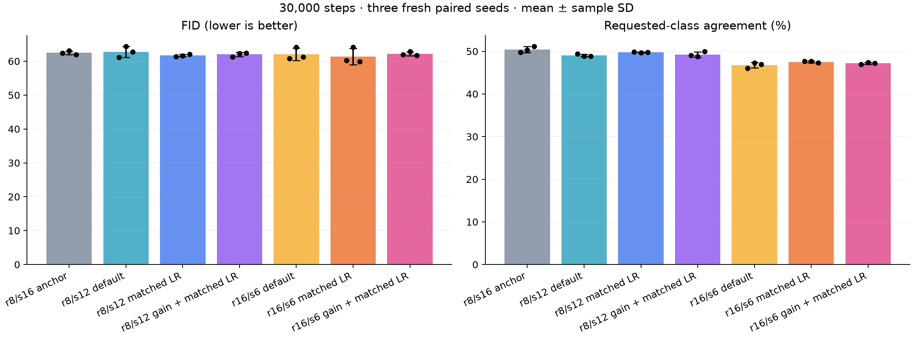
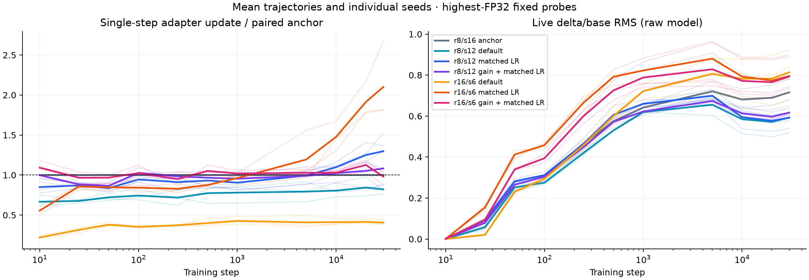

# Gain and LR sensitivity for narrower conditional generators

Three fresh paired training seeds (62/63/64), 30,000 steps per recipe. Values are mean ± sample SD, not confidence intervals.

Two gain parameterizations are tested for each selected rank/width. The default is 1/sqrt(r); the alternate multiplies it by 16/s. This is an empirical width-compensation heuristic. Default-rate controls use adapter LR multiplier 1. The matched-rate recipes use independent calibration seeds 60/61, with rates selected only from function updates.

| Recipe | Adapter parameters | Gain | Adapter LR multiplier | FID ↓ | Agreement ↑ | EMA noise MSE |
| --- | ---: | ---: | ---: | ---: | ---: | ---: |
| r8/s16 anchor | 774,336 | 0.353553 | 1.000000 | 62.48 ± 0.55 | 50.43 ± 0.71% | 0.06071 ± 0.00006 |
| r8/s12 default | 580,752 | 0.353553 | 1.000000 | 62.75 ± 1.65 | 49.05 ± 0.31% | 0.06072 ± 0.00009 |
| r8/s12 matched LR | 580,752 | 0.353553 | 1.273942 | 61.68 ± 0.35 | 49.77 ± 0.06% | 0.06058 ± 0.00005 |
| r8/s12 gain + matched LR | 580,752 | 0.471405 | 0.983142 | 62.01 ± 0.64 | 49.25 ± 0.66% | 0.06063 ± 0.00004 |
| r16/s6 default | 566,856 | 0.250000 | 1.000000 | 62.05 ± 1.79 | 46.77 ± 0.66% | 0.06061 ± 0.00011 |
| r16/s6 matched LR | 566,856 | 0.250000 | 2.513860 | 61.38 ± 2.38 | 47.52 ± 0.21% | 0.06051 ± 0.00023 |
| r16/s6 gain + matched LR | 566,856 | 0.666667 | 1.130930 | 62.16 ± 0.61 | 47.19 ± 0.21% | 0.06055 ± 0.00009 |

All recipes use width 192/depth 6/three heads/patch 4, identical base initialization per seed, non-affine pre-norm/AdaLN-Zero and the normalized adapter input. Gain/rate recipes of one rank/width also share adapter initialization and parameter count. r8/s12 and r16/s6 have the same dominant decoder weight budget (r*s=96), with different encoder/bias costs. The existing class/time condition is broadcast; self-attention is retained.

## Calibration and drift

The independent metric averages highest-FP32 single-step adapter-delta updates across six blocks, steps 50/100/250/500 and two seeds on the full 45k loader. Calibration runs a 500-step prefix of the exact 30k schedule. One correction is always verified for each non-anchor family, then at most two further corrections if its most recent candidate misses ±15%. Selection minimizes absolute log(update/target) among observed rates, with no quality metrics. Recipes freeze before confirmation.

| Recipe | Selected multiplier | Calibration update / target | Selected attempt |
| --- | ---: | ---: | ---: |
| r8/s16 anchor | 1.000000 | 1.000 | 0 |
| r8/s12 matched LR | 1.273942 | 0.942 | 1 |
| r8/s12 gain + matched LR | 0.983142 | 1.013 | 1 |
| r16/s6 matched LR | 2.513860 | 0.879 | 1 |
| r16/s6 gain + matched LR | 1.130930 | 1.009 | 1 |

| Recipe | Early update / paired anchor | Final update / paired anchor | Final live delta/base | Whole-training peak MiB |
| --- | ---: | ---: | ---: | ---: |
| r8/s16 anchor | 1.000 ± 0.000 | 1.000 ± 0.000 | 0.716 ± 0.067 | 620.2 ± 0.0 |
| r8/s12 default | 0.733 ± 0.023 | 0.821 ± 0.062 | 0.593 ± 0.082 | 616.8 ± 0.0 |
| r8/s12 matched LR | 0.885 ± 0.037 | 1.298 ± 0.266 | 0.592 ± 0.046 | 616.8 ± 0.0 |
| r8/s12 gain + matched LR | 0.933 ± 0.012 | 1.083 ± 0.210 | 0.617 ± 0.018 | 616.8 ± 0.0 |
| r16/s6 default | 0.377 ± 0.014 | 0.406 ± 0.039 | 0.813 ± 0.124 | 625.5 ± 0.0 |
| r16/s6 matched LR | 0.847 ± 0.017 | 2.100 ± 0.495 | 0.796 ± 0.088 | 625.5 ± 0.0 |
| r16/s6 gain + matched LR | 0.990 ± 0.039 | 0.981 ± 0.087 | 0.793 ± 0.092 | 625.5 ± 0.0 |

Fresh-seed early ratios outside the calibration tolerance: r8/s12 matched LR seed 64: 0.847×; r16/s6 matched LR seed 62: 0.833×; r16/s6 matched LR seed 64: 0.841×. Rates were not changed in response.

Fixed probes measure only the raw-model adapter delta at independent normalized inputs/conditions, not the entire-network update. Live branch ratios use eight fixed held-out images averaged across blocks. EMA quality measures a different state. Scalar matching does not fix gauges or ensure matched later updates, per-block behavior or variance preservation. Whole-training peaks include model, EMA, gradients, optimizer, activations and fixed diagnostic buffers; diagnostic forwards and final FID are excluded.

## Paired comparisons

Differences are variant minus control in seed order 62/63/64. Negative FID and positive agreement favor the variant.

| Variant versus control | FID differences | Agreement differences (pp) |
| --- | --- | --- |
| r8/s12 matched LR vs r8/s12 default | +0.26, -2.76, -0.70 | +0.44, +0.84, +0.90 |
| r8/s12 gain + matched LR vs r8/s12 matched LR | -0.08, +0.69, +0.38 | -0.82, -0.98, +0.24 |
| r16/s6 matched LR vs r16/s6 default | -0.58, +0.02, -1.45 | +1.60, +0.32, +0.32 |
| r16/s6 gain + matched LR vs r16/s6 matched LR | +1.77, -1.28, +1.85 | -0.66, -0.24, -0.10 |
| r8/s12 default vs r8/s16 anchor | -1.30, +1.32, +0.78 | -0.38, -1.44, -2.32 |
| r8/s12 matched LR vs r8/s16 anchor | -1.05, -1.43, +0.08 | +0.06, -0.60, -1.42 |
| r8/s12 gain + matched LR vs r8/s16 anchor | -1.12, -0.74, +0.47 | -0.76, -1.58, -1.18 |
| r16/s6 default vs r8/s16 anchor | -1.63, +1.03, -0.69 | -3.74, -3.00, -4.22 |
| r16/s6 matched LR vs r8/s16 anchor | -2.22, +1.05, -2.14 | -2.14, -2.68, -3.90 |
| r16/s6 gain + matched LR vs r8/s16 anchor | -0.44, -0.22, -0.29 | -2.80, -2.92, -4.00 |

## Protocol and limits

Pixel-space epsilon prediction, full 45k/5k CIFAR-10 split, base LR 4e-4, warmup 50, cosine floor .01, AdamW (.9,.999), zero weight decay, clipping 1, BF16, in-memory EMA .999. Each final evaluation uses 5,000 real and generated images, DDIM50 without CFG, sampling seed 2028 and the unchanged frozen auxiliary classifier. No test evaluation or saved model weights.

- One alternate gain per shape; this is targeted sensitivity, not exhaustive hyperparameter optimization.
- Gain times 16/s is an empirical compensation heuristic, not a variance-preservation or muP derivation.
- The rate changes every adapter parameter group; gain also changes function scaling. These are different optimization parameterizations.
- Matching scalar early update RMS does not match every seed/block, later update, live magnitude or entire-network update.
- Calibration seeds 60/61 and confirmation seeds 62/63/64 are independent of previous screens; no quality-based recipe selection.
- Default-rate controls keep LR multiplier 1; calibrated gains/rates freeze before any quality run and never retune on quality.
- All equal-shape models share base initialization; gain/rate variants of one rank/width share adapter initialization.
- r8/s12 and r16/s6 approximately match decoder budget, but encoder/bias totals and training memory differ.
- Three training seeds, one held-out split and sampling seed; sample SD is not a confidence interval.
- FID uses 5,000 real/generated images and class agreement uses the existing frozen auxiliary classifier.
- Concurrent eager training is not an isolated speed or equal-time quality comparison.
- Broadcast class/time only; no new ViT/LM, cross-attention, sequence retrieval or structured-operator experiments.

Calibration loops: 0.121 aggregate GPU-hours; confirmation loops: 7.552; final evaluation: 0.212; startup additional. All private supervisors are closed and workflow GPU claims released. Raw evidence audited before export: 58.1 MiB under 512 MiB. No checkpoints, model/evaluator weights, image grids or generated datasets saved. Dedicated speed benchmarks stay deferred.

[Structured results](dit-width-calibration.json) · [Full evidence](dit-width-calibration-evidence.json) · [Audit](dit-width-calibration-audit.json) · [Design notes](../DESIGN_NOTES.md)
