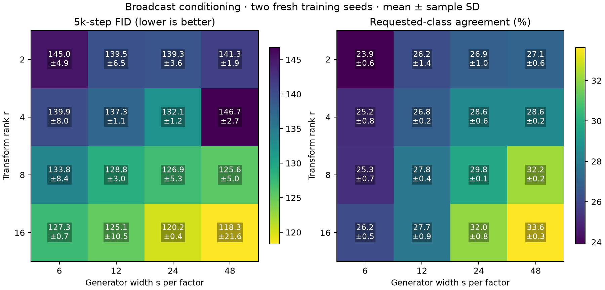
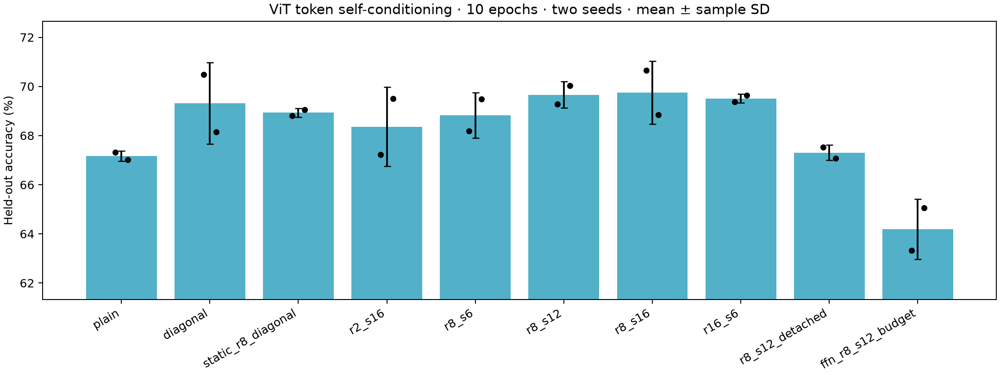

# Rank/width trend screen and token-conditioned ViT pilot

Two fresh paired seeds (58/59), one held-out train split. Values are mean ± sample SD, not confidence intervals. These short screens require longer fresh-seed confirmation.

## Observed trends

On the similar decoder-budget contour r*s=96, ranks 2/4/8/16 give FID 141.28 ± 1.90 / 132.10 ± 1.22 / 128.78 ± 3.00 / 127.27 ± 0.66. Requested-class agreement is 27.05 ± 0.61% / 28.55 ± 0.58% / 27.76 ± 0.42% / 26.16 ± 0.48%. Higher rank improves mean FID along this contour; class agreement favors the middle ranks. Encoder/bias budgets still differ, and gain/update scaling is not matched.

At rank 8, widths 6/12/16 give FID 133.82 ± 8.37 / 128.78 ± 3.00 / 126.18 ± 0.55; widths 24/48 give 126.94 ± 5.25 / 125.55 ± 5.01. Width beyond 16 does not give a steady FID improvement here. Other ranks also do not support a universal monotonic width rule.

Rank-16/s24 gives FID 120.19 ± 0.38 with 2,267,424 added parameters. Doubling width to 48 gives 118.28 ± 21.56 and 4,534,848 added parameters; its substantially larger seed spread weakens a mean-only preference. This is a short-screen observation, not longer-budget confirmation.

In ViT, rank-8/s16 gives 69.75 ± 1.29% versus diagonal conditioning 69.31 ± 1.65%. Its paired accuracy gains are +0.18/+0.70 percentage points, averaging +0.44, for 774,336 additional parameters and 92.5 MiB more reported training allocation. The small advantage needs longer fresh-seed confirmation.

Keeping gradients through c=h at rank-8/s12 improves accuracy over detached conditioning by +1.76/+2.96 percentage points (mean +2.36). This supports the full-gradient default within this recipe; it does not show that dynamic factors replace attention or universally beat diagonal conditioning.

Optimization remains a substantial confound: at diffusion rank 8, early fixed-input updates for s=6/48 are 0.423 ± 0.021 / 2.794 ± 0.007 of the paired s16 reference despite the common rank gain and learning rate. Rank-16/s48 ends with a live delta/base ratio 1.056 ± 0.055. Zero-delta initialization and 1/sqrt(r) do not imply matched updates or variance preservation.

The FFN controls underperform their plain/AdaLN baselines at these short budgets under the fixed common recipe. They have different hidden shapes and initialization. Their comparisons help describe this recipe but do not establish superiority over fully optimized ordinary capacity. The diffusion AdaLN baseline also has large two-seed FID spread, and these 5k-step results must not be pooled with the earlier 30k confirmations.

Next comparisons should retain the scaled-r8 anchor, investigate rank-16/s6 versus rank-8/s12 at similar decoder budget, and keep diagonal/full-gradient/detached controls in token-conditioning work. Test gain/LR sensitivity before interpreting width effects as capacity alone. No longer confirmation, LM, retrieval, richer-generator or structured-operator jobs were automatically launched.

## Broadcast class/time conditioning

Full 45k loader, 5,000 steps of the 30k schedule, warmup 50, LR 4e-4, non-affine norms/AdaLN-Zero and in-memory EMA. Each final FID uses 5,000 real/generated images, DDIM50 and the existing frozen FP32 classifier. No quality/LR/update tuning in this screen.

| Family | Added parameters | FID ↓ | Agreement ↑ | EMA noise MSE | Final live delta/base | Training peak MiB |
| --- | ---: | ---: | ---: | ---: | ---: | ---: |
| r2_s6 | 83,016 | 144.99 ± 4.85 | 23.90 ± 0.59% | 0.06822 ± 0.00007 | 0.388 ± 0.054 | 599.5 ± 0.0 |
| r2_s12 | 166,032 | 139.52 ± 6.46 | 26.23 ± 1.40% | 0.06812 ± 0.00012 | 0.433 ± 0.056 | 601.0 ± 0.0 |
| r2_s24 | 332,064 | 139.28 ± 3.58 | 26.88 ± 1.05% | 0.06825 ± 0.00002 | 0.424 ± 0.018 | 603.9 ± 0.0 |
| r2_s48 | 664,128 | 141.28 ± 1.90 | 27.05 ± 0.61% | 0.06807 ± 0.00002 | 0.451 ± 0.063 | 609.8 ± 0.0 |
| r4_s6 | 152,136 | 139.94 ± 7.96 | 25.17 ± 0.83% | 0.06811 ± 0.00028 | 0.574 ± 0.056 | 603.3 ± 0.0 |
| r4_s12 | 304,272 | 137.34 ± 1.14 | 26.83 ± 0.21% | 0.06802 ± 0.00004 | 0.569 ± 0.005 | 605.9 ± 0.0 |
| r4_s24 | 608,544 | 132.10 ± 1.22 | 28.55 ± 0.58% | 0.06770 ± 0.00015 | 0.595 ± 0.020 | 611.3 ± 0.0 |
| r4_s48 | 1,217,088 | 146.71 ± 2.73 | 28.59 ± 0.24% | 0.06756 ± 0.00003 | 0.595 ± 0.016 | 622.0 ± 0.0 |
| r8_s6 | 290,376 | 133.82 ± 8.37 | 25.27 ± 0.66% | 0.06777 ± 0.00002 | 0.636 ± 0.025 | 611.7 ± 0.0 |
| r8_s12 | 580,752 | 128.78 ± 3.00 | 27.76 ± 0.42% | 0.06739 ± 0.00008 | 0.738 ± 0.076 | 616.8 ± 0.0 |
| r8_s24 | 1,161,504 | 126.94 ± 5.25 | 29.78 ± 0.14% | 0.06734 ± 0.00012 | 0.723 ± 0.081 | 626.9 ± 0.0 |
| r8_s48 | 2,323,008 | 125.55 ± 5.01 | 32.22 ± 0.17% | 0.06698 ± 0.00015 | 0.777 ± 0.021 | 649.6 ± 0.0 |
| r16_s6 | 566,856 | 127.27 ± 0.66 | 26.16 ± 0.48% | 0.06727 ± 0.00013 | 0.861 ± 0.113 | 625.5 ± 0.0 |
| r16_s12 | 1,133,712 | 125.09 ± 10.46 | 27.74 ± 0.88% | 0.06700 ± 0.00002 | 0.911 ± 0.079 | 635.4 ± 0.0 |
| r16_s24 | 2,267,424 | 120.19 ± 0.38 | 32.03 ± 0.81% | 0.06660 ± 0.00006 | 0.929 ± 0.007 | 657.6 ± 0.0 |
| r16_s48 | 4,534,848 | 118.28 ± 21.56 | 33.62 ± 0.28% | 0.06632 ± 0.00012 | 1.056 ± 0.055 | 699.3 ± 0.0 |
| r2_s16 | 221,376 | 135.71 ± 8.38 | 25.76 ± 0.31% | 0.06807 ± 0.00008 | 0.438 ± 0.013 | 602.0 ± 0.0 |
| r8_s16 | 774,336 | 126.18 ± 0.55 | 28.41 ± 0.27% | 0.06744 ± 0.00018 | 0.713 ± 0.022 | 620.2 ± 0.0 |
| r8_s16_raw | 774,336 | 132.89 ± 4.21 | 28.96 ± 0.40% | 0.06741 ± 0.00015 | 0.678 ± 0.048 | 620.2 ± 0.0 |
| adaln | 0 | 139.01 ± 21.82 | 23.16 ± 0.76% | 0.06830 ± 0.00003 | 0.000 ± 0.000 | 574.3 ± 0.0 |
| ffn_r2_budget | 221,760 | 148.14 ± 0.18 | 23.64 ± 0.31% | 0.06819 ± 0.00020 | 0.000 ± 0.000 | 605.7 ± 0.0 |
| ffn_rs96_budget | 582,120 | 150.96 ± 7.81 | 23.83 ± 1.34% | 0.06791 ± 0.00025 | 0.000 ± 0.000 | 653.0 ± 0.0 |

At constant rank, the columns test generator-width trends. At constant width, the rows test transform-rank trends. The decoder-budget contour (r,s)=(2,48)/(4,24)/(8,12)/(16,6) holds r*s=96; encoder/bias and total parameter budgets differ. Fixed gain is 1/sqrt(r), except the raw-r8 control. Generator width can change functional-update scale under this initialization, so capacity is not fully isolated from optimization.

## Token self-conditioning

ViT width 192/depth 6/patch 4, MLP-input placement, full 45k/5k split, ten epochs/3,520 steps, LR 5e-4, AdamW, weight decay .05, label smoothing .1, warmup .05 and BF16. The condition is each normalized contextual hidden token, differentiated through by default; the detached control has identical forward conditioning and initialization. All variants retain static LayerNorm affine parameters.

| Family | Added parameters | Held-out accuracy ↑ | Held-out cross-entropy ↓ | Final low-rank/base | Training peak MiB |
| --- | ---: | ---: | ---: | ---: | ---: |
| plain | 0 | 67.17 ± 0.21% | 0.9524 ± 0.0039 | 0.000 ± 0.000 | 432.2 ± 0.0 |
| diagonal | 444,672 | 69.31 ± 1.65% | 0.8991 ± 0.0353 | 0.000 ± 0.000 | 511.4 ± 0.0 |
| static_r8_diagonal | 490,752 | 68.93 ± 0.18% | 0.9197 ± 0.0088 | 0.019 ± 0.002 | 533.9 ± 0.0 |
| r2_s16 | 666,048 | 68.36 ± 1.61% | 0.9364 ± 0.0339 | 0.715 ± 0.009 | 577.1 ± 0.0 |
| r8_s6 | 735,048 | 68.83 ± 0.92% | 0.9239 ± 0.0285 | 0.634 ± 0.047 | 580.0 ± 0.0 |
| r8_s12 | 1,025,424 | 69.66 ± 0.54% | 0.8980 ± 0.0206 | 0.817 ± 0.053 | 595.0 ± 0.0 |
| r8_s16 | 1,219,008 | 69.75 ± 1.29% | 0.8961 ± 0.0269 | 0.863 ± 0.032 | 603.9 ± 0.0 |
| r16_s6 | 1,011,528 | 69.51 ± 0.18% | 0.9048 ± 0.0061 | 0.590 ± 0.016 | 595.1 ± 0.0 |
| r8_s12_detached | 1,025,424 | 67.30 ± 0.31% | 0.9548 ± 0.0125 | 0.672 ± 0.061 | 594.1 ± 0.0 |
| ffn_r8_s12_budget | 1,025,640 | 64.19 ± 1.23% | 1.0402 ± 0.0465 | 0.000 ± 0.000 | 560.5 ± 0.0 |

Activation mixing avoids full per-token U/V tensors and uses basis intermediates [B,T,s,r]. The diagonal/static/DPLR controls share the input scale/shift design; the plain and FFN controls have no such heads. FFN hidden width is 1,212 versus 768 in the other cases, so its base initialization differs. Zero low-rank probes for plain/diagonal controls mean absence of a low-rank branch, not absence of learning. Live branches use eight fixed held-out images; independent normalized-token function probes use highest-FP32 matmul without autocast. These are raw-model diagnostics.

Reported training peaks include model, optimizer, gradients and activations; diffusion additionally keeps EMA in memory. Fixed diagnostic buffers also remain allocated, while diagnostic forwards and final diffusion evaluation are excluded from these peaks. These are whole-training memory observations, not isolated adapter activation measurements.

## Functional-update diagnostics

Fixed-input low-rank updates relative to the same-seed scaled r8/s16 reference, within each regime. Early averages use steps 50/250/500 over six blocks. Diffusion probes measure individual optimizer steps, including the final step 5,000. ViT probes measure changes since the previous recorded diagnostic (early intervals 40/200/250 steps; final interval 1,520 steps). Each paired reference uses the same interval. These are low-rank function updates, not entire-network updates; ViT interval changes are not per-step-average updates. The two regimes are not compared numerically.

| Regime / family | Early update / paired r8 | Final update / paired r8 |
| --- | ---: | ---: |
| diffusion / r2_s6 | 0.456 ± 0.024 | 0.358 ± 0.018 |
| diffusion / r2_s12 | 0.757 ± 0.081 | 0.683 ± 0.127 |
| diffusion / r2_s24 | 1.261 ± 0.032 | 1.255 ± 0.015 |
| diffusion / r2_s48 | 2.806 ± 0.223 | 2.466 ± 0.068 |
| diffusion / r4_s6 | 0.484 ± 0.012 | 0.348 ± 0.016 |
| diffusion / r4_s12 | 0.776 ± 0.034 | 0.726 ± 0.005 |
| diffusion / r4_s24 | 1.464 ± 0.027 | 1.295 ± 0.029 |
| diffusion / r4_s48 | 2.813 ± 0.185 | 2.595 ± 0.102 |
| diffusion / r8_s6 | 0.423 ± 0.021 | 0.352 ± 0.068 |
| diffusion / r8_s12 | 0.866 ± 0.029 | 0.709 ± 0.042 |
| diffusion / r8_s24 | 1.538 ± 0.081 | 1.277 ± 0.022 |
| diffusion / r8_s48 | 2.794 ± 0.007 | 2.675 ± 0.022 |
| diffusion / r16_s6 | 0.443 ± 0.030 | 0.348 ± 0.046 |
| diffusion / r16_s12 | 0.834 ± 0.104 | 0.716 ± 0.015 |
| diffusion / r16_s24 | 1.462 ± 0.116 | 1.290 ± 0.198 |
| diffusion / r16_s48 | 3.092 ± 0.212 | 2.595 ± 0.307 |
| diffusion / r2_s16 | 0.906 ± 0.068 | 0.903 ± 0.099 |
| diffusion / r8_s16 | 1.000 ± 0.000 | 1.000 ± 0.000 |
| diffusion / r8_s16_raw | 2.474 ± 0.153 | 2.175 ± 0.068 |
| diffusion / adaln | 0.000 ± 0.000 | 0.000 ± 0.000 |
| diffusion / ffn_r2_budget | 0.000 ± 0.000 | 0.000 ± 0.000 |
| diffusion / ffn_rs96_budget | 0.000 ± 0.000 | 0.000 ± 0.000 |
| vit / plain | 0.000 ± 0.000 | 0.000 ± 0.000 |
| vit / diagonal | 0.000 ± 0.000 | 0.000 ± 0.000 |
| vit / static_r8_diagonal | 0.115 ± 0.012 | 0.099 ± 0.008 |
| vit / r2_s16 | 0.841 ± 0.085 | 0.920 ± 0.028 |
| vit / r8_s6 | 0.441 ± 0.108 | 0.436 ± 0.017 |
| vit / r8_s12 | 0.765 ± 0.077 | 0.768 ± 0.077 |
| vit / r8_s16 | 1.000 ± 0.000 | 1.000 ± 0.000 |
| vit / r16_s6 | 0.430 ± 0.021 | 0.431 ± 0.009 |
| vit / r8_s12_detached | 0.818 ± 0.078 | 0.888 ± 0.036 |
| vit / ffn_r8_s12_budget | 0.000 ± 0.000 | 0.000 ± 0.000 |

## Limits and evidence

- Two seeds and short budgets describe coarse learning trends, not asymptotic quality or significance.
- Diffusion full-loader 5k prefix uses 30k LR horizon; ViT uses a complete 10-epoch cosine schedule. Regimes are not pooled.
- Fixed rank gain 1/sqrt(r), default generator initialization and LR multipliers 1; no update or quality tuning in this screen.
- Generator width can change signal/update scale; diagnostics expose it, but no variance preservation or muP guarantee.
- Constant r*s matches decoder weights only; encoder/bias and total budgets differ.
- ViT keeps static LayerNorm affine parameters in every control; DiT keeps non-affine norms and common AdaLN-Zero.
- ViT uses activation mixing with c=h (or detached h); DiT uses broadcast class/time weight mixing.
- Diffusion FID uses 5k images and one sampling seed; ViT evaluates only the held-out train split.
- Concurrent ordinary training telemetry is not an isolated speed comparison.
- No external sequence retrieval, LM integration, nonlinear generators or structured operators are tested here.

Training/validation/diagnostics: 3.451 aggregate GPU-hours; final diffusion generation/evaluation: 0.439; startup additional. All workers/controllers in the corrected screen exited successfully, private supervisors closed and claims released. Raw evidence audited before analysis export: 68.3 MiB under 512 MiB. No new model/evaluator weights, checkpoints, generated datasets or official test evaluation. Dedicated speed benchmarks were deferred.

Training and launch source stays frozen in the workflow runner. The artifact manifest separately hashes the analysis source used for this export; post-launch analysis additions report whole-training memory, distinguish one-step diffusion probes from interval ViT probes, and audit the preserved recovery.

[Structured aggregates and paired differences](rank-width-search.json) · [Audit](rank-width-search-audit.json) · [Full evidence](rank-width-search-evidence.json) · [Design notes](../DESIGN_NOTES.md)

## Preserved failed attempt

The first six workers trained successfully but failed the frozen-classifier source guard during evaluation. Their source/configs/logs remain at `/workspace/adalora/runs/rank-width-20261008T082627Z`; private supervisors are closed. The corrected screen repeated their configs and matched their selected batch/noise traces. The evaluator now verifies and loads its original frozen implementation independently of the current trainer. A separate one-step / 20-generated-image GPU smoke checked compatibility before relaunch; it is not quality evidence. The failed attempt consumed 0.417 aggregate claimed GPU-hours including startup and failed evaluation, additional to successful-run loop/evaluation totals above.
