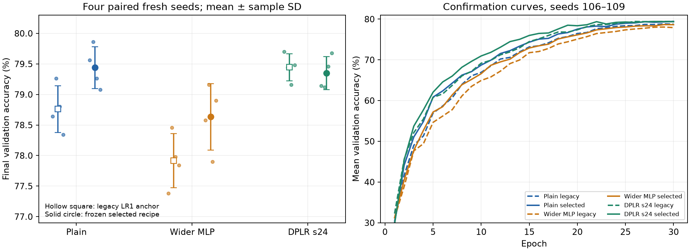

# ViT initializer and learning-rate control study

Equal-budget tuning leaves plain ViT and DPLR effectively tied at this 30-epoch horizon. Xavier-style initialization improves the plain and wider controls, but wider MLP remains below plain. The earlier two-seed DPLR advantage does not establish an advantage against the tuned plain control.

Completed 2026-10-12T12:15:47.865198+00:00. Raw workflow: `runs/vit-initializers-20261012T070919Z`. All seven checks passed on replay from its frozen runner. There are 2 compiled GPU preflights, 74 full-horizon tuning/diagnostic workers and 24 fresh confirmation workers; at most two of our GPUs were active. No model weights, resume checkpoints or official-test evaluation.

Each method received four distinct initializers × three global learning rates × two tuning seeds (104/105): 24 eligible runs per method. Two extra wider reference-fan-in runs are diagnostic only. Selection used final 30-epoch mean validation accuracy, not best epoch or an early prefix; selections and source hashes were frozen before confirmation. Seeds 106–109 evaluate both selected recipes and explicitly declared legacy LR1 anchors.

All cases use CIFAR-10 train/validation 45,000/5,000, split seed 123; width 192, depth 6, three heads, patch 4, batch 128; AdamW (0.9, 0.999), fused optimizer, compiled BF16, base LR 5e-4 times the listed multiplier, 5% warmup and cosine decay. Wider hidden width is 1483 versus 768. DPLR uses token self-conditioning, rank 8, projector bottleneck 24, factor offsets enabled, gain 1/sqrt(8), affine/low-rank LR multipliers both 1. Initializer profiles change only base MLP weights and preserve other common values, RNG draws and conditional zero initialization.

| Method | Role | Initializer | Global LR | Parameters | Final accuracy, mean ± sample SD |
|---|---|---|---:|---:|---:|
| Plain | selected | xavier_gelu | 0.0005 | 2,690,122 | 79.440 ± 0.343% |
| Plain | anchor | legacy | 0.0005 | 2,690,122 | 78.760 ± 0.384% |
| Wider MLP | selected | xavier_gelu | 0.0005 | 4,341,772 | 78.635 ± 0.544% |
| Wider MLP | anchor | legacy | 0.0005 | 4,341,772 | 77.915 ± 0.445% |
| DPLR s24 | selected | xavier_gelu | 0.00025 | 4,342,378 | 79.350 ± 0.270% |
| DPLR s24 | anchor | legacy | 0.0005 | 4,342,378 | 79.445 ± 0.222% |

Paired changes below are percentage points, in seed order 106, 107, 108, 109.

| Comparison (left minus right) | Paired changes | Mean |
|---|---|---:|
| Plain selected − Plain anchor | +0.92, +0.60, +0.46, +0.74 | +0.680 |
| Wider MLP selected − Wider MLP anchor | +1.20, +0.70, -0.08, +1.06 | +0.720 |
| DPLR s24 selected − DPLR s24 anchor | -0.56, -0.32, +0.30, +0.20 | -0.095 |
| DPLR s24 selected − Plain selected | -0.42, -0.74, +0.20, +0.60 | -0.090 |
| Wider MLP selected − Plain selected | -0.98, -0.70, -1.36, -0.18 | -0.805 |
| DPLR s24 anchor − Plain selected | +0.14, -0.42, -0.10, +0.40 | +0.005 |

Plain improves on every fresh seed (+0.46 to +0.92 points). Wider improves on three of four, mean +0.720 points, but selected wider still trails selected plain on all four (mean −0.805). Selected DPLR versus selected plain splits two wins/two losses and averages −0.090 points. Its own legacy anchor averages 79.445%, also effectively tied with selected plain (79.440%). The DPLR anchor is a declared control, not a recipe selected using confirmation results. There is no clear DPLR quality benefit here despite 61.4% more total parameters than plain; wider and DPLR are within 606 parameters of each other.

Tuning trends: Xavier won for all three methods, with global LR1 for plain/wider and LR0.5 for DPLR. Plain fan-in/LR0.5 was essentially tied with plain Xavier/LR1 on tuning seeds (79.61% versus 79.62%). Larger LR2 usually hurt; the wider mixed/LR2 candidate was notably seed-sensitive (76.88%/65.06%). The reference-fan-in-only wider correction produced 77.16%/77.62%, just +0.26/+0.02 points over paired legacy LR1 tuning runs. Matching initial gain alone did not resolve the wider control. These are tuning observations, not fresh confirmation comparisons.

The selected DPLR recipe does not reproduce its tuning improvement over its legacy anchor on fresh seeds (mean −0.095 points). This warns against interpreting the single winning grid cell as a universal improvement. Do not revise the frozen selection using these confirmation endpoints.

Final recorded augmented-training windows contain 7,624 examples per worker, within epoch 30. Their mean accuracies are:

| Method | Selected | Legacy anchor |
|---|---:|---:|
| Plain | 88.58% | 85.52% |
| Wider MLP | 85.00% | 83.45% |
| DPLR s24 | 92.33% | 89.43% |

Wider still fits the augmented training stream less well than plain after tuning, so simple excess capacity/overfitting is not a sufficient explanation. Selected DPLR fits training better while giving similar validation quality; this raises a generalization question. These are final logged windows, not whole-epoch or clean-training evaluations, and do not establish a cause.

Fixed normalized-token probes record the complete standalone MLP function, including its base and conditional branches, outside the compiled training graph. Mean initial/output RMS at the final step: selected plain 0.08196 → 0.72317, wider 0.06163 → 0.91147, DPLR 0.08196 → 0.28094. These are fixed-input probes rather than network-distribution RMS. Interval updates compare adjacent diagnostic snapshots and are not per-step averages. The diagnostics are finite and nonzero after the initial classifier/adapter zero-init delays; factor norms alone do not establish conditioning quality or gauge stability. Full measurements are in the JSON export.

Observed selected-run training throughput was about 4,852 images/s plain, 4,664 wider and 3,599 DPLR. Mean peak allocated training memory was about 416, 600 and 534 MiB respectively. These shared-instance, compiled training observations include the protocol overhead and are not an isolated kernel benchmark; they reinforce the need to justify DPLR compute with quality rather than establish precise speed ratios.

This is a bounded initializer/LR grid at 30 epochs and four confirmation seeds. The same research holdout was reused in tuning and confirmation; fresh seeds address initialization variability, not holdout-selection bias. Sample SD is not a confidence interval. Static-low-rank and diagonal controls were not retuned in this study. Larger models, longer schedules, external conditioning and DiT may behave differently; no claim transfers automatically.

Next priority: inspect the optimization/generalization evidence before expanding projector capacity. A future frozen control could train plain and DPLR with the same selected initializer/global LR to separate architecture from recipe selection, and tune the diagonal/static-low-rank controls with the same budget. Define the question and retention before any additional launch. Legacy defaults remain unchanged; no new GPU work was launched to produce this report.

[Frozen protocol](vit-initializers-protocol.json) · [Selection](vit-initializers-selection.json) · [Results and diagnostics](vit-initializers.json) · [Evidence index](vit-initializers-evidence.json) · [Audit](vit-initializers-audit.json) · [Export manifest](vit-initializers-manifest.json)

The superseded draft at `runs/vit-initializers-20261012T070149Z` is retained with its two preflights and source evidence. A duplicated initializer function was corrected before any draft tuning launch; no draft worker result was reused in this study.
