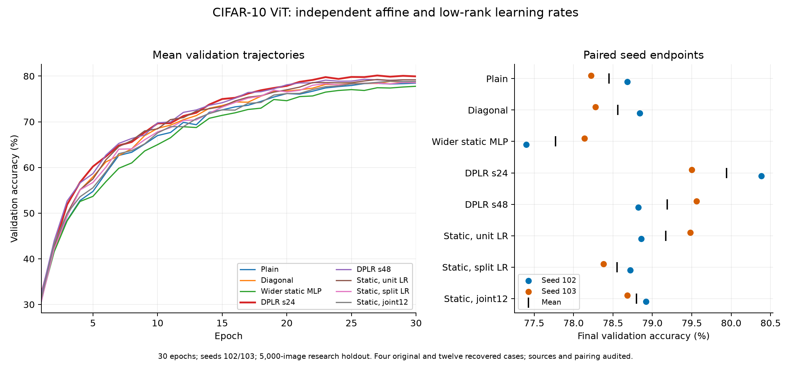

# ViT split learning rates: completed 30-epoch comparison

All 16 declared quality cases completed: four reused fully audited workers and 12 replacements from original seeds after container interruption. Final validation on the 5,000-image research holdout; paired seeds 102/103. Means ± sample SD, not confidence intervals. Transform rank `r=8`; `s` is projector bottleneck/basis width. Dynamic methods enable factor offsets.

DPLR s24 has the best mean accuracy at 79.94%. It improves over diagonal conditioning by 1.54/1.22 percentage points in seeds 102/103 (mean 1.38) and over the near-parameter-matched wider MLP by 2.98/1.36 points. Its advantage over unit-rate static low rank is 1.52/0.02 points (mean 0.77); that is much less consistent. The larger s48 is 0.75 points worse on average, with mixed seed differences and 26.7% more total parameters. Keep s24 as a provisional practical choice; this is not a robust win over every static alternative.

| Family | Parameters | Affine LR × | Low-rank LR × | Accuracy (%) | Training peak MiB |
|---|---:|---:|---:|---:|---:|
| plain | 2,690,122 | — | — | 78.45 ± 0.33 | 427.3 ± 45.1 |
| diagonal | 3,134,794 | 1 | — | 78.56 ± 0.40 | 478.7 ± 56.7 |
| static_capacity | 4,341,772 | — | — | 77.77 ± 0.52 | 615.5 ± 45.2 |
| s24 | 4,342,378 | 1 | 1 | 79.94 ± 0.62 | 549.6 ± 44.4 |
| s48 | 5,503,882 | 1 | 0.5 | 79.19 ± 0.52 | 595.5 ± 26.8 |
| static_unit | 3,180,874 | 1 | 1 | 79.17 ± 0.44 | 482.7 ± 32.0 |
| static_split | 3,180,874 | 1 | 16 | 78.55 ± 0.24 | 460.0 ± 0.0 |
| static_joint_12 | 3,180,874 | 12 | 12 | 78.80 ± 0.17 | 495.8 ± 50.7 |

Paired s24 minus control differences (positive favors s24):

| Control | Seed 102 (pp) | Seed 103 (pp) | Mean (pp) |
|---|---:|---:|---:|
| plain | +1.70 | +1.28 | +1.49 |
| diagonal | +1.54 | +1.22 | +1.38 |
| static_capacity | +2.98 | +1.36 | +2.17 |
| static_unit | +1.52 | +0.02 | +0.77 |
| static_split | +1.66 | +1.12 | +1.39 |
| static_joint_12 | +1.46 | +0.82 | +1.14 |
| s48 | +1.56 | -0.06 | +0.75 |

Fixing affine LR at 1 while calibrating only low-rank parameters kept the static split control's endpoint combined/base RMS at 2.21–2.63, compared with 13.80–21.02 for joint12. Static split uses low-rank LR 16 and joint12 uses 12, so this is not a pure affine-rate-only ablation. Both have finite results; large magnitude alone is not a demonstrated instability or a quality ranking. The unit-rate static control has combined/base RMS 1.52–2.49 and a small low-rank/base RMS 0.021–0.044, yet scores 79.17%, better than either higher-rate static recipe.

Calibration selected s48 LR 0.5 and static split LR 16 using low-rank updates alone, with affine LR 1. On fresh quality seeds, selected early ratios still transfer within bounds: s48 spans 0.795–1.145 and static split 0.827–1.273 across steps 500/800/1200. The frozen unit-rate control spans 0.059–0.075 and was deliberately not update matched. Matching functional updates did not select the highest-accuracy static recipe; scalar early-update calibration is a control, not an optimizer-performance optimum.

s24 uses 38.5% more total parameters than diagonal and 36.5% more than unit static; its strongest capacity control is the wider MLP within 606 parameters, whose own LR was not tuned. s48 adds 26.7% parameters and 8.4% mean observed training peak allocation over s24, without a quality benefit here. Concurrent memory/throughput telemetry is not an isolated speed benchmark. Relative to the earlier ten-epoch screen, the wider static MLP is much more competitive at 30 epochs, but those were different seeds and schedules; that comparison does not isolate duration.

Next recommended experiment: confirm s24 against diagonal and the stronger unit-rate static baseline with more fresh paired seeds before expanding projector width or nonlinear designs. Keep calibration/magnitude diagnostics, but do not discard useful unit-rate controls because their early updates are smaller. No new GPU jobs were launched by this status check.

All seven recovery audit checks passed when replayed from the frozen runner, including all 16 unique cases, source/runtime/split/initialization/observed-stream pairing across cohorts, exact original group rates and successful worker exits. The original stale `quality` protocol, four completed workers and two partial attempts remain unchanged; the separate recovery protocol is complete. Recovery supervisors are closed and no adalora GPU worker is active. No weights, checkpoints or official-test evaluation were produced. Recovery raw artifacts are approximately 250 MiB, within the declared 4 GiB bound; original retention is unchanged. Combined quality-worker elapsed time is 1.619 GPU-hours, including startup/evaluation and excluding failed attempts, calibration, idle time and orchestration.

Limits: Two fresh paired quality seeds and reused research holdout; sample SD is not a confidence interval. 30 epochs is a separate fresh-init schedule; comparison to previous ten-epoch endpoints is not a continuation or paired duration-only ablation. Pilot 1200-step prefixes use the full 10560-step horizon and 528 warmup steps; no old pilots are reused. Affine LR 1 is fixed except the declared static joint12 diagnostic; low-rank updates do not match whole-network or diagonal optimization. Static unit and static joint12 remain frozen controls even if their updates miss calibration bounds. s24 is within 606 total parameters of the wider static MLP; s48 has a larger budget. Offsets are enabled in dynamic methods; their initialization is zero and weight decay is zero. Static affine norms and ordinary self-attention are unchanged; no AdaLN residual gate is introduced. Compiled concurrent telemetry is not an isolated speed benchmark; no weights, checkpoints or official-test evaluation. Grid and selection are fixed before quality; a failed gate withholds quality without automatic expansion. Recovery reuses only fully completed, audited cases; remaining cases restart from original seeds without weights. Container interruption spans cohorts; trainer/model sources, packages, split, initialization and observed streams are audited across cohorts.

[Comparison/diagnostics](vit-split-lr.json) · [Evidence](vit-split-lr-evidence.json) · [Audit](vit-split-lr-audit.json) · [Recovery protocol](vit-split-lr-protocol.json) · [Original protocol](vit-split-lr-original-protocol.json) · [Calibration](vit-split-lr-calibration.json)
